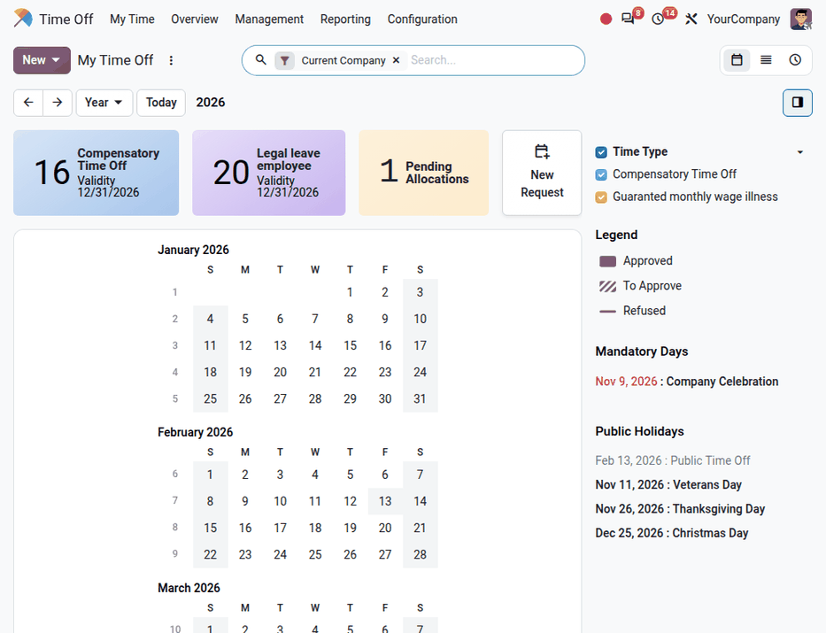
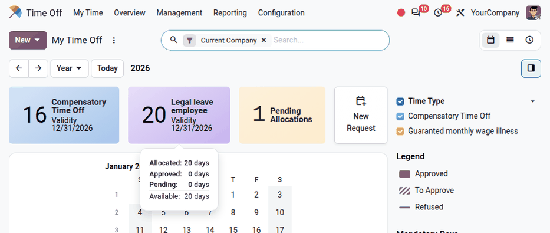
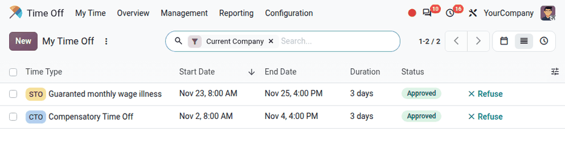
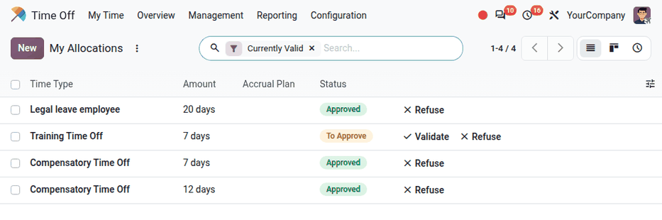

=======
My time
=======

The *My Time* menu of the **Time Off** app houses all the various time off information for the
signed-in user.

This includes the main **Time Off** :ref:`dashboard <time_off/dashboard>`, which displays an
overview of the various time off balances, as well as :ref:`time-off requests
<time_off/my-time-off>` and :ref:`allocations <time_off/my-allocations>`.

.. _time_off/dashboard:

Dashboard
=========

All users have access to the **Time Off** app dashboard, which is the first page that appears when
the **Time Off** app is opened. The dashboard can also be accessed at any point by navigating to
:menuselection:`Time Off app --> My Time --> Days Off`.

The dashboard shows a summary of the user's time off, and the entire current calendar year, with the
current day highlighted. The week numbers are notated in light grey, in the far left column of each
month.

To change the view, click the :guilabel:`Year` :icon:`arrow_drop_down` button to reveal a drop-down
menu. Then, select either :guilabel:`Day`, :guilabel:`Week`, or :guilabel:`Month` to present the
calendar in that corresponding view.

.. tip::
   The calendar displays weekends by default. To hide the weekends, click the :guilabel:`Year`
   :icon:`arrow_drop_down` button, and click :icon:`check` :guilabel:`Show weekends` to clear its
   check mark. The dashboard reloads, and the weekends are hidden from view.

.. note::
   To change the displayed dates, click the :icon:`arrow_back` :guilabel:`(Previous)` or
   :icon:`arrow_forward` :guilabel:`(Next)` buttons to the left of the :guilabel:`Year` button. The
   calendar view adjusts in increments of the selected view.

   For example, if :guilabel:`Year` is selected, the arrows adjust the view by one year.

   To reset the view, so it includes the current date, click the :guilabel:`Today` button.

Above the calendar view is a summary of the user's time off balances. Every time type that has been
allocated or taken appears in its own summary card, in the color of the time type. Each card lists
the time type, the current available balance (in hours or days), and if applicable, the validity
date of the allocation. For time types that do not require an allocation, the card shows the amount
of time off already taken.

To view the full details of a time off balance, click on the card. The details are presented in a
popover window, including:

- :guilabel:`Allocated`: The total amount of time off allocated to the employee. Click
  :guilabel:`Allocated` to view a list of the allocations granted.
- :guilabel:`Accrual (Future)`: The amount of time off that is expected to be accrued by the
  selected date. This line only appears for allocations using an :doc:`accrual plan
  <accrual_plans>`.
- :guilabel:`Approved`: The total amount of time off that has been approved. Click
  :guilabel:`Approved` to view the corresponding time off.
- :guilabel:`Pending`: The total amount of time off that is waiting for approval. Click
  :guilabel:`Pending` to view the corresponding time off requests.
- :guilabel:`Available`: The total amount of time off available to the employee after the approved
  and pending time off are factored in.

.. important::
   If part of the balance expires before it can be used, the validity date on the card is
   highlighted in yellow, along with a :icon:`warning` :guilabel:`(warning)` icon,
   and a warning in the popover indicates how much time can be used before the allocation expires.

If the user has allocation requests waiting for approval, a :guilabel:`Pending Allocations` card
displays their number. Click on it to view these requests.

A user can also select a future date to see an estimate of how much time they should accrue by that
point. On the right side of the time off summary cards, there is a :guilabel:`Balance on the` field.
Click on the date field, and a calendar selector popover appears.

.. note::
   The :guilabel:`Balance on the` field **only** appears if the user is accruing time off through an
   :doc:`accrual plan <accrual_plans>`, or has an allocation starting in the future.

Navigate to the desired date, and Odoo displays the time off balances the user should have on that
date. This takes into account all time off currently planned and approved.

On the right side of the calendar, the various time types are displayed, each with their own
corresponding color. The :guilabel:`Legend` explains how the various statuses for time off requests
are presented.

Time off that has been approved appears in a solid color. Time off requests that are still in the
:guilabel:`To Approve` stage, appear with white stripes in the color. :guilabel:`Refused` time off
requests have a line through the dates.

The :guilabel:`Mandatory Days` and :guilabel:`Public Holidays` of the current year are also listed
on the right side of the calendar.

New time off requests can be made from the :guilabel:`Dashboard`. Click the :guilabel:`New` button
in the upper-left corner, then :guilabel:`New Time Off`, and a :doc:`New Time Off
<request_time_off>` pop-up window appears.

New allocation requests can also be made from the :guilabel:`Dashboard`. Click the
:guilabel:`New Request` card, or click :guilabel:`New`, then :guilabel:`New Allocation Request`,
and a :ref:`New Allocation <time_off/request-allocation>` pop-up window appears.

.. _time_off/my-time-off:

My time off
===========

To view a list of all the signed-in user's time off requests, navigate to :menuselection:`Time Off
app --> My Time --> Days Off`, then click the :icon:`reorder` :guilabel:`(List)` icon in the
top-right corner. All time off requests, both past and present, appear in a list view.

The list includes the following information for each request: the :guilabel:`Time Type`,
:guilabel:`Start Date`, :guilabel:`End Date`, :guilabel:`Duration`, and :guilabel:`Status`.

A new time off request can be made from this view. Click the :guilabel:`New` button to
:doc:`request_time_off`.

Additionally, if the user has the necessary access rights, a :icon:`close` :guilabel:`Refuse` or
:icon:`check` :guilabel:`Validate` button appears at the end of each line.

.. _time_off/my-allocations:

My allocations
==============

To view a list of all allocations, navigate to :menuselection:`Time Off app --> My Time -->
Requests`. All allocations and requested allocations that are currently valid appear in the *My
Allocations* list view.

The information presented on the :guilabel:`My Allocations` page includes: :guilabel:`Time Type`,
:guilabel:`Amount`, :guilabel:`Accrual Plan`, and :guilabel:`Status`. If the signed-in user has the
appropriate access rights, a :icon:`close` :guilabel:`Refuse` or :icon:`check`
:guilabel:`Validate` button appears at the end of each line.

A new allocation request can be made from this view, as well. Click the :guilabel:`New` button to
:ref:`request an allocation <time_off/request-allocation>`.

