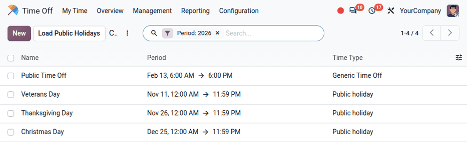
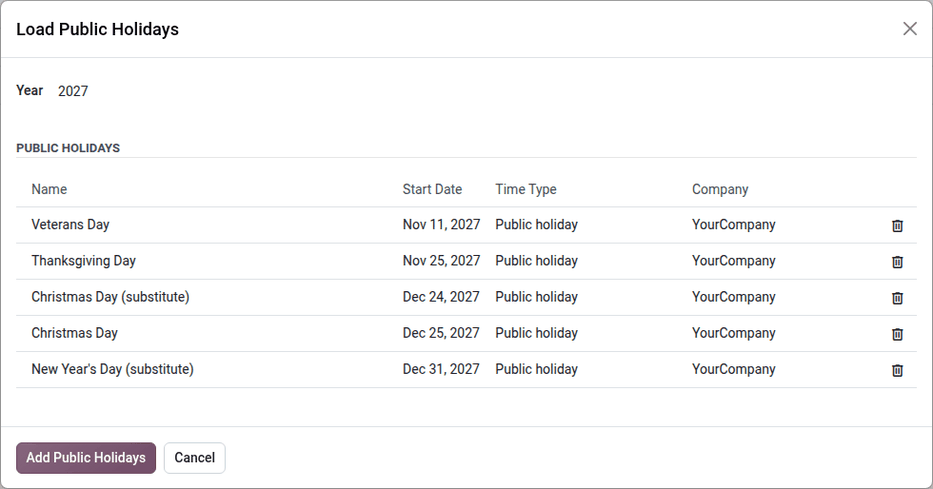

===============
Public holidays
===============

Since holidays vary by country, region, and even city, public holidays must be configured in Odoo
so employees receive the appropriate days off. In the **Time Off** app, public holidays, and any
other day the company is closed, are called *company holidays*.

Configuring company holidays helps employees clearly see their non-working days and prevents
unnecessary time off requests for dates already designated as holidays. Company holidays do **not**
impact the employees' time off balances.

Company holidays configured in the **Time Off** app are also reflected across other Odoo apps that
use :doc:`working schedules <../payroll/working_schedules>`, including **Calendar**, **Planning**,
**Manufacturing**, and more. In the **Payroll** app, the company holidays are counted with their
time type when computing the :doc:`worked time <../payroll/work_entries>`.

Because of Odoo's integration across these apps, configuring all public holidays is considered best
practice.

.. note::
   For the countries for which Odoo provides public holiday data, a scheduled action automatically
   creates the public holidays of the next twelve months for each company, right after the **Time
   Off** app is installed, and then every month. These countries include, among others, Australia, Belgium, Canada,
   India, Mexico, the Netherlands, Saudi Arabia, Switzerland, the United Arab Emirates, and the
   United States.

To view the configured company holidays, navigate to :menuselection:`Time Off app --> Configuration
--> Company Holidays`. All the company holidays of the current year appear in a list view.

Load public holidays
====================

To load the public holidays of a specific year, navigate to :menuselection:`Time Off app -->
Configuration --> Company Holidays`, and click the :guilabel:`Load Public Holidays` button. A *Load
Public Holidays* pop-up window loads.

Enter the :guilabel:`Year` to load. The public holidays of that year appear in the list below, for
each company the user is currently working in, based on the country of the company. Public holidays
that already exist in the database are not listed.

Review the list: modify the :guilabel:`Time Type` of a public holiday if needed, or click the
:icon:`fa-trash-o` :guilabel:`(Delete)` icon to remove a line. Then, click :guilabel:`Add Public
Holidays` to create the company holidays.

.. note::
   A warning appears at the top of the pop-up window if a company has no country set, if no public
   holiday data is available for its country and the selected year, or if all the public holidays
   of the year already exist.

Create company holidays
=======================

To manually create a company holiday, navigate to :menuselection:`Time Off app --> Configuration
--> Company Holidays`.

Click the :guilabel:`New` button and a new line appears at the bottom of the list.

Enter the following information on that new line:

- :guilabel:`Name`: Enter the name of the holiday.
- :guilabel:`Period`: Using the date and time picker, select the date and time the holiday starts
  and ends. By default, the holiday covers the whole current day, from `12:00 AM` to `11:59 PM`.

  .. note::
     It is **not** recommended to change the default hours of `12:00 AM` to `11:59 PM`. This
     ensures all employees working all shifts receive the public holiday.

- :guilabel:`Time Type`: Select the :doc:`time type <time_off_types>` of the holiday. By default,
  the :guilabel:`Public holiday` time type of the company's country is selected. In the **Payroll**
  app, this time type defines how the holiday is paid.
- :guilabel:`Working Hours`: This column is hidden by default. To display it, click the
  :icon:`oi-settings-adjust` :guilabel:`(additional options)` icon in the top-right corner of the
  list, and tick the :guilabel:`Working Hours` checkbox. If the holiday should only apply to
  employees who have a specific working schedule, select it using the drop-down menu. If left blank
  (:guilabel:`All Schedules`), the holiday applies to all employees of the company.

The company holiday is created for the current company.

.. important::
   When a company holiday is created or modified, the time off requests overlapping it are
   recomputed. If the duration of a request changes, the employee is notified, and the difference is
   given back to, or taken from, their allocation.
