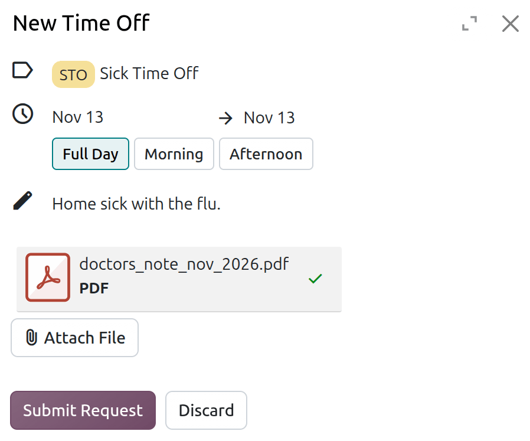
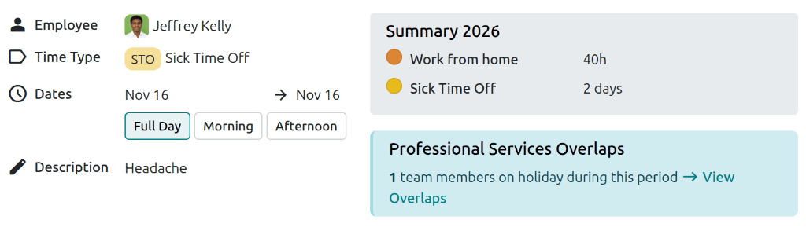

================
Request time off
================

When employees wish to take time off, they first submit a time off request through the **Time Off**
application.

If the :doc:`Time Type <time_off_types>` does not require any approvals, the time off request is
automatically approved. If approval is needed, the request is reviewed by either the employee's
manager or their time off officer, depending on who the employee's :ref:`time off approver is
<employees/approvers>`.

Submit time off request
=======================

To request time off, navigate to :menuselection:`Time Off app --> My Time --> Days Off` and the
*My Time Off* dashboard loads. Click the :menuselection:`New` button, then :guilabel:`New Time Off`,
and a blank *New Time Off* pop-up window loads.

Fill out the various :ref:`fields on the form <time_off/fields>`. Once completed, click the
:guilabel:`Submit Request` button, and the request is sent to the corresponding manager and time off
officer, and appears in their :ref:`All Time Off <time_off/management/manage-time-off>` dashboard.

.. _time_off/fields:

Time off request fields
-----------------------

Enter the following information on the *New Time Off* pop-up request form:

- :icon:`label` :guilabel:`(Time Off Type)`: Select the type of time off being requested.
- :icon:`schedule` :guilabel:`(Dates)`: Click into the first date field and using the calendar
  selector, select the start date for the time off request. Set the second field to the end date for
  the request. When requesting time off for a single day, set both fields to the same date. If
  applicable, set the start and end times for the request. Depending on how the selected
  :guilabel:`Time Off Type` is configured, additional fields may appear. Specify when the time off
  is being requested for a :guilabel:`Full Day`, the :guilabel:`Morning`, or the
  :guilabel:`Afternoon`. These options appear as either buttons or a drop-down selection.
- :icon:`edit_f` :guilabel:`(Description)`: Enter a description for the time off request. This
  should include any details that managers and approvers may need to approve the request, such as
  `Sick with the flu` or `Family wedding`.
- :icon:`fa-paperclip` :guilabel:`Attach File`: This field **only** appears if the :guilabel:`Time
  Off Type` selected is :ref:`configured to require documentation <time_off/time-off-config>`. Click
  the :icon:`fa-paperclip` :guilabel:`Attach File` button, and a file explorer window appears.
  Navigate to the desired file, select it, then click the :guilabel:`Open` button. The file is
  listed on the *New Time Off* pop-up window. Only one file can be attached.

  .. note::
     If the *Time Off Type* requires documentation, such as a doctor's note, :guilabel:`Required`
     appears in red text next to the :icon:`fa-paperclip` :guilabel:`Attach File` button.

         attached.

Expanded time off request fields
--------------------------------

On the  *New Time Off* pop-up request form, click the :icon:`expand_content` :guilabel:`(Expand)`
icon in the corner to view the request in a full-page view.

In the full-page view, additional fields may appear. If the employee has any approved time off for
the current year, it appears in a gray :guilabel:`Summary (year)` box. The summary box lists all
time off types, and the total amount of time scheduled.

If the time off request overlaps with another employee in the same department, a blue
:guilabel:`(Department) Overlaps` summary appears. This box shows how many other employees have time
off scheduled for the same time period. Click :icon:`east` :guilabel:`View Overlaps` to load a
calendar view, displaying the overlaps.

.. tip::
   A :icon:`calendar_today` :guilabel:`Calendar` smart button appears at the top of this view. Click
   this button to view the employee's time off in a calendar view.

.. important::
   If an employee requests more time than they currently have available, a warning appears on the
   time off request form, stating :guilabel:`Only (#.#) day(s) available` in red text. This aids
   employees if they are unaware of their time off balances, and attempt to request more time than
   they have, and can adjust the request before submitting it.

   .. image:: request_time_off/not-enough-time.png
      :alt: A warning note stating the request is for more days than the user has available.
