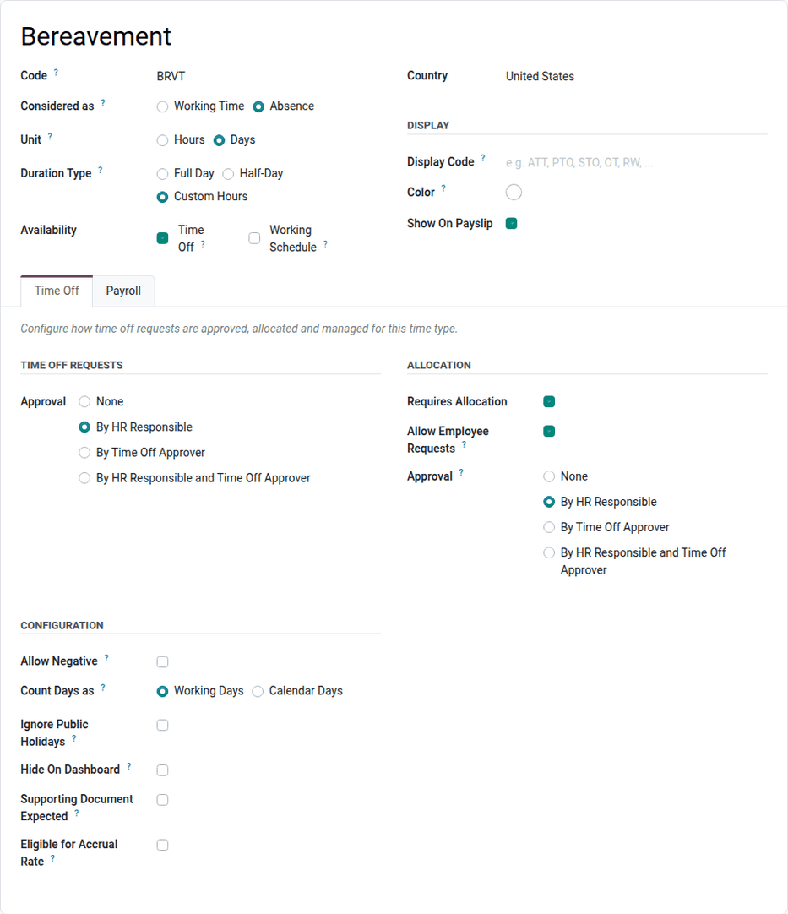
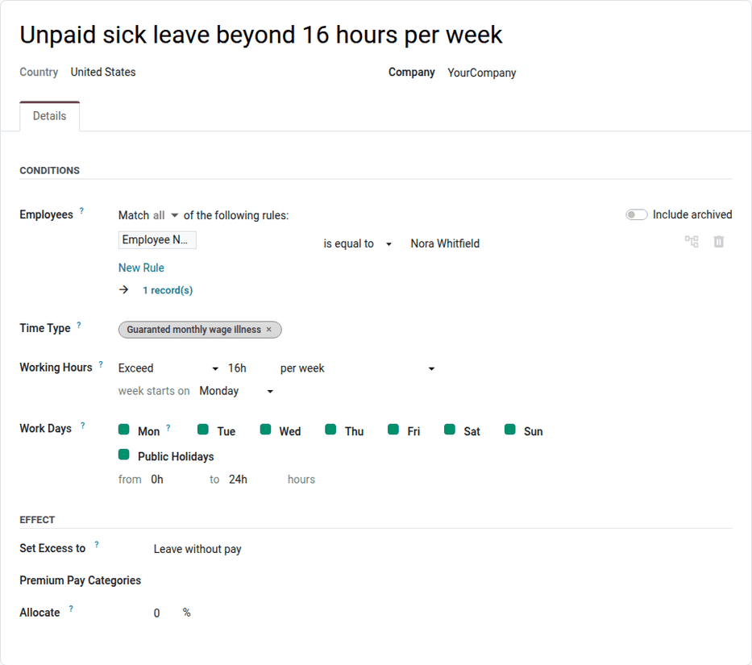

==========
Time types
==========

One of the first things that requires configuration in the **Time Off** app are the *time types*.

When employees request time off, they must specify the *time type* they are requesting, such as
sick time, vacation time, etc. The time type determines several things, including *how* the request
is made (hours, half days, or days), whether time must be allocated first, and how it is
:ref:`approved <time_off/time-off-requests>`.

Time types are shared between the **Time Off**, **Payroll**, **Attendances**, and **Employees**
apps: the same time type defines how time off is requested in the **Time Off** app, and how it is
paid in the **Payroll** app.

To view the configured time types, navigate to :menuselection:`Time Off app --> Configuration -->
Time Types`. The time types are presented in a list view, with their display code, name, code, and
description.

The list contains both time types considered as *working time*, such as :guilabel:`Work` or
:guilabel:`Work from home`, and time types considered as *absence*, such as :guilabel:`Generic Time
Off` or :guilabel:`Leave without pay`. Use the :guilabel:`Working Time` and :guilabel:`Absence Time`
filters to display only one of the two.

Odoo comes with generic time types, as well as country-specific ones that are installed with the
:doc:`payroll localization <../payroll/payroll_localizations>`. Country-specific time types are
only visible to companies of that country. The preconfigured time types can be modified to suit
business needs, or used as-is.

.. seealso::
   Time types are also available in :menuselection:`Employees app --> Configuration --> Time
   Management --> Time Types`, and in the **Attendances** and **Payroll** apps. Refer to
   :ref:`payroll/work-entry-types` for the payroll-related configuration.

Create time type
================

To create a new time type, navigate to :menuselection:`Time Off app --> Configuration --> Time
Types`. From here, click the :guilabel:`New` button to reveal a blank *Time Type* form. Then, enter
the following information on the form.

.. note::
   The only **required** fields on the time type form are the name and the :guilabel:`Code`.

General information section
---------------------------

This section outlines the high-level information for the time type. Enter the following information
at the top of the form:

- *Name*: Enter the name for the particular time type, such as `Vacation` or `Bereavement`.
- :guilabel:`Code`: Enter the code used by the **Payroll** app when computing this time type. The
  code must be unique per country.
- :guilabel:`Considered as`: Select whether the time type counts as :guilabel:`Working Time` or as
  an :guilabel:`Absence`. Time types created from the **Time Off** app are set to
  :guilabel:`Absence` by default.
- :guilabel:`Unit`: Select whether time of this type is allocated and accrued in :guilabel:`Hours`
  or in :guilabel:`Days`.
- :guilabel:`Duration Type`: Select the minimum duration employees can request for this time type:

  - :guilabel:`Full Day`: Time off can only be requested in full-day increments.
  - :guilabel:`Half-Day`: Time off can be requested in half-day increments (morning or afternoon).
  - :guilabel:`Custom Hours`: Time off can be requested in hourly increments.

- :guilabel:`Availability`: Tick the :guilabel:`Time Off` checkbox if employees can select this time
  type in their time off requests. When this checkbox is cleared, the *Time Off* tab is hidden. Tick
  the :guilabel:`Working Schedule` checkbox if the time type can be used on the lines of a
  :doc:`working schedule <../payroll/working_schedules>`.
- :guilabel:`Country`: If this time type is restricted to one country, select the country from the
  drop-down menu. If this field is left blank, the time type applies to all countries. Time types
  created from the **Time Off** app are set to the country of the current company by default.
- :guilabel:`Display Code`: Enter a short code (three characters maximum) for the time type. This
  code is displayed, for example, on the time off bars of the :ref:`Overview
  <time_off/overview>`. It is for display purposes only and does not affect any computations.
- :guilabel:`Color`: Select a color used for this time type in the **Time Off** app dashboards and
  calendars.

Time off tab
------------

The *Time Off* tab contains all information related to the **Time Off** app, including details for
allocating, requesting, and approving time off. This tab is only visible if the :guilabel:`Time Off`
checkbox is ticked in the :guilabel:`Availability` field.

.. _time_off/time-off-requests:

Time off requests section
~~~~~~~~~~~~~~~~~~~~~~~~~

This section determines how approvals are handled for time off requests of this time type.

Select what specific kind of :guilabel:`Approval` is required for the time type. The options are:

- :guilabel:`None`: No approvals are required when requesting this time type. The time off request
  is automatically approved.
- :guilabel:`By HR Responsible`: A time off officer is required to approve the time off request.
  This option is selected by default.
- :guilabel:`By Time Off Approver`: Only the employee's specified approver for time off, which is
  configured in the *Work Information* tab of the :ref:`employee's form <employees/approvers>`, is
  required to approve the time off request.
- :guilabel:`By HR Responsible and Time Off Approver`: Both the employee's :ref:`specified time off
  approver <employees/approvers>` and a time off officer are required to approve the time off
  request.

Allocation section
~~~~~~~~~~~~~~~~~~

This section determines how :doc:`allocations <allocations>` are handled for this time type.

- :guilabel:`Requires Allocation`: Tick this checkbox if time must be allocated to employees before
  they can request this time type. If the time type can be requested without time off being
  previously allocated, clear the checkbox. If cleared, no other options appear in the
  *Allocation* section.

  .. important::
     This setting cannot be modified once time off of this type has been requested. In that case,
     create a new time type instead.

- :guilabel:`Allow Employee Requests`: Tick this checkbox if employees can :ref:`request an
  allocation <time_off/request-allocation>` of this time type for themselves. If employees should
  **not** be able to request allocations, leave the checkbox cleared: only time off officers can
  then allocate this time type.

  .. important::
     Requesting an allocation does **not** guarantee that it is granted.

- :guilabel:`Approval`: This field only appears if :guilabel:`Allow Employee Requests` is ticked.
  Select the type of approval required for the allocation requests of this time type:

  - :guilabel:`None`: The allocation request is automatically approved.
  - :guilabel:`By HR Responsible`: A time off officer must approve the allocation request. This
    option is selected by default.
  - :guilabel:`By Time Off Approver`: Only the employee's specified :ref:`time off approver
    <employees/approvers>` is required to approve the allocation request.
  - :guilabel:`By HR Responsible and Time Off Approver`: Both the employee's time off approver and
    a time off officer are required to approve the allocation request.

.. _time_off/time-off-config:

Configuration section
~~~~~~~~~~~~~~~~~~~~~

This section determines all other details regarding the time type, aside from approvals and
allocations.

- :guilabel:`Allow Negative`: This option only appears if :guilabel:`Requires Allocation` is
  ticked. Tick this checkbox if employees can request more time off than they currently have,
  allowing a negative balance. If ticked, an :guilabel:`up to` field appears. In this field, enter
  the maximum amount of negative time allowed, in hours or days, depending on what was selected in
  the :guilabel:`Unit` field.

  .. example::
     Sara currently has three days of the `Vacation` time type. She is planning a trip that requires
     five days of time off.

     The `Vacation` time type has the :guilabel:`Allow Negative` option ticked, and the
     :guilabel:`up to` field is set to three days.

     These settings allow Sara to submit a request for five days of the `Vacation` time type. If
     approved, her `Vacation` time off balance will be negative two (-2) days.

- :guilabel:`Count Days as`: Select how the duration of the time off is counted. With
  :guilabel:`Working Days`, only the days the employee is scheduled to work are counted. With
  :guilabel:`Calendar Days`, every day of the request is counted, including weekends. For example, a
  request covering a whole week counts five days with :guilabel:`Working Days` (for an employee
  working from Monday to Friday) and seven days with :guilabel:`Calendar Days`. This setting cannot
  be modified once time off of this type has been requested.
- :guilabel:`Ignore Public Holidays`: By default, the public holidays that fall within a time off
  request are **not** deducted from the employee's balance. Tick this checkbox if the public
  holidays should be counted in the duration of the time off, like any other working day.

  .. example::
     An employee in the United States requests time off for the week of July 4th. Since the 4th of
     July is a public holiday, the request only uses four days of the employee's balance by default.
     If :guilabel:`Ignore Public Holidays` is ticked on the time type, the same request uses five
     days.

- :guilabel:`Hide On Dashboard`: Tick this checkbox if the balance of this time type should *not*
  appear on the employee's time off :ref:`dashboard <time_off/dashboard>`. The time type can still
  be selected when requesting time off.
- :guilabel:`Supporting Document Expected`: Tick this checkbox if employees should attach a document
  to their time off request, such as a medical certificate. A notice is then displayed on the
  request, next to the :guilabel:`Attach File` button.
- :guilabel:`Eligible for Accrual Rate`: Tick this checkbox if time off of this type counts as
  worked time when computing :doc:`accrual plans <accrual_plans>` based on worked time. This
  checkbox can only be modified on time types considered as :guilabel:`Absence`: time types
  considered as :guilabel:`Working Time` are always eligible.
- :guilabel:`Allow Request on Top`: Tick this checkbox if employees can request other time off
  overlapping time off of this type. This option is not available for time types considered as
  :guilabel:`Absence`.
- :guilabel:`Display Time Off in Calendar`: Tick this checkbox to create entries in the
  **Calendar** app when time off of this type is requested. This option is not available for time
  types considered as :guilabel:`Absence`.

Payroll tab
-----------

The *Payroll* tab defines how time of this type is paid in the **Payroll** app, for example its
:guilabel:`Pay Rate` (`100%` for paid time off, `0%` for unpaid time off) and, when the **Payroll**
app is installed, its salary rule categories. Refer to :ref:`payroll/new-work-entry-type` for
details on these fields.

.. _time_off/automatic-rules:

Automatic rules
===============

*Automatic rules* (also called *time rules*) reclassify part of the time recorded for employees,
based on conditions. They are evaluated automatically every time an attendance or an approved time
off of the selected employees is created or modified. Automatic rules are commonly used to:

- turn the hours worked beyond the working schedule into overtime, and give compensatory time off
  for them (see :doc:`overtime rules <../attendances/overtime>`);
- reclassify the part of a time off that exceeds a threshold into another time type, for example,
  sick leave beyond a certain number of hours per week becoming unpaid.

To view the automatic rules, navigate to :menuselection:`Time Off app --> Configuration -->
Automatic Rules`. The same rules are also available in :menuselection:`Attendances app -->
Configuration --> Automatic Rules`. This menu is only available to users with *Administrator*
access rights for the **Time Off** app.

Click :guilabel:`New` to create a rule. The form is organized in the following sections:

- :guilabel:`Country` and :guilabel:`Company`: Restrict the rule to employees of a country or of a
  company. Leave the fields empty to apply the rule to all of them.
- *Conditions*: Define which time the rule applies to.

  - :guilabel:`Employees`: Define a filter selecting the employees the rule applies to.
  - :guilabel:`Time Type`: Select the time types considered by the rule. To apply a rule on time
    off, select the corresponding time types.
  - :guilabel:`Working Hours`: Select whether the rule applies when the time of these types
    :guilabel:`Exceed` or is :guilabel:`Less than` a quantity of hours, either per day or per week,
    or compared to the employee's daily or weekly schedule.
  - :guilabel:`Work Days`: Select the days of the week (and whether public holidays are included)
    and the hours of the day the rule applies to.

- *Effect*: Define what happens to the time matching the conditions.

  - :guilabel:`Set Excess to` (or :guilabel:`Set Deficit to` for a :guilabel:`Less than` rule):
    Select the time type given to the excess (or missing) time. This time type must not require an
    allocation. Leave the field empty to keep the original time type.
  - :guilabel:`Allocate` (or :guilabel:`Take` for a :guilabel:`Less than` rule): Enter a percentage
    of the excess time to grant to the employee as time off (`100%` means one hour of time off for
    one extra hour), then select the time type to allocate *to*. For a :guilabel:`Less than` rule,
    the missing time is deducted *from* the selected time type. The selected time type must
    require an allocation, and be available for time off.
  - :guilabel:`Premium Pay Categories`: If the **Payroll** app is installed, select the salary
    rule categories used to pay a premium for the time matching the rule.

.. example::
   A company does not pay sick leave beyond 16 hours per week. The time off manager creates an
   automatic rule with the following configuration:

   - :guilabel:`Time Type`: the sick leave time type.
   - :guilabel:`Working Hours`: :guilabel:`Exceed` `16:00` :guilabel:`per week`.
   - :guilabel:`Set Excess to`: :guilabel:`Leave without pay`.

   When an employee working eight hours a day takes a sick leave from Monday to Friday, the first
   two days (16 hours) remain sick leave. The other three days are converted to
   :guilabel:`Leave without pay`, as separate time off linked to the original request.

.. note::
   Rules based on a weekly quantity are only applied to past weeks. Time off and attendances of the
   current or future weeks are evaluated once the week is over.

.. seealso::
   - :doc:`../attendances/overtime`
   - :doc:`../payroll/work_entries`
