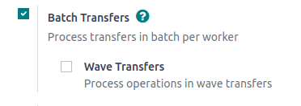
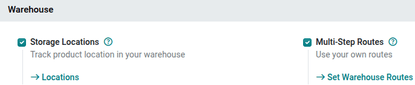
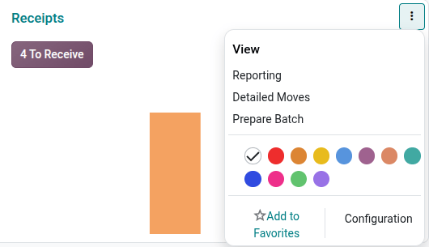
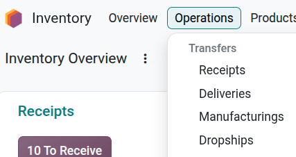
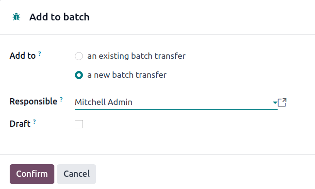
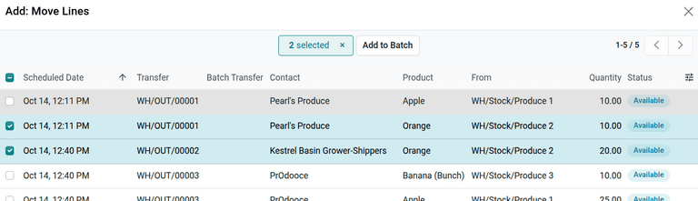
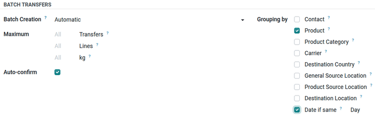
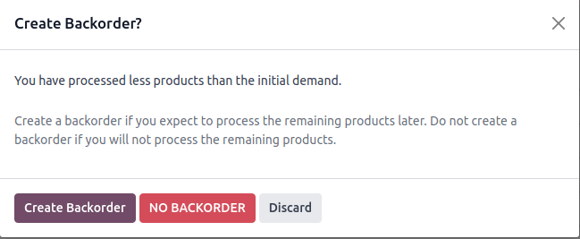
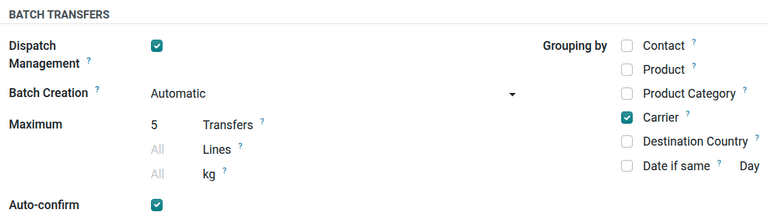
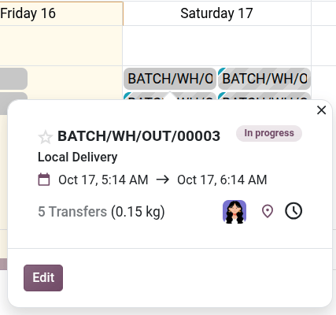

=============
Batch picking
=============

*Batch picking* enables a single picker to handle multiple orders at once, reducing the number of
times needed to navigate to a warehouse location. When picking in batches, orders are grouped and
consolidated into a picking list. After the picking, the batch is taken to an output location, where
the products are sorted into their respective delivery packages.

Because orders *must* be sorted at the output location after being picked, this picking method suits
businesses with a few products that are ordered often. Storing high-demand items in easily
accessible locations can increase the number of orders that are fulfilled efficiently.

Batch picking is ideal for industries or warehouses that handle high order volumes with a stable
demand. This method increases efficiency by allowing workers to pick items for multiple orders in
one trip through the warehouse, reducing travel time and boosting productivity.

Configuration
=============

To activate the batch picking option, begin by going to :menuselection:`Inventory app -->
Configuration --> Settings`. Under the *Operations* section, select the :guilabel:`Batch, Wave &
Cluster Transfers` checkbox.

Because batch picking is a method to optimize the *pick* operation in Odoo, the :guilabel:`Storage
Locations` and :guilabel:`Multi-Step Routes` options under the *Warehouse* heading must also be
selected on this settings page. When finished, click :guilabel:`Save`.

.. seealso::
   - :doc:`Delivery in two steps <../daily_operations/receipts_delivery_two_steps>`
   - :doc:`../daily_operations/delivery_three_steps`

Create batch transfers
======================

To manually group transfers directly from the :menuselection:`Inventory` app, click the
:icon:`fa-ellipsis-v` :guilabel:`(vertical ellipsis)` icon on the *Inventory Overview* menu. For
example, click the :icon:`fa-ellipsis-v` :guilabel:`(vertical ellipsis)` icon for the *Receipts*
Kanban card, then select :guilabel:`Prepare Batch`.

On the batch transfer form, fill out the following fields accordingly:

- :guilabel:`Responsible`: Optionally select an employee assigned to the picking. Leave this field
  blank if *any* worker can fulfill this picking.
- :guilabel:`Operation Type`: From the drop-down menu, select the operation type under which the
  picking is categorized.
- :guilabel:`Scheduled Date`: Specify the date by which the :guilabel:`Responsible` person should
  complete the transfer.

.. seealso::
   To learn more about the :guilabel:`Dock Location`, :guilabel:`Vehicle`, and :guilabel:`Vehicle
   Category` fields, see :doc:`dispatch management system <../setup_configuration/dispatch>`.

.. _inventory/batch/create:

Batch transfers
---------------

To batch transfers, in the *Transfers* tab, click :guilabel:`Add a transfer` to open the *Add:
Transfers* window. If the :guilabel:`Operation Type` field is filled, the list will filter transfer
records matching the selected :guilabel:`Operation Type`.

1. Click :guilabel:`Create New` to create a new transfer, or select transfers to add.
#. Click :guilabel:`Select` to add the selected transfers to the batch picking.
#. Click :guilabel:`Confirm` to confirm the batch picking.

.. example::
   A new batch transfer is assigned to the :guilabel:`Responsible`, `Joel Willis`, for the `Pick`
   :guilabel:`Operation Type`. The :guilabel:`Scheduled Date` is set to `August 11`.

   .. image:: batch/batch-transfer-form.png
      :alt: View of Batch Transfers form.

   Clicking :guilabel:`Add a transfer` opens the *Add: Transfers* window, displaying only pickings.
   This is because the :guilabel:`Operation Type` was set to `Pick` on the batch transfer form.

   Click the checkbox to the side of the transfers, `WH/PICK/00001` and `WH/PICK/00002`, to include
   them in the new transfer. Then, click the :guilabel:`Select` button to close the *Add: Transfers*
   window.

   .. image:: batch/add-transfers-window.png
      :alt: Select multiple transfers from the transfers window.

.. _inventory/warehouses_storage/add-batch-transfers:

Add batch from transfers list
~~~~~~~~~~~~~~~~~~~~~~~~~~~~~

Another method of creating batch transfers is available using the :guilabel:`Add to batch` option in
a list. Navigate to the :menuselection:`Inventory app --> Operations` drop-down menu, and select any
of the :guilabel:`Transfers` to open a filtered list of transfers.

1. On the transfers list, select the checkbox to the side of the transfers to add to a batch.
#. Click the :icon:`fa-cog` :guilabel:`Actions` button and select :guilabel:`Add to batch` from the
   drop-down menu.

   .. image:: batch/add-to-batch.png
      :alt: Click Add to batch from the Actions button.

   Doing so opens an *Add to batch* pop-up window.

#. Select the employee :guilabel:`Responsible` for the picking.
#. Choose from the two radio options to add to :guilabel:`an existing batch transfer` or create
   :guilabel:`a new batch transfer`.
#. Add a :guilabel:`Description` for this batch.

   .. tip::
      The :guilabel:`Description` field can be used to add additional information to help workers
      identify the source of the batch, where to place the batch, what shipping containers to use,
      etc.

#. To create a batch to be processed at a later time, select the :guilabel:`Draft` checkbox.
#. Conclude the process by clicking :guilabel:`Confirm`.

Add move lines to batch
~~~~~~~~~~~~~~~~~~~~~~~

Single moves can be added to a batch.

1. Open an existing batch transfer, or :ref:`create a new one <inventory/batch/create>`.
#. In the *Transfers* tab, click :guilabel:`Add a move line`. The *Add: Move Lines* window opens.
#. Select one or more moves to add to the batch transfer.
#. Click :guilabel:`Add to Batch`.

.. _inventory/batch/automatic:

Automatic batches
-----------------

Batches can be automatically created and assigned based on several criteria. The *Automatic Batches*
option is defined on the *operation type* level.

.. example::
   In a multi-step delivery process, the picking operation can be grouped by customer, while the
   shipping operation can be organized by carrier and destination country.

To enable *automatic batches*, navigate to :menuselection:`Inventory app --> Configuration -->
Operations Types`, and select the desired operation type (e.g., :guilabel:`Delivery Orders`,
:guilabel:`Receipts`, etc.).

1. In the *Batch transfers* section, select :guilabel:`Automatic` in the :guilabel:`Batch Creation`
   field.
#. Specify the :guilabel:`Maximum` number of :guilabel:`Transfers`, :guilabel:`Lines`, or
   :guilabel:`kg` that a batch should adhere to.
#. Select :guilabel:`Auto-confirm` to automatically confirm batches that are automatically created.
#. Select one or more criteria that batches should be grouped by in the :guilabel:`Grouping by`
   field by selecting the appropriate checkbox. Only one batch is created, even when multiple
   grouping options are selected.

   Batches can be automatically generated based on the following criteria:

   - :guilabel:`Contact`
   - :guilabel:`Product`
   - :guilabel:`Product Category` (select categories to group)
   - :guilabel:`Carrier`
   - :guilabel:`Destination Country`
   - :guilabel:`General Source Location` (source location of the transfer)
   - :guilabel:`Product Source Location` (location found in the :guilabel:`Moves` smart button for a
     product)
   - :guilabel:`Destination Location`
   - :guilabel:`Date if same` (choose from :guilabel:`Day` or :guilabel:`Week`)

Process batch transfer
======================

Handle batch transfers in the :menuselection:`Inventory app --> Operations --> Batch Transfers`
page.

.. tip::
   To process a batch transfer, it must be *confirmed*. The :guilabel:`Validate` button is
   highlighted in purple if the order is confirmed and all items are available. If the
   :guilabel:`Reserve` button is highlighted instead, there are items in the batch that are
   currently *not* available in-stock.

To view the complete product list, open the desired batch transfer. In the *Operations* tab, the
:guilabel:`Quantity` column indicates the required quantity for the order. The :guilabel:`Demand`
column lists the amount required to completely fulfill the order. Lastly, the :guilabel:`Picked`
column specifies the products that have been picked and are ready for the next step.

To display the :guilabel:`Picked` column, click the :icon:`oi-settings-adjust` :guilabel:`(settings
adjust)` icon at the top corner of the *Operations* tab, then select :guilabel:`Picked`.

.. example::
   The product, `Desk Organizer`, is out of stock (its :guilabel:`Quantity` is `0.00`). The `Office
   Chair` and `Flipover` products do not have enough stock to fulfill the order.

   Click the :guilabel:`Reserve` button to search the stock again for available products.

   .. image:: batch/operations-tab.png
      :alt: Show unavailable reserved quantities in the Operations tab.

Alternatively, process batch orders using the :menuselection:`Barcode` app.

.. seealso::
   :doc:`../../../barcode/operations/receipts_deliveries`

Create a back order
-------------------

On the batch transfer form, if the :guilabel:`Quantity` of the product is *less* than the
:guilabel:`Demand` quantity, a *Create Backorder?* pop-up window appears when clicking
:guilabel:`Validate`.

Click :guilabel:`Create Backorder` to create a back order for the unfulfilled products.

.. note::
   When creating a new back order, the transfers that have **not** been validated in the batch will
   be removed from it.

Click :guilabel:`No Backorder` to finish the picking *without* creating a back order.

Click :guilabel:`Discard` to cancel the validation and return to the batch transfer form.

Example: Batching by carrier
============================

Stealthy Wood uses multiple carriers to ship their products worldwide. Each carrier has its own
pickup window in which they will visit the warehouse and load orders to be shipped.

FedEx, for example, arrives at the warehouse at 11:00 AM every day and leaves by 12:00 PM. The
picking coordinator, therefore, wants to ensure that all FedEx shipments for that day are ready by
10:30 AM so that they can be loaded onto the truck quickly. A local truck handles local deliveries,
and UPS and USPS also arrive during the day.

To accommodate these schedules, Stealthy Wood wants to organize its shifts around carrier pickups.
The shift manager navigates to :menuselection:`Inventory app --> Configuration --> Operations
Types` and opens the :guilabel:`Delivery Orders` operation type. They scroll to the *Batch
Transfers* section and set the :guilabel:`Batch Creation` option to :guilabel:`Automatic`. Then,
they opt to group by :guilabel:`Carrier`. They only want employees to pick 5 orders at a time, so
they set the :guilabel:`Maximum` number of :guilabel:`Transfers` to `5`.

The day before orders are due to go out, the shift manager navigates to :menuselection:`Inventory
app --> Operations --> Batch Transfers`. They change the view to the :icon:`fa-chart-gantt`
:guilabel:`(Gantt)` view. From there, they drag and drop batch orders to schedule them according to
carrier pickup windows. Then, they click each entry in the chart to open a popover window, where
they can click the :icon:`fa-user-plus` :guilabel:`(Assign)` icon to assign an employee to the
picking.

Employees use the :menuselection:`Barcode` app to process the batch orders.
