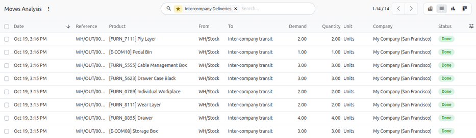

=============================
Inter-warehouse replenishment
=============================

.. |MTO| replace:: :abbr:`MTO (Make to Order)`

Businesses with multiple locations such as warehouses, retail shops, or manufacturing facilities may
resupply stock from other warehouses. Odoo **Inventory** allows locations to replenish products from
other warehouses, either internal or external to the company, automatically generating
*inter-warehouse* or *inter-company* transfers.

This documentation explains how to conduct inter-warehouse and inter-company transfers using two
replenishment strategies:

#. :ref:`Replenish on Order (MTO) <inventory/resupply_warehouses/MTO>`
#. :ref:`Reordering rule <inventory/resupply_warehouses/reordering-rule>`

.. seealso::
   :doc:`Difference between MTO and reordering rules <../replenishment>`

.. _inventory/resupply_warehouses/configuration:

Configuration
=============

To conduct inter-warehouse or inter-company transfers using either |MTO| or reordering rules,
navigate to :menuselection:`Inventory app --> Configuration --> Settings` and ensure that both
:guilabel:`Storage Locations` and :guilabel:`Multi-Step Routes` are enabled.

To use inter-company transfers, ensure that a :doc:`multi-company environment
<../../../../general/companies/multi_company>` is configured. See :ref:`Resupply from another
company <inventory/resupply_warehouses/inter-company>` for the additional requirements.

Warehouses
----------

To configure the central warehouse and its connecting storage locations, navigate to
:menuselection:`Inventory app --> Configuration --> Warehouses`.

.. important::
   Each location, including the central warehouse and each shop, *must* be configured as its own
   warehouse.

Select an existing warehouse or :ref:`create a new one <inventory/warehouses/configuration>` to be
resupplied from the central warehouse.

In the *Warehouse Configuration* tab, locate the :guilabel:`Resupply From` field. Select one or more
warehouses that will resupply the current warehouse. In a multi-company database, this field also
lists the warehouses of the other companies the user has access to.

.. note::
   The :guilabel:`Resupply From` field appears **only** if the database has at least two warehouses,
   or if multiple companies are configured.

.. example::
   The central warehouse that will supply the shops is called `Main`. The :guilabel:`Resupply From`
   field is set to this warehouse on the shop's warehouse configuration page.

   .. image:: resupply_warehouses/warehouse.png
      :alt: Supply one warehouse with another in the Warehouse Configuration tab.

.. seealso::
   :doc:`../inventory_management/warehouses`

Set route on a product
----------------------

Products must also be configured properly in order for them to be transferred between warehouses.

Go to :menuselection:`Inventory app --> Products --> Products` and select the desired product.

In the *Inventory* tab, the :guilabel:`Routes` field of the *Operations* section lists any new
routes generated from the warehouse configuration as :guilabel:`X: Supply Product from Y`, where `X`
is the receiving warehouse, and `Y` is the supplying warehouse.

After selecting the applicable routes, proceed to either the :ref:`MTO
<inventory/resupply_warehouses/MTO>` or the :ref:`reordering rules
<inventory/resupply_warehouses/reordering-rule>` configuration process.

.. _inventory/resupply_warehouses/MTO:

MTO
~~~

To replenish products using |MTO|, ensure the :guilabel:`Replenish on Order (MTO)` route is selected
in the *Inventory* tab of the product form.

.. important::
   The :guilabel:`Replenish on Order (MTO)` route **only** appears if the :guilabel:`Replenish on
   Order (MTO)` feature is enabled in :menuselection:`Inventory app --> Configuration --> Settings`.

With the resupply and |MTO| routes selected, continue by :ref:`replenishing from another warehouse
<inventory/resupply_warehouses/resupply-workflow>`.

.. example::
   A customized cabinet, sold at the warehouse `Store`, is resupplied from the central warehouse,
   `YourCompany`. To replenish the product using |MTO|, the following routes are selected:

   - :guilabel:`Store: Supply Product from YourCompany`
   - :guilabel:`Replenish on Order (MTO)`

   .. image:: resupply_warehouses/resupply-route.png
      :alt: Route setting which enables a product to be resupplied from a second warehouse.

.. _inventory/resupply_warehouses/reordering-rule:

Reordering rule
~~~~~~~~~~~~~~~

To replenish products using reordering rules, ensure the :guilabel:`X: Supply Product from Y` route
is selected in the *Inventory* tab of the product form.

Then, create a reordering rule to automate replenishment by clicking the :guilabel:`Reordering
Rules` smart button.

Click :guilabel:`New` and configure the following:

- :guilabel:`Location`: The stock location of the receiving warehouse.
- :guilabel:`Route`: The :guilabel:`X: Supply Product from Y` route. If this column is hidden,
  enable it by clicking the :icon:`oi-settings-adjust` :guilabel:`(optional columns)` icon. If the
  product already has the resupply route, this field is automatically populated.
- :guilabel:`Min`: The minimum inventory level for which to trigger an automatic stock transfer.
- :guilabel:`Max`: The maximum inventory level to which stock should be replenished.

.. example::
   A :ref:`0/0 reordering rule <inventory/warehouses_storage/zero-zero>` to replenish the shop's
   warehouse is created, with the :guilabel:`Location` set to `SHOP/Stock`, and the
   :guilabel:`Route` set to :guilabel:`Store (Chicago): Supply Product from Main`.

   .. image:: resupply_warehouses/reordering-rule.png
      :alt: Show reordering rule configurations.

.. seealso::
   :doc:`reordering_rules`

.. _inventory/resupply_warehouses/resupply-workflow:

Replenish one warehouse from another
====================================

After completing the setup, trigger replenishment using one of the following methods:

- Via the product form: On the product form, click the :icon:`fa-cog` :guilabel:`(Actions)` icon,
  then :guilabel:`Replenish`. In the pop-up window, set the desired :guilabel:`Quantity` and
  :guilabel:`Scheduled Date`. Optionally, set the resupply route in the :guilabel:`Preferred Route`
  field. Then, click :guilabel:`Confirm`.

  .. image:: resupply_warehouses/replenish.png
     :alt: Replenish pop-up window on the product form.

- Via a sales order (|MTO| only): Create a quotation with the product. On the *Other Info* tab of
  the quotation form, set the :guilabel:`Warehouse` to the receiving warehouse, then
  :guilabel:`Confirm` the quotation.

  .. image:: resupply_warehouses/warehouse-field.png
     :alt: Warehouse field on the Other Info tab of a quotation.

- Via a reordering rule: The rule triggers automatically when the forecasted quantity drops below
  the :guilabel:`Min` quantity. To trigger it manually, go to :menuselection:`Inventory app -->
  Operations --> Replenishment`, and click :guilabel:`Order` on the rule's line.

Once triggered, the following transfers are created:

#. Outgoing transfers that move the product from the supplying warehouse to the transit location.
   Depending on the warehouse's :guilabel:`Outgoing Shipments` setting, this is a single delivery,
   or a pick (and pack) followed by a delivery.
#. A receipt from the transit location to the receiving warehouse, followed by any additional steps
   set in its :guilabel:`Incoming Shipments` setting. The receipt is :guilabel:`Waiting` until the
   delivery from the supplying warehouse is validated.

If the product is transferred between warehouses of the same company, the transit location is
`Inter-warehouse transit`. If the transfer occurs between warehouses of different companies, the
transit location is `Inter-company transit`.

.. tip::
   A delivery created manually from the supplying warehouse to the receiving warehouse's address
   also generates the receipt at the receiving warehouse. Returns of these receipts are sent back to
   the supplying warehouse.

.. example::
   A sales order for the product at the shop's Chicago location is created. To replenish the product
   from the `Main` warehouse, Odoo generates a delivery order from `WH/Stock` to `Inter-company
   transit`, and a receipt from `Inter-company transit` to the shop's `SHOP/Stock` location. The
   receipt becomes ready once the delivery is validated.

   .. image:: resupply_warehouses/transfers.png
      :alt: Show shipments from warehouse to store.

.. _inventory/resupply_warehouses/inter-company:

Resupply from another company
=============================

In a :doc:`multi-company database <../../../../general/companies/multi_company>`, a warehouse can be
resupplied by a warehouse belonging to another company, without creating inter-company sales or
purchase orders.

To do so, ensure the following:

- The user has access to both companies, and both are selected in the :ref:`company selector
  <general/multi-company/company-selector>`.
- The product is :ref:`shared between the companies
  <general/multi-company/shared-and-unshared-records>` (i.e., its :guilabel:`Company` field is
  empty).

Then, :ref:`configure the warehouse <inventory/resupply_warehouses/configuration>` of the receiving
company, and select the supplying company's warehouse in the :guilabel:`Resupply From` field. The
resulting :guilabel:`X: Supply Product from Y` route is shared between both companies, and is used
with |MTO| or reordering rules in the same way as an inter-warehouse route.

When triggered, the delivery belongs to the supplying company, and the receipt belongs to the
receiving company.

.. important::
   The receiving company's stock valuation uses the product's value before it left the supplying
   company. The `Inter-company transit` location itself is not valued.

Ship a sales order from another company's warehouse
---------------------------------------------------

The :guilabel:`Warehouse` of a sales order can also be set to a warehouse from another company
selected in the company selector. The products are then delivered to the customer directly from that
warehouse, and the delivery belongs to the warehouse's company.

Track inter-company deliveries
------------------------------

To review the products moved between companies, go to :menuselection:`Inventory app --> Reporting
--> Moves Analysis`. Click the :icon:`fa-caret-down` :guilabel:`(Toggle Search Panel)` icon in the
search bar, and select the :guilabel:`Intercompany Deliveries` :ref:`Favorites
<inventory/warehouses_storage/moves-analysis-search-options>` filter.

This report lists the completed moves to the `Inter-company transit` location and the deliveries of
sales orders made from another company's warehouse.

