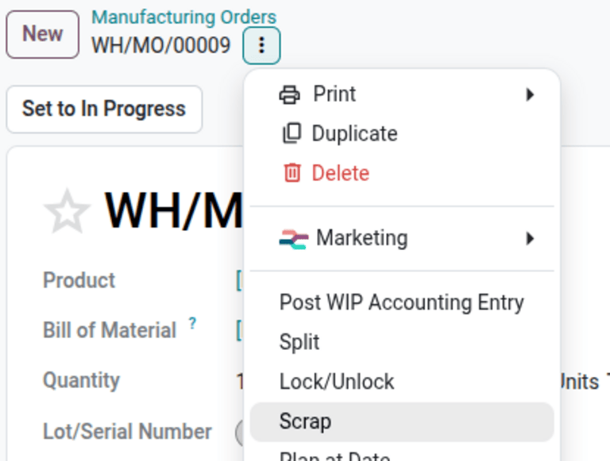
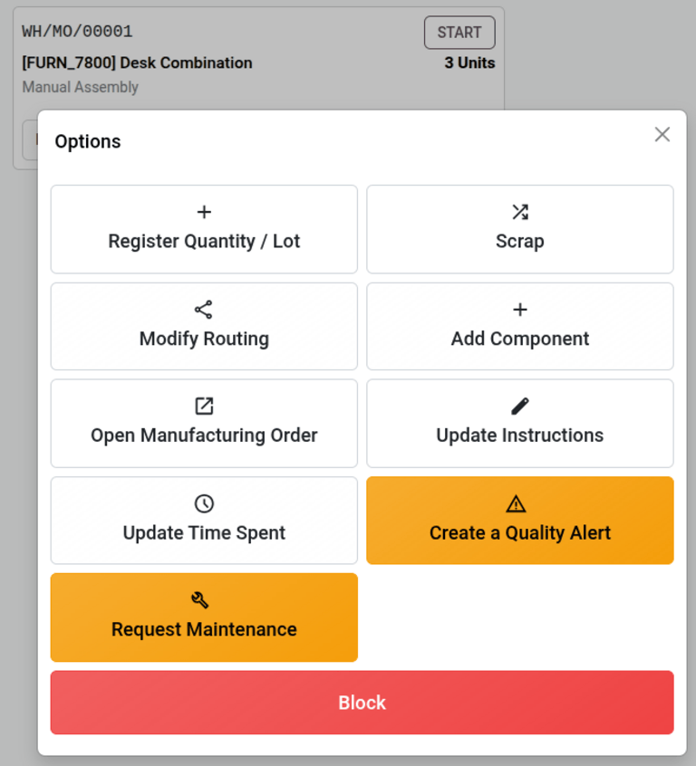
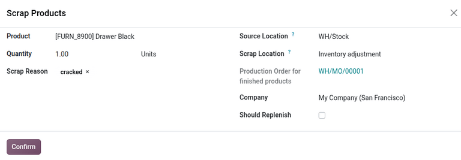

==========================
Scrap during manufacturing
==========================

.. |MO| replace:: :abbr:`MO (Manufacturing Order)`
.. |MOs| replace:: :abbr:`MOs (Manufacturing Orders)`

During the manufacturing process, scrapping components or finished products may be necessary when
items are damaged, defective, or no longer usable.

Tracking scrapped materials helps manufacturers monitor waste, identify process issues, and account
for production costs.

By default, in Odoo, scrapped items are removed from physical inventory and moved to a virtual
location called *Inventory adjustment*. This location is not a physical space. It is a way to log
and track losses without affecting real stock levels. However, to better account for scrapped goods
and to make sure these scraps show up in the :ref:`Profit and Loss report
<accounting/reporting/profit-and-loss>`, it is possible to set up a scrap location and scrap
journal.

.. seealso::
   - :doc:`Location types <../../inventory/warehouses_storage/inventory_management>`
   - :doc:`../../inventory/inventory_valuation/scrapped_inventory_valuation`

.. tip::
   View scrap orders by navigating to :menuselection:`Inventory --> Operations --> Scrap`. Each
   scrap order shows the date and time the order was created, along with the product and quantity
   that was scrapped. Click in the :guilabel:`Search` field to :guilabel:`Group By` the
   :guilabel:`Product` and review the total quantity of each item scrapped.

.. _manufacturing/management/scrap-window:

Navigate to the scrap window
============================

Scrapping can be done in either the :ref:`Manufacturing app
<manufacturing/scrap_manufacturing/manufacturing-app>` or the :ref:`Shop Floor module
<manufacturing/scrap_manufacturing/shop-floor>`, depending on the task.

**Manufacturing** app allows:

- Scrapping finished products (only if the |MO| is in the *Done* stage).
- Scrapping components (while the |MO| is in the *Draft* or *Confirmed* stage).

**Shop Floor** allows:

- Scrapping only components.

.. _manufacturing/scrap_manufacturing/manufacturing-app:

Manufacturing app
-----------------

To scrap a product from the **Manufacturing** app, go to :menuselection:`Manufacturing -->
Operations --> Manufacturing Orders` and open the desired |MO|.

.. note::
   By default, this list is filtered by |MOs| that have the :guilabel:`To Do` status. Clear this
   filter to show completed |MOs|.

On the |MO|, click the :icon:`more_vert` :guilabel:`(Actions)` icon, then choose :guilabel:`Scrap`
from the drop-down menu.

Then, :ref:`complete the Scrap Products pop-up window
<manufacturing/scrap_manufacturing/scrap-products>`.

.. _manufacturing/scrap_manufacturing/shop-floor:

Shop Floor
----------

In *Shop Floor*, only components can be scrapped. Navigate to the desired |MO| card, and then tap
the :icon:`more_vert` :guilabel:`(Actions)` icon. In the *Options* pop-up window, select
:icon:`shuffle` :guilabel:`Scrap`, then :ref:`complete the Scrap Products window
<manufacturing/scrap_manufacturing/scrap-products>`.

.. _manufacturing/scrap_manufacturing/scrap-products:

Scrap Products pop-up window
============================

After opening the *Scrap Products* pop-up window using one of the methods :ref:`detailed above
<manufacturing/management/scrap-window>`, select the component or finished product being scrapped
from the :guilabel:`Product` drop-down menu.

In the :guilabel:`Quantity` field, enter the quantity being scrapped.

To record a reason the product or component is being scrapped, add it in the :guilabel:`Scrap
Reason` field.

By default, the :guilabel:`Source Location` field is set to the warehouse's pre-production location,
while the :guilabel:`Scrap Location` field is set to the :guilabel:`Inventory adjustment` location.
If either the source or scrap location should be changed, select a different location from their
respective drop-down menus.

Enable the :guilabel:`Should Replenish` checkbox if a replenishment order should be created to
replace the scrapped component upon confirmation of the scrap order.

For one-step manufacturing, the replenishment comes directly from stock (if stock is available), or
a purchase order or |MO| is triggered for those replenishment routes. For two- or three-step
manufacturing, enabling :guilabel:`Should Replenish` creates a transfer to validate, which is linked
to the |MO|.

After filling out the *Scrap Products* pop-up window, click :guilabel:`Confirm`. After one or more
scrap orders have been created, a :icon:`height` :guilabel:`Scraps` smart button appears at the top
of the screen on the |MO| form. Click it to view a list of all scrap orders for the |MO|.
