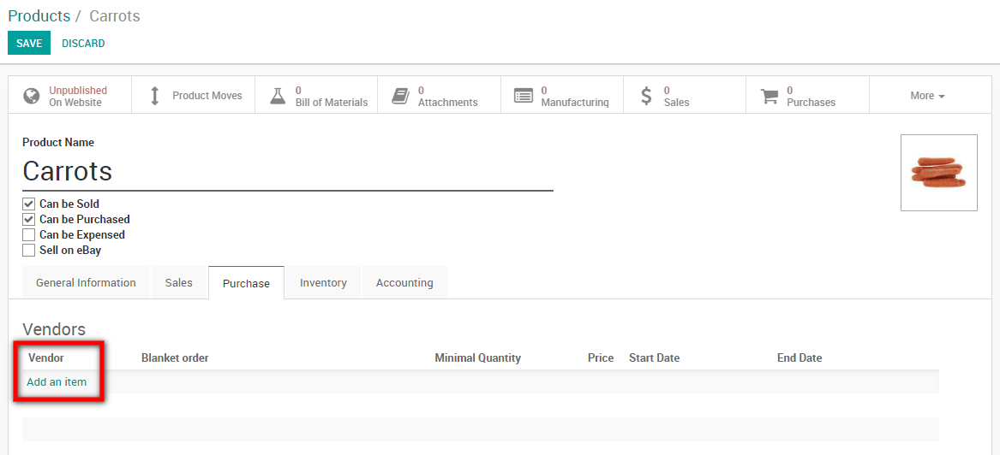
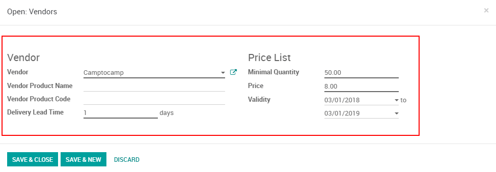

=================================
Configurar múltiples proveedores en un producto
=================================

Si necesita comprar un mismo producto a varios proveedores, Odoo le permite vincularlos directamente con un solo producto.

Añadir proveedores en un producto
========================

Para utilizar esta función, vaya a :menuselection:`Compras --> Productos` y seleccione un producto.

Desde allí, puede añadir proveedores existentes a su producto o crear uno nuevo sobre la marcha.

Tenga en cuenta que la primera vez que compre el producto a un nuevo proveedor, Odoo vinculará automáticamente el contacto y el precio con el producto.

Añadir precio y cantidad, así como un período de validez
-------------------------------------------------

Al añadir un proveedor a un producto, puede incluir el nombre y código del producto del proveedor, así como fijar la cantidad mínima, el precio y el período de validez.

.. tip::
    ¡Esta función de Odoo también funciona con variantes de sus productos, como una camiseta en diferentes tallas!
