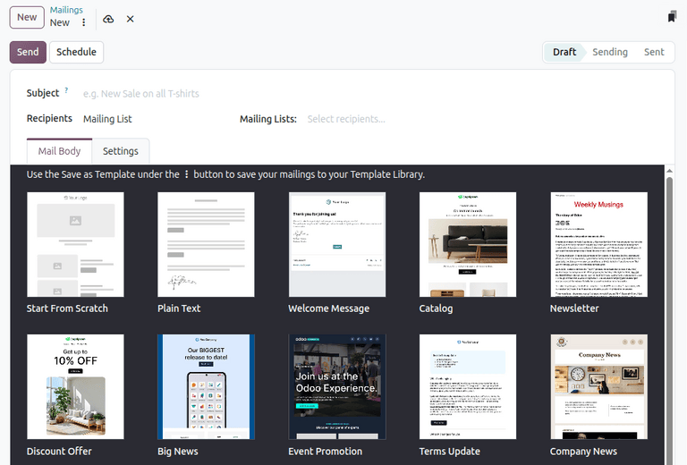
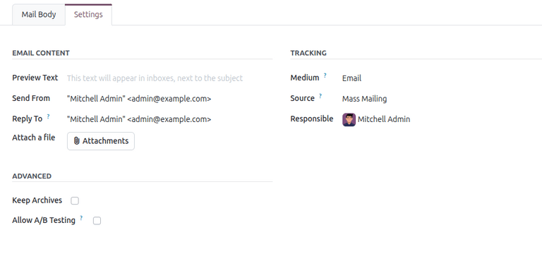
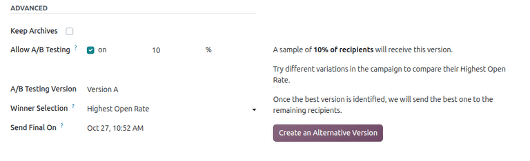
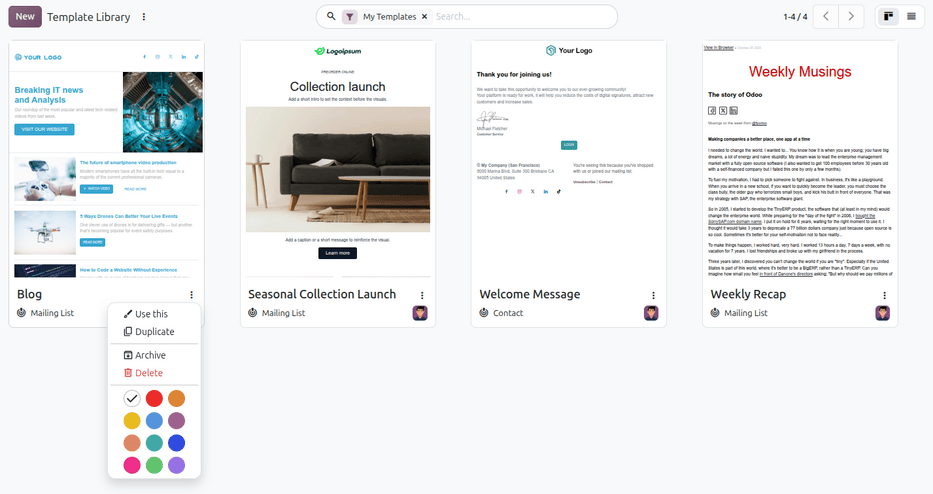
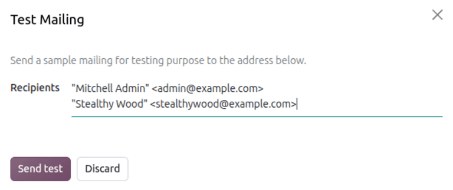
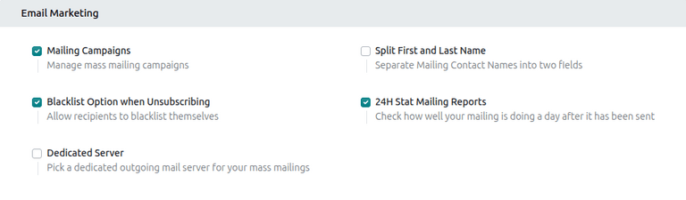
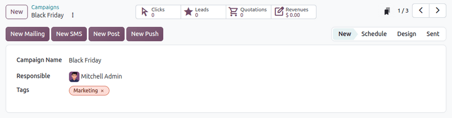

:show-content:

===============
Email Marketing
===============

The Odoo *Email Marketing* app provides drag-and-drop design tools, pre-built templates, and other
interactive features to create engaging email campaigns. The *Email Marketing* app also provides
detailed reporting metrics to track the campaigns' overall effectiveness.

.. seealso::
   - `Odoo Tutorial: Email Marketing
     <https://www.odoo.com/slides/slide/email-marketing-essentials-989?fullscreen=1>`_
   - `Magic Sheet - Email Marketing strategy [PDF]
     <https://drive.google.com/drive/folders/1TqZfYCF-56yhUSDVyfFjkmB23RWaRBP7>`_

.. cards::

   .. card:: Mailing lists
      :target: email_marketing/mailing_lists

      Silo contacts into specific mailing lists.

   .. card:: Manage unsubscriptions (blacklist)
      :target: email_marketing/unsubscriptions

      Allow recipients to unsubscribe and blacklist from future mailings.

   .. card:: Lost leads reactivation email
      :target: email_marketing/lost_leads_email

      Target lost leads with Email Marketing.

   .. card:: Analyze metrics
      :target: email_marketing/analyze_metrics

      Analyzing campaign metrics.

Email Marketing dashboard
=========================

After installing the application, open the **Email Marketing** app. This opens a dashboard of
mailings with different view and filter options.

The following view options are available:

.. tabs::

   .. tab:: List

      The :icon:`reorder` :guilabel:`(List)` view is the default view of the :guilabel:`Mailings`
      dashboard, displaying detailed information about each individual mailing.

      By default, information about mailings is shown in the following columns:

      - :guilabel:`Date`: The date the mailing was sent.
      - :guilabel:`Subject`: The subject of the mailing.
      - :guilabel:`Responsible`: The user who created the mailing, or the user assigned to the
        mailing.
      - :guilabel:`Sent`: How many times the mailing has been sent.
      - :guilabel:`Delivered (%)`: Percentage of sent mailings that have been successfully
        delivered.
      - :guilabel:`Opened (%)`: Percentage of sent mailings that have been opened by the recipients.
      - :guilabel:`Clicked (%)`: Percentage of sent mailings that have been clicked by the
        recipients.
      - :guilabel:`Replied (%)`: Percentage of sent mailings that have been replied to by the
        recipients.
      - :guilabel:`Status`: The status of the mailing (:guilabel:`Draft`, :guilabel:`In Queue`, or
        :guilabel:`Sent`).

      To add or remove columns, click the :icon:`tune` :guilabel:`(optional columns)` icon at the
      end of the columns, then select the additional options from the drop-down menu.

   .. tab:: Kanban

      The :icon:`oi_view-kanban` :guilabel:`(Kanban)` view provides a quick overview of mailings,
      categorized by their current stages.

      By default, mailings are categorized into the following stages:

      - :guilabel:`Draft`: The mailing is still being written/created.
      - :guilabel:`In Queue`: The mailing is scheduled for later.
      - :guilabel:`Sending`: The mailing is currently being sent to its recipients.
      - :guilabel:`Sent`: The mailing has already been sent to its recipients.

      Each card on the :guilabel:`Mailings` dashboard provides key information about the
      corresponding mailing. Click the upper corner of the card set a color, :guilabel:`Delete` the
      mailing, or :guilabel:`Archive` the message for future use.

   .. tab:: Calendar

      The :icon:`calendar_today` :guilabel:`(Calendar)` view displays each mailing as a clickable
      entry on the date it was sent or scheduled.

      In the side panel, filter the results by :guilabel:`Responsible` user or mailing
      :guilabel:`Status` via the checkboxes.

      Click any of the entries to :guilabel:`View` the mailing in more detail or :guilabel:`Delete`
      it.

.. _email_marketing/create-mailing:

Create a mailing
================

To create a mailing from the *Mailings* dashboard, click the :guilabel:`New` button. A blank mailing
form loads.

Begin by specifying the :ref:`subject and recipients <email_marketing/recipients>`. Beneath that,
the :ref:`Mail Body <email_marketing/mail_body>` and :ref:`Settings <email_marketing/settings_tab>`
tabs provide additional configurations to customize the mailing.

.. _email_marketing/recipients:

Subject and recipients
----------------------

To start, enter the :guilabel:`Subject` of the mailing.

Then, select one of the following :guilabel:`Recipients`:

- :guilabel:`Applicant`: Send the mailing to applicants.
- :guilabel:`Contact`: Send the mailing to contacts.
- :guilabel:`Employee`: Send the mailing to employees.
- :guilabel:`Event Registration`: Send the mailing to event attendees.
- :guilabel:`Event Track`: Send the mailing to event track speakers.
- :guilabel:`Lead`: Send the mailing to leads.
- :guilabel:`Mailing Contact`: Send the mailing to mailing contacts. These contacts can be accessed
  by navigating to :menuselection:`Email Marketing app --> Mailing Lists --> Mailing List Contacts`.
- :guilabel:`Mailing List`: Send the mailing to the recipients of the selected :guilabel:`Mailing
  Lists`.
- :guilabel:`Point of Sale Order`: Send the mailing to vendors on point of sale orders.
- :guilabel:`Purchase Order`: Send the mailing to vendors on purchase orders.
- :guilabel:`Sales Order`: Ties specifically to the **Sales** app and focuses on a specific sales
  order in the database.

.. note::
   With the default :guilabel:`Mailing List` option selected, a specific mailing list **must** be
   chosen from the adjacent :guilabel:`Select mailing lists` field drop-down menu.

   Those options (excluding the default :guilabel:`Mailing List`) provide the option to create a
   more specific recipient filter in the :guilabel:`Domain` field. Optionally, :guilabel:`Dynamic
   Lists` can be selected to automatically populate the domain.

.. _email_marketing/mail_body:

Mail Body tab
-------------

In the *Mail Body* tab, select a message template. The template can be modified using the sidebar.

The features on the sidebar used to create and customize emails are separated into three sections:
:guilabel:`Blocks`, :guilabel:`Customize`, and :guilabel:`Design`.

Each building block provides unique features and professional design elements. To use a building
block, drag-and-drop the desired block element onto the body of the email being built. Once dropped,
various aspects of the building block can be customized.

.. tip::
   To build an email from the ground up, without any building block elements, select the
   :guilabel:`Plain Text` template. When selected, Odoo provides a completely blank email canvas,
   which can be customized in a number of way using the front-end rich text editor that accepts
   forward slash `/` commands.

   When `/` is typed into the blank body of the email, while using a :guilabel:`Plain Text`
   template, a drop-down menu of various design elements appears, which can be used to create the
   desired email design.

.. _email_marketing/settings_tab:

Settings tab
------------

The options present in the *Settings* tab of the mail form are divided into three sections: *Email
Content*, *Tracking*, and *Advanced*.

.. note::
   The options available in the *Settings* tab vary depending on if the *Mailing Campaigns* feature
   is activated in :menuselection:`Email Marketing --> Configuration --> Settings`. See
   :ref:`email_marketing/mailing-campaigns` for more information.

Email content
~~~~~~~~~~~~~

The *Email Content* section provides the following configuration options:

- :guilabel:`Preview Text`: Enter a preview sentence to encourage recipients to open the email. In
  most inboxes, this is displayed next to the subject. If left empty, the first characters of the
  email content appear instead.
- :guilabel:`Send From`: Designate an email alias that displays as the sender of this particular
  email.
- :guilabel:`Reply To`: Designate an email alias to whom all the replies of this particular email
  are sent.
- :guilabel:`Attach a file`: Upload any required (or helpful) :icon:`attach_file`
  :guilabel:`Attachments` on this mailing.

Tracking
~~~~~~~~

The *Tracking* section includes the following configuration options:

- :guilabel:`Medium`: Choose a tracking method (e.g., `Email`, `SMS`).
- :guilabel:`Source`: Choose a source to track (e.g., `Mass Mailing`, `Newsletter`).
- :guilabel:`Responsible`: Designate a user in the database to be responsible for this particular
  email.

.. note::
   If the *Mailing Campaign* feature *is* activated, an additional :guilabel:`Campaign` field
   appears in the :guilabel:`Tracking` section of the *Settings* tab.

Advanced
~~~~~~~~

Select the :guilabel:`Keep Archives` option to keep archived mailings.

If the :guilabel:`Allow A/B Testing` option is enabled, different versions of the same mailing are
sent to random recipients to gauge the effectiveness of the mailing.

In the :guilabel:`on (#)%` field, specify the percentage of recipients that are sent this current
version of the mailing as part of the test. Specify the name of the version in the :guilabel:`A/B
Testing Version` field.

Beneath that, two additional fields appear:

In the :guilabel:`Winner Selection` field, select the criteria to determine how the final version of
the email is selected. The following options are provided:

- :guilabel:`Manual`: Allows the user to determine the "winning" version of the mailing. This option
  removes the :guilabel:`Send Final On` field.
- :guilabel:`Highest Open Rate` (default): The mailing with the highest open rate is determined to
  be the "winning" version.
- :guilabel:`Highest Click Rate`: The mailing with the highest click rate is determined to be the
  "winning" version.
- :guilabel:`Highest Reply Rate`: The mailing with the highest reply rate is determined to be the
  "winning" version.
- :guilabel:`Leads`: The mailing with the most leads generated is determined to be the "winning"
  version.
- :guilabel:`Quotations`: The mailing with the most quotations generated is determined to be the
  "winning" version.
- :guilabel:`Revenues`: The mailing with the most revenue generated is determined to be the
  "winning" version.

The :guilabel:`Send Final On` field allows users to choose a date that is used to know *when* Odoo
should determine the winning version and send it to the remaining recipients.

Next to these fields is a :guilabel:`Create an Alternative Version` button. When clicked, Odoo opens
a new *Mail Body* tab so the user can create an alternate version of the email for testing.

.. _email_marketing/template-library:

Mailing templates
=================

To save a mailing as a template for future use, navigate to :menuselection:`Email Marketing app -->
Mailings` and select a mailing or :ref:`create a new one <email_marketing/create-mailing>`. Above
the mailing form, click the :icon:`more_vert` :guilabel:`(Actions)` icon and select :icon:`brush`
:guilabel:`Save as Template`.

To use a mailing template, navigate to :menuselection:`Email Marketing app --> Templates`. On the
*Template Library* page, select the template or its :icon:`more_vert` :guilabel:`(vertical
ellipsis)` icon, then click :guilabel:`Use this` to populate a new mailing form with the configured
fields.

.. _email_marketing/sending-testing:

Send, schedule, test
====================

Once the mailing is finalized, proceed to :ref:`Send <email_marketing/send>`, :ref:`Schedule
<email_marketing/schedule>`, or :ref:`Test <email_marketing/test>` it.

.. _email_marketing/send:

Send
----

The :guilabel:`Send` button reveals a :guilabel:`Ready to unleash emails?` pop-up window.

When the :guilabel:`Send to all` button is clicked, Odoo sends the email to the desired recipients.
Once Odoo has sent the mailing, the status changes to :guilabel:`Sent`.

.. _email_marketing/schedule:

Schedule
--------

The :guilabel:`Schedule` button reveals a :guilabel:`When do you want to send your mailing?` pop-up
window. Click the :guilabel:`Send on` field and select the future date and time on the calendar
pop-over. Finally, click the :guilabel:`Schedule` button. The status of the mailing changes to
:guilabel:`In Queue`.

.. _email_marketing/test:

Test
----

The :guilabel:`Test` button reveals a :guilabel:`Test Mailing` pop-up window.

In the :guilabel:`Recipients` field, enter one or more email addresses of the contacts to whom Odoo
should send this test email.

Once all the desired email addresses have been entered in the :guilabel:`Recipients` field, click
the :guilabel:`Send Test` button.

.. warning::
   By default, there's a daily limit applied to **all emails** sent across **all applications**. If
   there are remaining emails to be sent after a limit has been reached, those mailings are **not**
   sent automatically the next day. The sending needs to be forced by opening the email and clicking
   :guilabel:`Retry`.

.. _email_marketing/mailing-campaigns:

Mailing campaigns
=================

In order to create and customize mailing campaigns, the *Mailing Campaigns* feature **must** be
activated in the *Settings* page of the **Email Marketing** application. To do that, navigate to
:menuselection:`Email Marketing app --> Configuration --> Settings`, click the box beside
:guilabel:`Mailing Campaigns`, and click the :guilabel:`Save` button.

Once the :guilabel:`Mailing Campaigns` feature is activated, a new :guilabel:`Campaigns` menu option
appears in the header. The option opens a Kanban view of all mailing campaigns in the database.

.. _email_marketing/campaign-page:

Create mailing campaign
-----------------------

To create a campaign, navigate to :menuselection:`Email Marketing app --> Campaigns`. Then, click
:guilabel:`New`.

In the new pop-over, specify a :guilabel:`Campaign Name`, a :guilabel:`Responsible` user, and
:guilabel:`Tags` (if applicable). Then, click :guilabel:`Add` to create the campaign or
:guilabel:`Edit` to open a more detailed campaign form.

At the top of the form, various metric-related smart buttons showcase specific analytics related to
the campaign:

- :icon:`arrow_selector_tool` :guilabel:`Clicks`: Open a list of recipients who clicked a tracked
  link in the campaign.
- :icon:`star` :guilabel:`Opportunities`: Open a list of opportunities or leads generated from the
  campaign.
- :icon:`shopping_cart` :guilabel:`Quotations`: Open a list of sales quotations associated with the
  campaign.
- :icon:`edit_square` :guilabel:`Revenues`: Open a list of :doc:`journal entries
  <../finance/accounting/get_started/journals>` tracking transactions related to the campaign.

.. note::
   If the Odoo **CRM** *Leads* feature is enabled, the :icon:`star` :guilabel:`Opportunities` shows
   up as :icon:`star` :guilabel:`Leads`.

Additionally, the following buttons appear:

- :guilabel:`New Mailing`: Create a :ref:`new mailing <email_marketing/create-mailing>`.
- :guilabel:`New SMS`: Create a new :doc:`SMS mailing <sms_marketing/create_sms>`.
- :guilabel:`New Post`: Create a new :doc:`social media post <social_marketing/social_posts>`.
- :guilabel:`New Push`: Create a new :ref:`push notification
  <social_marketing/social_posts/push-notifications>` for social media posts.

.. seealso::
   - :doc:`email_marketing/mailing_lists`
   - :doc:`email_marketing/unsubscriptions`
   - :doc:`email_marketing/lost_leads_email`
   - :doc:`email_marketing/analyze_metrics`

.. toctree::
   :titlesonly:

   email_marketing/mailing_lists
   email_marketing/unsubscriptions
   email_marketing/lost_leads_email
   email_marketing/analyze_metrics
