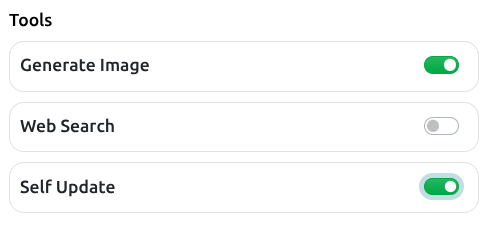
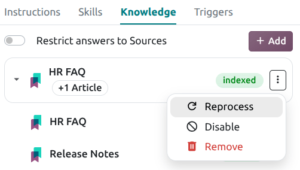
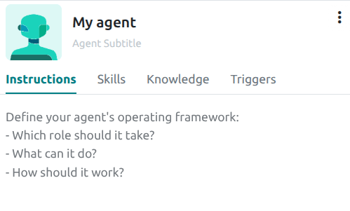

.. meta::
   :description: AI agents in Odoo are virtual assistants that understand natural-language requests
                 and perform tasks. Learn how agents use instructions, skills, tools, and knowledge
                 sources, and how to create and configure a new agent.

=========
AI agents
=========

.. |AI| replace:: :abbr:`AI (artificial intelligence)`
.. |IAP| replace:: :abbr:`IAP (In-app purchases)`

An |AI| agent is a virtual assistant in Odoo that can understand natural-language requests, access
information, and perform tasks using the tools available to it. Agents can be configured for
specific roles and can be used interactively or as part of automated workflows.

Agents are built from four main components:

- *Instructions* define the agent's purpose, behavior, and responsibilities.
- *Knowledge* provides information the agent can use when completing tasks.
- *Skills and tools* define what the agent can do. Skills provide instructions for specific tasks,
  while tools allow the agent to perform actions in Odoo.
- *Triggers* determine when the agent is invoked, such as when a user starts a conversation or when
  an automated or scheduled action calls the agent.

.. important::
   While many |AI| features can be used in Odoo without the **AI** application, creating and
   customizing agents requires the **AI** application be installed.

   Odoo |AI| uses In-app purchases (IAP) for AI requests. For more information on using |IAP|
   credits, including how to purchase additional credits, visit the `Odoo AI IAP
   <https://iap.odoo.com/iap/in-app-services/867>`_.

Agent structure
===============

.. _ai/agents/prompts-in-odoo:

Instructions
------------

Instructions define the agent's overall role, purpose, and behavior.

Each AI agent is assigned a *System Prompt* that provides its main instructions. It can define the
agent's responsibilities, constraints, and how it should respond to requests.

Each :ref:`Skill <ai/agents/skills>` also includes its own prompt-like component, called
*Instructions*. Instructions are skill-specific guidelines that refine how the agent behaves in a
given context or workflow and how it interacts with the Odoo framework.

Instructions often include:

- A purpose, or what the skill covers.
- Rules or constraints for the agent to follow when assigned this skill.
- Step-by-step workflows for completing a specific action.
- Technical details needed to complete any actions.

.. _ai/agents/skills:

Skills
------

*Skills* define specific tasks an agent can perform. Each *Skill* includes instructions that guide
the agent through the task and can have one or more tools assigned to it.

.. important::
   If an agent is not assigned any Skills, it can **only** provide information. It **cannot**
   complete tasks or make changes to the database.

Multiple *Skills* can be assigned to the same agent, allowing it to perform different types of
tasks.

.. _ai/tools:

Agent tools
~~~~~~~~~~~

*Tools* are the functions an agent can perform in Odoo. Each agent has the following tools
available:

- *Generate image*: A collection of tools to support image generation. Load this skill when the user
  asks to generate or enhance an image.
- *Web Search*: Enable the Agent to explore the internet in real time.
- *Self Update*: Allows an agent to identify missing or incomplete instructions and *Skills* and
  propose or make changes to its configuration.

To enable a tool on an agent, click the *Skills* tab, then slide the appropriate toggle to green.

.. _ai/sources:

Subagents
~~~~~~~~~

An agent can use other |AI| agents as *subagents* to handle specialized tasks. When a user submits a
request, the main agent can determine whether to delegate part of the task to a subagent based on
its purpose and capabilities.

Subagents allow an agent to delegate specific tasks to specialized agents rather than handling every
request itself. The main agent can then use the subagent's results as part of its response.

To assign a subagent, click on the *Skills* tab, scroll to the *Subagents* section, then click
:icon:`add` :guilabel:`Add`. Then, select from the list of existing agents, or click
:guilabel:`Create New` to create a new one.

Knowledge
---------

Sources are the data the agent can refer to when generating responses or completing tasks. Sources
are indexed so the agent can retrieve relevant information when a user asks a question.

.. example::
    An agent designed to answer customer support questions has **Knowledge** articles included as
    sources, which include frequently asked questions.

Sources can be in the following formats:

 - Files uploaded to the agent
 - Links to webpages
 - Documents (uploaded in the :doc:`Documents <../documents>` application)
 - :doc:`Knowledge <../knowledge>` app articles

.. important::
   If the :guilabel:`Restrict answers to Sources` option is enabled on an agent, the agent can
   **only** utilize information from the uploaded and active sources.

Reprocessing sources
~~~~~~~~~~~~~~~~~~~~

If the content of a source changes after it has been indexed, it may be necessary to reprocess the
source so that agents use the most recent information. Reprocessing can be triggered manually and
ensures that updated documents, links, or knowledge articles are reflected in future agent
responses.

To reprocess a source:

#. Navigate to the :menuselection:`AI` app and select an |AI| agent.
#. Click the *Knowledge* tab, and select a source.
#. Click the :icon:`fa-ellipsis-v` :guilabel:`(vertical ellipsis)` icon for the source.
#. On the menu, click :guilabel:`Reprocess`.

Triggers
--------

An agent can be triggered in different ways depending on how it is used.

Agents can be launched interactively by users through an AI chat. They can also be triggered
automatically by automated actions and scheduled actions, allowing agents to participate in
automated workflows.

To add a trigger to an agent, navigate to the *Trigger* tab and click :icon:`add` :guilabel:`Add`.
On the *When should your agent be triggered?* popup, choose from one of the following options:

- *On a schedule*: Runs automatically according to a set frequency.
- *Based on a Date Field*: Runs once per record, as soon as a specific date is reached.
- *After creation*: Runs whenever a new record is added.
- *After update*: Runs whenever a specific field is updated.

.. tip::
   If unsure which option is best for a particular use case, click the :guilabel:`I need help to
   choose` option at the bottom of the popup. This opens a conversation with the *Odoo AI* agent.
   The agent then walks through the specifics of the use case to help select the best option.

.. seealso::
   See :doc:`AI server actions <server-actions>` for more information.

.. _ai/create-agent:

Create a new agent
==================

To create a new |AI| agent, navigate to the :menuselection:`AI` app and click :guilabel:`New`. Enter
an agent name, then add a short description, if desired.

.. tip::
   Before creating a new agent, it is recommended to have a clear use case in mind. This helps when
   writing out the *Instructions* and assigning the *Skills*.

On the *Instructions* tab, enter a system prompt with detailed instructions for the agent as to
their role and responsibilities.

On the *Skills* tab, select one or more :guilabel:`Skills` for the agent. As explained above,
:ref:`Skills <ai/agents/skills>` include both instructions and tools that guide the agent in helping
users complete a task.

Slide the :guilabel:`Restrict answers to Sources` toggle to active to limit the agent to **only**
respond based on the provided resources.
