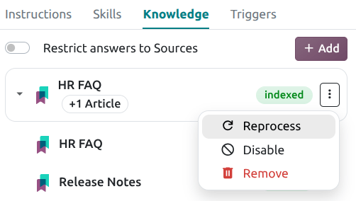
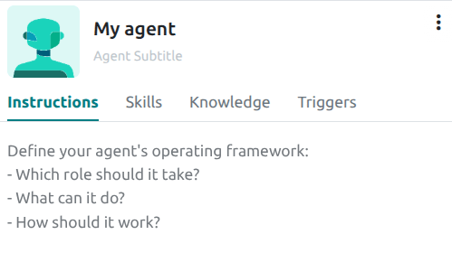

.. meta::
   :description: AI agents in Odoo are virtual assistants that understand natural-language requests
                 and perform tasks. Learn how agents use instructions, skills, tools, and knowledge
                 sources, and how to create and configure a new agent.

=========
AI agents
=========

.. |AI| replace:: :abbr:`AI (artificial intelligence)`

An |AI| agent is a virtual assistant in Odoo that can understand natural-language requests, access
information, and perform tasks using the tools available to it. Agents can be configured for
specific roles and can be used interactively or as part of automated workflows.

Agents are built from four main components:

- *Instructions* define the agent's purpose, behavior, and responsibilities.
- *Knowledge* provides information the agent can use when completing tasks.
- *Skills and tools* define what the agent can do. Skills provide instructions for specific tasks,
  while tools allow the agent to perform actions in Odoo.
- *Triggers* determine when the agent is invoked, such as when a user starts a conversation or when
  an automated or scheduled action calls the agent.

.. important::
   While many |AI| features can be used in Odoo without the **AI** application, creating and
   customizing agents requires that the **AI** application is installed.

.. _ai/agents/prompts-in-odoo:

AI Instructions
===============

Instructions define the agent's overall role, purpose, and behavior.

Each AI agent is assigned a *System Prompt* that provides its main instructions. It can define the
agent's responsibilities, constraints, and how it should respond to requests.

Each :ref:`Skill <ai/skills>` also includes its own prompt-like component, called *Instructions*.
Instructions are skill-specific guidelines that refine how the agent behaves within a certain
context or workflow, and how it interacts within the Odoo framework.

Instructions often include:

- A purpose, or what the skill covers.
- Rules or constraints for the agent to follow when assigned this skill.
- Step-by-step workflows for how to complete a specific action.
- Technical details needed to complete any actions.

Agent structure
===============

.. _ai/sources:

Knowledge
---------

Sources are the data the agent can refer to when generating responses or completing tasks. Sources
are indexed so the agent can retrieve relevant information when a user asks a question.

.. example::
    An agent designed to answer customer support questions has **Knowledge** articles included as
    sources, which include frequently asked questions.

Sources can be in the following formats:

 - PDFs
 - Weblinks
 - Documents (uploaded in the :doc:`Documents <../documents>` application)
 - :doc:`Knowledge <../knowledge>` app articles

.. important::
   If the :guilabel:`Restrict to Sources` option is enabled on an agent, the agent can **only**
   utilize information from the uploaded and active sources.

Reprocessing sources
~~~~~~~~~~~~~~~~~~~~

If the content of a source changes after it has been indexed, it may be necessary to reprocess the
source so that agents use the most recent information. Reprocessing can be triggered manually and
ensures that updated documents, links, or knowledge articles are reflected in future agent
responses.

To reprocess a source:

#. Navigate to the :menuselection:`AI` app and select an |AI| agent,
#. Click the knowledge tab, and select a source.
#. Click the :icon:`fa-ellipsis-v` :guilabel:`(vertical ellipsis)` icon for the source.
#. On the menu, click :guilabel:`Reprocess`.

.. _ai/skills:

Skills
------

*Skills* define specific tasks an agent can perform. Each *Skill* includes instructions that guide
the agent through the task and can have one or more tools assigned to it.

.. important::
   If an agent is not assigned any Skills, it is **only** able to provide information. It **cannot**
   complete tasks or make changes to the database.

Multiple *Skills* can be assigned to the same agent, allowing it to perform different types of
tasks.

.. _ai/tools:

Tools
~~~~~

*Tools* are the functions an agent can perform in Odoo. For example, a tool can allow an agent to
search records, create or update records, or open an Odoo view. Multiple *Tools* can be assigned to
a single skill.

Triggers
--------

An agent can be triggered in different ways depending on how it is used.

Agents can be launched interactively by users through an AI chat. They can also be triggered
automatically by automated actions and scheduled actions, allowing agents to participate in
automated workflows.

When an agent is triggered by an automation, the conversation can be reviewed to see how the agent
handled the task.

.. seealso::
   See :doc:`AI server actions <server-actions>` for more information.

.. _ai/create-agent:

Create a new agent
==================

To create a new |AI| agent, navigate to the :menuselection:`AI` app and click :guilabel:`New`. Enter
an agent name, then add a short description, if desired.

.. tip::
   Before creating a new agent, it is recommended to have a clear use case in mind. This helps when
   writing out the *Instructions*, and assigning the *Skills* and *Tools*.

On the *Instructions* tab, enter a system prompt with detailed instructions for the agent as to
their role and responsibilities.

On the *Skills* tab, select one or more :guilabel:`Skills` for the agent. As explained above,
:ref:`Skills <ai/skills>` include both instructions and tools that guide the agent in helping users
complete a task.

Slide the :guilabel:`Restrict answers to Sources` toggle to active to limit the agent to **only**
respond based on the provided resources.
