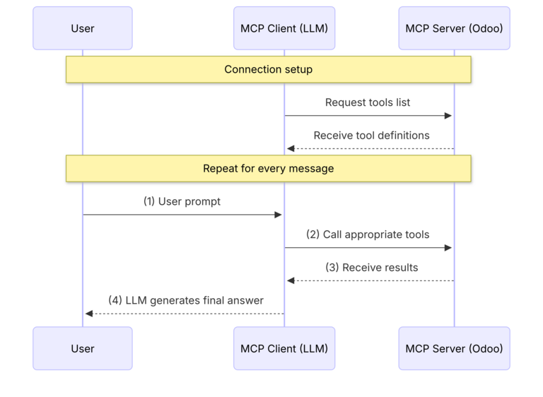
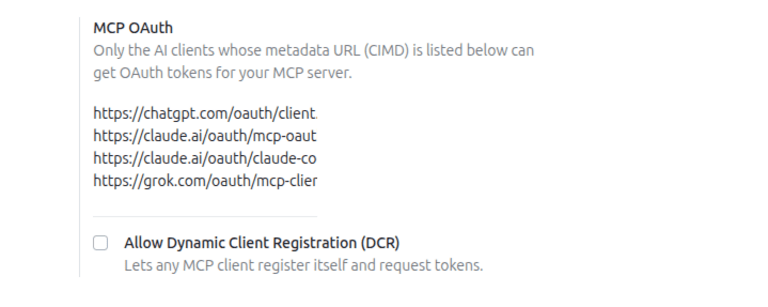
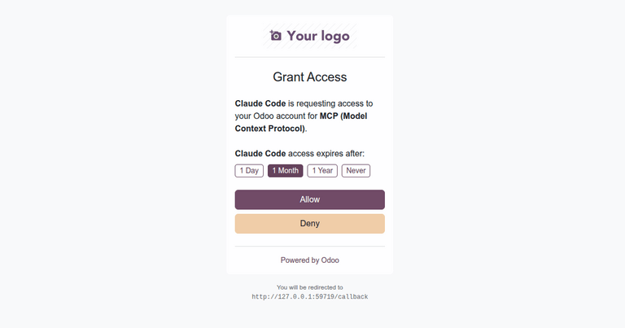
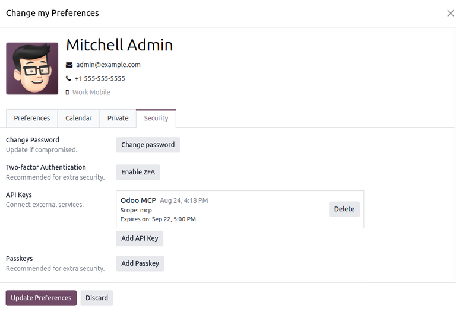
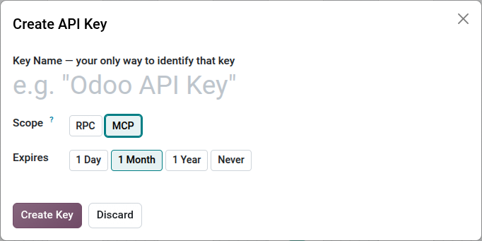

:show-content:

=============
AI MCP server
=============

.. |AI| replace:: :abbr:`AI (artificial intelligence)`
.. |MCP| replace:: :abbr:`MCP (Model Context Protocol)`
.. |LLM| replace:: :abbr:`LLM (large language model)`
.. |CIMD| replace:: :abbr:`CIMD (Client ID Metadata Document)`

Model Context Protocol (MCP) is an open-source standard that allows large language models (LLMs) to
securely interact with external applications and access their data. In Odoo **AI**, users can
connect an external |AI| agent directly to their Odoo database through an Odoo |MCP| server in order
to read or modify the database using their own local |AI| workflows.

The following documentation provides an overview of Odoo |MCP| servers, how to connect |AI| agents
to them, and how to read or write data through the server.

.. note::
   This documentation uses the following terms with some flexibility and may differ from their
   proper technical usage, either in Odoo or externally:

   - *Client*: Refers broadly to the |AI| application with which the user interacts. For example,
     the |LLM| prompted by the user is also referred to as the *client*.

.. _ai/mcp/overview:

MCP workflow
============

In the |MCP| workflow, an Odoo database acts as a remote |MCP| *server* that communicates with the
|MCP| *client* (the user's external |AI| agent) to execute :doc:`tools <server-actions>` such as
reading data or editing records in the database. This process occurs internally and is invisible to
the user, who interacts with the |MCP| client **only** by prompting it with specific tasks.

The following sequence outlines the |MCP| workflow in Odoo:

#. The user :ref:`configures the client <ai/mcp/configuration>` with server details and an
   authentication key. Once connected, the client automatically makes an initial request to the
   server for any available :doc:`AI tools <mcp_server/mcp_tools>` (or *Server Actions*) exposed to
   it in the database. If successful, the client caches the tools for the remainder of the session.
#. The user prompts the client in plain language. A list of :ref:`example prompts
   <ai/mcp/use-cases>` is provided in this documentation.
#. The client requests that the server invoke the correct tools.
#. After executing the tool, the server returns the results to the client.
#. The client responds to the user's prompt in plain language.

.. seealso::
   :doc:`server-actions`

.. _ai/mcp/configuration:

Configuration
=============

The configuration process includes the following steps:

#. Set up authentication using either :ref:`OAuth <ai/mcp/oauth>` or :ref:`API key
   <ai/mcp/authentication>`.
#. :ref:`Configure the MCP server details <ai/mcp/server-settings>` and connect via the client.
#. :ref:`Expose server actions <ai/mcp/expose-tools>` to the client from Odoo.
#. If necessary, :ref:`revoke access <ai/mcp/revoke>` for unwanted clients.

.. important::
   Before configuring the AI client settings in step two, ensure that the following are installed:

   - An |MCP|-compatible AI agent (e.g., *Claude Code*, *Antigravity*, *Codex*)
   - `Node.js <https://nodejs.org/en/download>`_ (if authenticating using an API key)

.. _ai/mcp/oauth:

Connect with OAuth
------------------

OAuth is the recommended method of authentication, allowing users to securely approve access to Odoo
from their client without manually copying, pasting, or exposing authentication keys.

To authenticate using OAuth, perform the following steps:

#. :ref:`Allow the client <ai/mcp/oauth/allow>` to access the database.
#. :ref:`Connect the client <ai/mcp/oauth/connect>` and grant access.

.. note::
   OAuth is only available to internal users. Portal users must authenticate using an API key.

.. _ai/mcp/oauth/allow:

Approve AI clients
~~~~~~~~~~~~~~~~~~

Only approved |AI| clients can request access to the database. To review the approved clients,
navigate to :menuselection:`Settings app --> Integrations section --> MCP OAuth`.

The :guilabel:`MCP OAuth` field lists the metadata URL, or *Client ID Metadata Document (CIMD)*, of
each approved client.

To approve another client that supports |CIMD|, add its metadata URL on a new line, then click
:guilabel:`Save`.

For clients that do not support |CIMD|, select the :guilabel:`Allow Dynamic Client Registration
(DCR)` checkbox. This allows **any** |MCP| client to register itself and request access.

.. warning::
   Enabling *DCR* allows any application to register as a client. To block a registered client, turn
   on :ref:`developer mode <developer-mode>`, navigate to :menuselection:`Settings app --> Technical
   --> OAuth Clients`, then archive the client.

.. _ai/mcp/oauth/connect:

Connect the client and grant access
~~~~~~~~~~~~~~~~~~~~~~~~~~~~~~~~~~~

In the |MCP| client, add a server using only the server endpoint URL (e.g.,
`https://example.odoo.com/mcp`).

.. important::
   Be sure to replace the following placeholders with the appropriate values:

   - `server_name`: Enter a custom name to identify the |MCP| server.
   - `database_url`: Enter the URL of the Odoo database.

.. tabs::

   .. tab:: Claude

      In the terminal, paste the following command to add the |MCP| server:

      .. code-block::

         claude mcp add --transport http <server_name> <database_url>/mcp

      Then, run `claude mcp list` to check the connection status of the newly added server.

   .. tab:: Grok

      In the terminal, paste the following command to add the |MCP| server:

      .. code-block::

         grok mcp add --transport http <server_name> <database_url>/mcp

      Then, run `grok mcp list` to check the connection status of the newly added server.

   .. tab:: ChatGPT

      Open ChatGPT, navigate to :menuselection:`Settings --> Plugins --> Add / Add custom MCP
      server`.

      Provide a name, the endpoint/URL (`<database_url>/mcp`), and the authentication method
      (`OAuth`). Finally, save to add the server.

After adding the server, the client opens the Odoo login page in a browser. After signing in, the
*Grant Access* page shows which client is requesting access. Under :guilabel:`<client> access
expires after:`, select how long access remains valid, then click :guilabel:`Allow`.

After granting access, the browser redirects back to the client. When access expires, the client
prompts the user to sign in again.

.. seealso::
   - `Connect to MCP servers using Grok <https://docs.x.ai/build/features/mcp-servers>`_
   - `Connect to MCP servers using Claude Code <https://code.claude.com/docs/en/mcp-quickstart>`_
   - `Connect to MCP servers using ChatGPT/Codex
     <https://learn.chatgpt.com/docs/extend/mcp?surface=cli>`_

.. _ai/mcp/authentication:

Connect with an API key
-----------------------

To connect the |MCP| client to the server, users must first set up authentication to the server via
a static API key. Every time the |MCP| client sends a request to the server, it uses the key to
authenticate the user's identity and permissions in the Odoo database.

To generate the API key, click the user icon in the upper corner, then select :guilabel:`My
Preferences`.

On the *Change my Preferences* pop-up window, open the *Security* tab. Then, click :guilabel:`Create
API Key`. On the *Access Control* pop-up window, confirm the database password.

After confirming the password, configure the API key in the *Create API Key* pop-up window by
entering the following information:

- :guilabel:`Key Name`: Enter a brief and descriptive name for the key.
- :guilabel:`Scope`: Select the :guilabel:`MCP` option to specify the type of key.
- :guilabel:`Expires`: Select the period of time for which this key should be valid (e.g., `1
  Month`).

Finally, click :guilabel:`Create Key` to generate the key.

.. important::
   Be sure to save the key elsewhere. Once generated, the key is only shown to the user once and
   remains hidden thereafter.

.. _ai/mcp/server-settings:

Configure server settings
~~~~~~~~~~~~~~~~~~~~~~~~~

After generating an authentication key in Odoo, the user must properly configure their client with
the following:

- The API key generated in the previous section
- The server URL, or *endpoint*, to which the client connects. This URL is formed by taking the
  user's database URL and concatenating `/mcp` (e.g., `https://example.odoo.com/mcp`).

.. important::
   Be sure to replace the following placeholders with the appropriate values:

   - `server_name`: Enter a custom name to identify the |MCP| server.
   - `database_url`: Enter the URL of the Odoo database.
   - `API_KEY`: Enter the API key generated in the previous section.

.. tabs::

   .. tab:: Claude

      Connecting to Odoo |MCP| with Claude can be done either via *Claude Desktop* or *Claude Code*
      CLI.

      **Via Claude Desktop**

      Open *Claude Desktop*. Navigate to :menuselection:`Settings --> Developer`. The *Local MCP
      Servers* section lists all configured |MCP| servers along with their statuses.

      To add a new server, click :guilabel:`Edit Config`. In the file explorer, open
      `claude_desktop_config.json` and paste the following JSON snippet between the outermost
      ellipses:

      .. code-block:: none

         {
           ...
           "mcpServers": {
             "<server_name>": {
               "command": "npx",
               "args": [
                 "-y",
                 "mcp-remote",
                 "<database_url>/mcp",
                 "--header",
                 "Authorization: Bearer <API_KEY>"
               ]
             }
           },
           ...
         }

      After saving the configuration file, the newly added server should appear in the *Local MCP
      Servers* section along with its connection status.

      **Via Claude Code CLI**

      In the terminal, paste the following command to add the |MCP| server:

      .. code-block:: none

         claude mcp add --transport stdio <server_name> -- npx -y mcp-remote <database_url>/mcp --header "Authorization: Bearer <API_KEY>"

      .. note::
         To add the server to the system's global (user-wide) configuration (i.e., the server is
         accessible for all projects), include the `--scope user` flag in the command above.

      Finally, run ``claude mcp list`` to check the connection status of the newly added server.

   .. tab:: Antigravity

      Connecting to Odoo |MCP| with Google Antigravity can be done through *Antigravity 2.0* or
      *Antigravity CLI*.

      **Configure via Antigravity 2.0**

      Open *Antigravity 2.0*. Navigate to :menuselection:`Settings --> Customizations`. The
      *Installed MCP Servers* section lists all configured |MCP| servers along with their statuses.

      To add a new server, click :guilabel:`Open MCP Config`. In the file explorer, open
      `mcp_config.json` and paste the following JSON snippet between the outermost ellipses:

      .. code-block:: none

         {
           ...
           "mcpServers": {
             "<server_name>": {
               "command": "npx",
               "args": [
                 "-y",
                 "mcp-remote",
                 "<database_url>/mcp",
                 "--header",
                 "Authorization: Bearer <API_KEY>"
               ]
             }
           },
           ...
         }

      After saving the configuration file, the newly added server should appear in the *Installed
      MCP Servers* section along with its connection status.

      **Connect via Antigravity CLI**

      Before connecting using *Antigravity CLI*, configure the server in *Antigravity 2.0*.

      To check the connection status, run ``agy`` in the terminal to start *Antigravity*. Then, run
      ``/mcp``. The newly added server should appear along with its connection status.

   .. tab:: Codex

      Configuring an Odoo |MCP| server in *Codex* can be done either by directly editing the
      configuration file or via the *Codex CLI*.

      **Via config file**

      Open the `config.toml` file, located in the root directory (`~/.codex/config.toml`). Then,
      paste the following into the configuration file:

      .. code-block:: none

         [mcp_servers.<server_name>]
         command = "npx"
         args = ["-y", "mcp-remote", "<database_url>/mcp", "--header", "Authorization: Bearer <API_KEY>"]

      .. note::
         While the `config.toml` is located globally in the system's root directory, it can also be
         created for trusted, local projects by configuring a `.codex/config.toml` file in the
         directory.

      **Via Codex CLI**

      In the terminal, paste the following command to add the |MCP| server:

      .. code-block:: none

         codex mcp add <server_name> -- npx -y mcp-remote <database_url>/mcp --header "Authorization: Bearer <API_KEY>"

      To check the connection status, run ``codex`` in the terminal to start *Codex*. Then, run
      ``/mcp``. The newly added server should appear.

.. seealso::
   - `Connect to MCP servers using Claude Code <https://code.claude.com/docs/en/mcp-quickstart>`_
   - `Connect to MCP servers using Antigravity <https://antigravity.google/docs/mcp/>`_
   - `Connect to MCP servers using Codex <https://learn.chatgpt.com/docs/extend/mcp?surface=cli>`_

.. _ai/mcp/expose-tools:

Expose tools to client
----------------------

After connecting to the server, the |MCP| client reads and writes data to the Odoo database by
invoking the appropriate tool according to the user's query.

These tools are accessed by turning on developer mode, then navigating to :menuselection:`Settings
--> Technical --> Server Actions` to open the dashboard of server actions, or tools.

By default, an Odoo database exposes the following tools to the client:

- `AI Tool: Get Fields`
- `AI Tool: Get Models`
- `AI Tool: MCP Retrieve initial context`
- `AI Tool: Search`
- `AI Tool: Read group`

The remaining tools are hidden from the client and must be manually exposed to be invoked.

To expose a tool, click on the tool entry. In the *Usage* tab of the server action form, select the
checkbox next to :guilabel:`Available in MCP`. Optionally, select the checkbox next to
:guilabel:`Readonly Tool` to mark that the tool does not write or modify existing data and can be
automatically invoked without user approval.

.. note::
   Enabling the :guilabel:`Readonly Tool` checkbox does not "hide" the tool from the AI client. It
   only advises the client that the tool is safe to invoke without explicit user approval.

.. seealso::
   See the :doc:`available tools <mcp_server/mcp_tools>` page for a full list of available tools in
   the database.

.. _ai/mcp/revoke:

Revoke access
-------------

Each connection, whether made through OAuth or with an API key, appears as an API key in the user's
:menuselection:`My Preferences --> Security` tab. To revoke access, delete the corresponding key.

.. _ai/mcp/use-cases:

Example use cases
=================

An Odoo |MCP| server can be used to complete the following use cases, including example user
prompts.

Data analysis and reporting
---------------------------

.. list-table::
   :header-rows: 1

   * - Use case
     - Example prompt
   * - Sales pipeline review
     - "Show me my open opportunities grouped by stage, then chart the pipeline value by
       salesperson."
   * - Manufacturing/inventory planning
     - "Which products on my Master Production Schedule have no forecast data, and what's my total
       forecasted demand this month?"
   * - Historical reporting
     - "How much did we invoice last quarter compared to this quarter?"

Navigation and UI interaction
-----------------------------

.. list-table::
   :header-rows: 1

   * - Use case
     - Example prompt
   * - Bulk record creation
     - "Create contacts for these five leads I'm pasting in."
   * - Filtering and grouping open views
     - "Filter this current view to my team and group by month instead."
   * - Data lookup and edit
     - "Does Azure Interior have a Tax ID on file? If not, set it to XX0123456789."

Custom styling
--------------

.. list-table::
   :header-rows: 1

   * - Use case
     - Example prompt
   * - Website content editing
     - "Add a banner to my homepage announcing our summer sale, using a stock photo of a beach."
   * - Custom site styling
     - "Round the corners on all my product images site-wide."
   * - AI image generation
     - "Generate an image of a mountain at dusk and put it in the hero section."

.. seealso::
   - :doc:`server-actions`
   - :doc:`mcp_server/mcp_tools`

.. toctree::
   :titlesonly:

   mcp_server/mcp_tools
