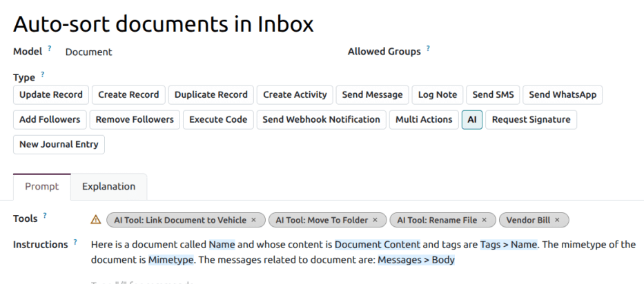

.. meta::
   :description: Use Odoo AI in automated workflows. Learn how to trigger AI agents automatically
                 and how AI server actions evaluate records and select tools to execute, with a
                 document sorting example and guidance on choosing the right approach.

=================
AI server actions
=================

.. |AI| replace:: :abbr:`AI (artificial intelligence)`

Odoo |AI| can be used in automated workflows in two ways: an automated or scheduled action can
trigger an |AI| agent to perform a task, or an AI server action can make decisions and select tools
to execute within a workflow.

These approaches serve different purposes:

- *AI agent triggers*: Summon a configured :doc:`agent <agents>` to perform a task based on its
  instructions, Skills, and Sources.
- *AI server actions*: Use |AI| to interpret a prompt, evaluate a record, and select an appropriate
  server action to execute.

Trigger an AI agent
-------------------

An |AI| agent can be launched interactively by a user through an AI chat or triggered automatically
as part of an Odoo workflow.

To configure an automatic trigger, open the agent and navigate to the *Trigger* tab. Click
:icon:`add` :guilabel:`Add`. On the *When should your agent be triggered?* pop-up, choose one of the
following options:

- *On a schedule*: Run the agent automatically according to a set frequency.
- *Based on a Date Field*: Run the agent once per record when a specific date is reached.
- *After creation*: Run the agent whenever a new record is created.
- *After update*: Run the agent whenever a specified field is updated.

Configure the additional options for the selected trigger, then save the agent.

.. tip::
   For long-running tasks, such as extensive web searches, use a scheduled trigger rather than an
   immediate, event-driven trigger. This allows the task to run in the background instead of
   blocking the user interface while the operation executes.

When the trigger conditions are met, the agent executes the instructions using its configured
Skills, Tools, and Sources.

.. important::
   Agents triggered automatically perform their tasks directly, without requesting user approval
   before creating or updating records. Configure the agent's instructions and available tools
   carefully, particularly when the workflow can modify important business data.

How AI server actions work
--------------------------

|AI| server actions extend Odoo's automation framework by allowing |AI| to make decisions during a
workflow. They are useful when a task requires interpreting information or selecting an appropriate
action, but the actual execution should remain controlled by standard server actions.

AI-driven workflows use two components: *the Manager* and *the Worker*.

AI server action: the manager
~~~~~~~~~~~~~~~~~~~~~~~~~~~~~

An |AI| server action acts as a decision-maker, or Manager. It:

- Reads the record and its context.
- Interprets the AI prompt.
- Selects an appropriate tool.
- Provides the arguments required by the selected tool.

The Manager does not enforce business rules or execute the underlying operation itself. Its role is
limited to deciding which tool to call and what arguments to provide.

.. _ai/server-actions/tools:

AI tool: the worker
~~~~~~~~~~~~~~~~~~~

A *Tool* is a standard server action configured for use by |AI|. To make a server action available
as a tool, enable the *Use in AI* option in its *Usage* tab.

Tools contain the execution logic and perform operations such as updating records, moving documents,
or writing data.

The tool must enforce any required business rules in its own execution logic. When called by the
server action, it executes without requesting additional user approval, unless its code explicitly
prevents the operation.

AI server action workflow
~~~~~~~~~~~~~~~~~~~~~~~~~

The |AI| server action workflow follows this sequence:

#. A record triggers an |AI| server action.
#. The server action evaluates the prompt using the record as context.
#. The server action selects an available tool.
#. The server action supplies the arguments required by the tool.
#. The tool executes its configured logic.

.. important::
   |AI| server actions do not automatically enforce business rules or validate whether an operation
   is appropriate. The server action must contain the necessary checks and safeguards. If a server
   action is called, its execution logic runs unless the code itself prevents the operation.

Use case: Sort documents in the Inbox
-------------------------------------

The *Auto-sort documents in Inbox* example demonstrates the full |AI| Server Action pattern.
Navigate to the *Server Actions* menu by going to :menuselection:`Settings --> Technical --> Server
Actions`. Then search for `Auto-sort documents in Inbox`.

.. note::
   This server action is designed to review documents for their content and add tags. The action
   itself does **not** move documents or add tags. It only decides which tool should be used, based
   on the documents' content.

   The :guilabel:`Model` for the action is listed as *Document*, and the :guilabel:`Type` is *AI*.

The prompt for this action provides context about the document, as well as the intent of the action.

The :guilabel:`Tools` field includes several actions that may be taken based on this prompt,
including moving a document, adding tags, or creating invoices or bills.

.. note::
   *AI Tool: Link Document to Vehicle*, *AI Tool: Move to Folder*, and *AI Tool: Rename File* are
   all *Execute Code* server actions, meaning they trigger Python code.

For example, if the action determines, based on the content of the document, that the most
appropriate tool is *AI Tool: Move to Folder*, the Python code performs the following operation:

.. code-block:: python

   ai['result'] = record._ai_action_move_in_folder(folder_id)

This code executes unconditionally when called and performs the move using an existing method.

.. note::
   The |AI| does not infer arguments from the Python code or from the method signature. Instead,
   arguments passed to a tool are determined entirely by the tool's configuration.

   For the *AI: Move to Folder* tool, the Python code expects a variable named `folder_id`. The |AI|
   knows to provide `folder_id` because it is explicitly declared as an argument in the
   configuration. This can be found on the *Usage* tab of the server action, in the :guilabel:`AI
   Schema` field. The :guilabel:`Name` column under *AI Schema* must match the variable name used in
   the Python code exactly.

   The |AI| uses the argument description to understand what the parameter represents, what type of
   value is expected, and when it is appropriate to supply it.

   If an argument is not defined in the Usage tab, the AI cannot provide it, even if the Python code
   references it.

Creating custom AI tools
------------------------

The same pattern in the *Auto-sort documents in Inbox* example above can be implemented using
standard Odoo logic. For example, to create an action that can update a task description, an
*Execute Code* action could be created with the following code:

.. code-block:: python

    record.write({'description': content})

To make the action available to an AI server action:

#. Open the server action's Usage tab.
#. Enable *Use in AI*.
#. Define an argument named `content` in the |AI| Schema.
#. Provide a description explaining what content the server action should supply.
#. Save the server action.

Choose the right approach
-------------------------

Both |AI| agent triggers and |AI| server actions use |AI| in automated workflows, but the
appropriate choice depends on the task.

Use an |AI| agent trigger when:

- The task requires a specialized agent with configured instructions, Skills, and Sources.
- The agent needs to perform a flexible or multi-step task.
- The task should run automatically or on a schedule.
- The agent needs to evaluate information and determine how to complete a task.

Use an |AI| server action when:

- The task requires |AI| to interpret a prompt and select from a defined set of tools.
- The operation has a specific execution method and defined arguments.
- |AI| needs to make a decision within an existing server action workflow.
- The execution logic should be handled by standard server actions or custom Python code.

.. seealso::
   :ref:`Server Actions <reference/actions/server>`
