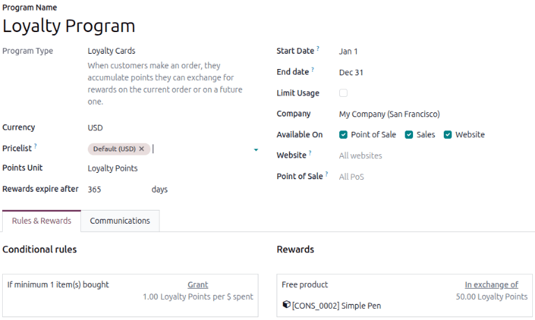

.. meta::
   :description: Configure discount and loyalty programs in Odoo Sales, Subscriptions, eCommerce,
                 and Point of Sale, including program types, conditional rules, and rewards, to
                 offer customers varied and time-sensitive pricing beyond standard pricelists.

=============================
Discount and loyalty programs
=============================

The Odoo **Sales**, **Subscriptions**, **eCommerce**, and **Point of Sale** applications allow users
to create discount and loyalty programs that customers can use for online and in-store shopping.
These programs offer more varied, public, and time-sensitive pricing options than :doc:`pricelists
</applications/sales/sales/products_prices/prices/pricing>`.

.. _sales/loyalty_discount/configure-settings:

Configure the settings
======================

To begin using discount and loyalty programs, navigate to :menuselection:`Sales --> Configuration
--> Settings`. Under the :guilabel:`Pricing` heading, activate the :guilabel:`Promotions, Loyalty &
Gift Card` setting by checking the box next to the feature. Finally, click :guilabel:`Save` to save
the changes.

.. _sales/loyalty_discount/configure-programs:

Configure discount and loyalty programs
=======================================

To create discount and loyalty programs, go to :menuselection:`Sales --> Promotions --> Discount &
Loyalty`. From this screen, a discount & loyalty program can be created from scratch, or one of
seven templates may be chosen as a starting point. Templates include:

- :guilabel:`Promotional Program`: A promotion where a discount of 10% is automatically granted on
  orders over $50.
- :guilabel:`Promo Code`: A promotion with a code for 10% off select products.
- :guilabel:`Buy X, Get Y`: A promotion to buy 2 products and get the 3rd for free.
- :guilabel:`Next Order Coupon`: A promotion where a coupon with a discount valid on the next
  purchase is sent after an order is completed.
- :guilabel:`Loyalty Card`: A promotion where customers earn points with each purchase that can be
  exchanged for gifts.
- :guilabel:`Coupon`: A promotion to generate and share unique coupon codes with customers.
- :guilabel:`Fidelity Card`: A promotion where customers who buy 10 products over time get a
  discount on their 11th purchase.

New programs can be created by clicking the :guilabel:`New` button. Existing programs can be edited
by selecting them. Creating or editing a program opens the program form.

The program form typically contains the following fields. The options available may vary depending
on the :ref:`Program Type <sales/loyalty_discount/program-types>` selected and the applications
installed in the database.

- :guilabel:`Program Name`: Enter the name of the program in this field. The program name is **not**
  visible to the customer.
- :guilabel:`Type`: Select the desired :ref:`program type <sales/loyalty_discount/program-types>`
  from the drop-down menu.
- :guilabel:`Limit Usage`: If desired, select this checkbox, and enter a number of
  :guilabel:`usages` to limit the number of times the program's benefits can be used.
- :guilabel:`Availability Dates`: Select the date from which the program is available.

Additional fields may appear in the program form depending on which apps are installed to the
database and if the form is for a new program or an existing one. Other commonly encountered fields
include:

- :guilabel:`For`: Specify one or more pricelists for this loyalty program to apply to. When a
  single loyalty program is linked to several pricelists, it makes it viable for different customer
  segments to have different pricelists, but the *same* loyalty programs. If this field is left
  blank, the program is applied to everyone, regardless of pricelist.
- :guilabel:`Type`: Enter the name of the points used for the :guilabel:`Loyalty Card` program (e.g.
  `Loyalty Points`). Points unit names are visible to the customer. This field is **only** available
  when the :guilabel:`Program Type` is set to :guilabel:`Loyalty Card`.
- :guilabel:`Points Validity`: Set the number of days before earned points expire. Setting this
  field to 0 ensures points have no expiration date.

All of the existing cards, codes, coupons, etc. that have been generated for the program are
accessible through the smart button located at the top of the form. Loyalty card history lines
display a date on which points expire. Customers can see point expiration dates in their portals.
When customers use points, the soonest-to-expire points are used first. Expired points do not count
towards a card's balance.

.. _sales/loyalty_discount/program-types:

Program types
-------------

The different :guilabel:`Program Types` available on the program form are:

- :guilabel:`Coupons`: Generate and share single-use coupon codes that grant immediate access to
  rewards.
- :guilabel:`Loyalty Cards`: When making purchases, the customer accumulates points to exchange for
  rewards on current and/or future orders.
- :guilabel:`Promotions`: Set conditional rules for ordering products, which, when fulfilled, grant
  access to rewards for the customer.
- :guilabel:`Discount Code`: Set codes which, when entered upon checkout, grant discounts to the
  customer.
- :guilabel:`Buy X Get Y`: for every (X) item bought, the customer is granted 1 credit. After
  accumulating a specified amount of credits, the customer can trade them in to receive (Y) item.
- :guilabel:`Next Order Coupons`: Generate and share single-use coupon codes that grant access to
  rewards on the customer's next order.

.. _sales/loyalty_discount/conditional-rules:

Conditional rules
-----------------

Next, configure the :guilabel:`Conditional rules` that determine when the program applies to a
customer's order. In the *Rules & Rewards* tab, click :guilabel:`+ Add a rule` under
:guilabel:`Conditional rules` to add *rules* to the program. This opens the *Create Conditional
rules* pop-up window.

The following options are available for configuring conditional rules. The options available in this
window may change depending on the program type, the apps installed to the database, and other
factors:

- :guilabel:`Discount Code`: Enter a custom code to be used for the :guilabel:`Discount Code`
  program, or use the default one generated by Odoo. This field is only available when the
  :guilabel:`Program Type` is set to :guilabel:`Discount Code`.
- :guilabel:`Minimum Quantity`: Enter the minimum number of products that must be purchased in order
  to access the reward. Set the minimum quantity to at least `1` to ensure that the customer must
  make a purchase in order to access the reward.
- :guilabel:`Minimum Purchase`: Enter the minimum amount (in currency), with :guilabel:`tax
  included` or :guilabel:`tax excluded`, that must be spent in order to access the reward. If both a
  minimum quantity *and* minimum purchase amount are entered, then the customer's order must meet
  both conditions.
- :guilabel:`Products`: Select the specific product(s) for which the program applies. Leave this
  field blank to apply it to all products.
- :guilabel:`Categories`: Select the category of products for which the program applies. Choose
  :guilabel:`All` to apply it to all product categories.
- :guilabel:`Product Tag`: Select a tag to apply the program to products with that specific tag.
- :guilabel:`Grant`: Enter the number of points the customer earns :guilabel:`per order`,
  :guilabel:`per currency spent`, or :guilabel:`per unit paid` (for the :guilabel:`Loyalty Cards`
  and :guilabel:`Buy X Get Y` programs).

Click :guilabel:`Save & Close` to save the rule and close the pop-up window, or click
:guilabel:`Save & New` to save the rule and immediately create a new one. Click :guilabel:`Discard`
to close the window without saving changes.

.. _sales/loyalty_discount/rewards:

Rewards
-------

In the *Rules & Rewards* tab of the program form, click :guilabel:`+ Add a reward` next to
:guilabel:`Rewards` to add *rewards* to the program. This reveals the *Create Rewards* pop-up
window.

The following options are available for configuring rewards. The options available in this window
may change depending on the program type, the apps installed to the database, and other factors:

- :guilabel:`Reward Type`: Select the reward type among :guilabel:`Free Product`,
  :guilabel:`Discount`, and :guilabel:`Free Shipping`. The other options for reward configuration
  depend on the :guilabel:`Reward Type` selected.

  - :guilabel:`Free Product`:

    - :guilabel:`Quantity Rewarded`: Select the number of free products rewarded to the customer.
    - :guilabel:`Product`: Select the product given for free as a reward. Only one product can be
      selected.
    - :guilabel:`Product Tag`: Select a tag to further specify the free product eligible for the
      reward.

  - :guilabel:`Discount`:

    - :guilabel:`Discount`: Enter the discounted amount in either :guilabel:`%`, :guilabel:`$`, or
      :guilabel:`$ per point`. Then, select whether the discount applies to the entire
      :guilabel:`Order`, the :guilabel:`Cheapest Product` on the order, or only :guilabel:`Specific
      Products`. If :doc:`developer mode </applications/general/developer_mode>` is active, the
      reward can be set to apply to the :guilabel:`Cheapest Product` in a specific domain (for
      example, the cheapest t-shirt when there are multiple types of clothing in a sales order).
    - :guilabel:`Max Discount`: Enter the maximum amount (in currency) that this reward may grant as
      a discount. Leave this field at `0` for no limit.

  - :guilabel:`Free Shipping`:

    - :guilabel:`Description on order`: Enter the description that appears on the order form when
      this discount is applied.
    - :guilabel:`Max Discount`: Enter the maximum amount (in currency) that this reward may grant as
      a discount. Leave this field at `0` for no limit.

Settings
--------

Additional program options are available under the *Settings* tab.

- :guilabel:`Available On`: Set the apps that this loyalty program is available on.
- :guilabel:`Website`: Select a website on which the program is available. If this field is left
  blank, this program is available on all websites.
- :guilabel:`Point of Sale`: Select the points of sale at which the program is available. If this
  field is left blank, this program is available at all :abbr:`PoS (Point of Sale)` stations.
- :guilabel:`Company`: Choose the company for which this program is available, if working in a
  multi-company database. If this field is left blank, the program is available to all companies in
  the database.
