.. meta::
   :description: This page explains how to enable, create, and edit pricelists in the Odoo Sales
                 app, and how to add price rules that apply a discount, surcharge, or fixed price,
                 including rules for product packaging. It also describes the pricelist rule logic
                 Odoo uses to prioritize rules.

==========
Pricelists
==========

A *pricelist* is a method of dynamic pricing that applies a list of prices (or price rules) that
overrides the sales price on a product's form. This adjustment can be set to apply to all products
sold or tailored to only apply to specific customers, customer groups, sales orders, time periods,
etc., and is useful for creating pricing strategies and optimizing sales margins.

Odoo **Sales** has a useful pricelist feature that can be tailored to fit any unique pricing
strategy. Pricelists suggest certain prices, but they can always be overridden on the sales order.

.. seealso::
   - :doc:`currencies`
   - :doc:`../../../../websites/ecommerce/configuration/prices`
   - :doc:`../../../subscriptions`

.. _sales/products/pricelist-configuration:

Configuration
=============

To enable pricelists in the Odoo **Sales** app, first navigate to :menuselection:`Sales app -->
Configuration --> Settings`. In the *Pricing* section, enable the checkbox next to the
:guilabel:`Pricelists` feature, and click :guilabel:`Save` to save all changes.

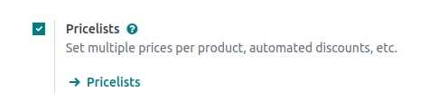

Access the *Pricelists* page by either clicking the :icon:`oi-arrow-right` :guilabel:`Pricelists`
link (beneath the :guilabel:`Pricelists` feature on the *Settings* page), or navigating to
:menuselection:`Sales app --> Products --> Pricelists`.

Either option reveals the *Pricelists* page, in which pricelists can be created and modified at any
time.

.. important::
   If there is no specific pricelist configured on a sales quotation, the :guilabel:`Default`
   pricelist is applied. The :guilabel:`Default` pricelist is the first pricelist found in
   :menuselection:`Sales app --> Products --> Pricelists` without an assigned :guilabel:`Country
   Group`. Odoo reads the :guilabel:`Pricelist Name` column from top to bottom to determine the
   :guilabel:`Default` pricelist.

.. note::
   The :guilabel:`Selectable` column is only applicable to Odoo **eCommerce**. This option allows
   website visitors to choose a pricelist when shopping in the **eCommerce** website.

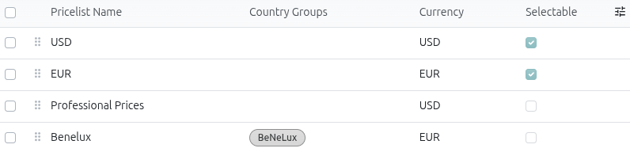

.. _sales/products/create-edit-pricelists:

Creating and editing pricelists
-------------------------------

From the *Pricelists* page, either select the pricelist to edit or click :guilabel:`New` to create a
new pricelist, which reveals a blank pricelist form that can be configured to suit the business's
needs.

#. **Add the name**: Click the blank field at the top of the form and enter the name.
#. **Choose the type of currency**: Click and select an option from the :guilabel:`Currency` field
   to use as a basis for all pricing in the pricelist. This field displays when :doc:`multiple
   currencies <../../../../finance/accounting/get_started/multi_currency>` are enabled in the
   database.
#. **Optional: Select a company**: If working in a :doc:`multi-company environment
   <../../../../general/companies/multi_company>`, select which company this pricelist should apply
   to in the :guilabel:`Company` field. If this field is left blank, the pricelist is automatically
   applied to all companies in the database.
#. **Optional: Select countries**: To limit the pricelist to certain countries, select the countries
   or country groups in the :guilabel:`Country Groups` field. Odoo then applies the pricelist
   automatically based on the customer's location.

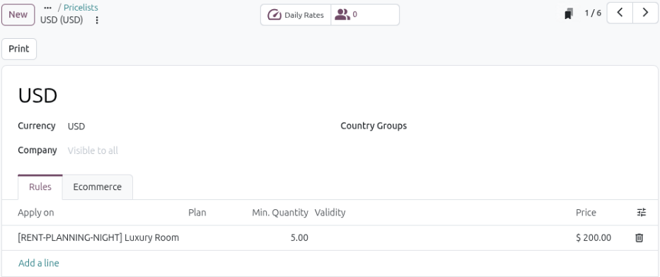

.. _sales/products/price-rules:

Adding price rules
------------------

In the *Rules* tab, each line creates specific pricing rules. When the pricelist is used on a sales
order, Odoo applies those rules to calculate the prices. This can be used to create complex pricing
structures, such as progressive discounts when greater quantities of a product are purchased.

To create a new price rule, click :guilabel:`Add a line`, which opens a *Create Pricelist Rules*
pop-up form.

1. **Select and configure the price type**: In the :guilabel:`Apply` field, select one of the
   following options to configure how the price is adjusted:

   - :ref:`Discount <sales/pricing/discount>`: Applies a percentage rate discount based on sales
     price or a pricelist.
   - :ref:`Surcharge <sales/pricing/surcharge>`: Applies an additional percentage fee based on sales
     price, cost, or a pricelist.
   - :ref:`Fixed Price <sales/pricing/fixed-price>`: Sets a flat sales price per unit.

   .. important::
      If a price rule is set for a specific product, and another one for its product category, Odoo
      prioritizes the *product* rule and applies it.

#. **Optional: Select a category or product**: Choose an option from either the :guilabel:`Category`
   or :guilabel:`Product` drop-down menus. If one field is assigned, then the other field becomes
   disabled. If left blank, the pricelist rule applies to all products or categories in the
   database.

   .. important::
      If a product doesn't have an assigned category, then it is not included in the :guilabel:`All
      categories` option.

#. **Optional: Select a recurrence plan**: If the price rule is part of a subscription, in the
   :guilabel:`Recurring Plan` field drop-down menu, select a recurrence period. The default
   selections are :guilabel:`Monthly`, :guilabel:`6 Months`, or :guilabel:`Weekly`. New recurrence
   periods can also be created from this field by clicking :guilabel:`Search more` and clicking
   :guilabel:`Create New`.
#. **Assign a Minimum Quantity**: If the price rule is only applied when a specific number of a
   product is ordered, enter the amount in the :guilabel:`Minimum Quantity` field. The default
   amount is `0`.

   .. note::
      For creating price rules for products that come in packs, refer to the
      :ref:`sales/pricing/packaging-price-rules` section.

#. **Optional: Set validity dates**: If the price rule is only valid on specific dates, such as a
   limited-time sale, enter the start and end dates in the :guilabel:`Validity Period` field during
   which this pricelist can be applied to quotations.
#. **Configure company settings**: If in :ref:`Developer Mode <developer-mode/activation>`, the
   *Create Pricelist Rules* pop-up form displays a :ref:`sales/pricing/company-settings` section
   with additional fields.

Once all configurations are complete, either click :guilabel:`Save & Close` to save the pricelist
rule, or click :guilabel:`Save & New` to immediately create another pricelist rule on a fresh form.

.. seealso::
   :doc:`../../../subscriptions`

.. _sales/pricing/packaging-price-rules:

Configuring price rules for packaging
~~~~~~~~~~~~~~~~~~~~~~~~~~~~~~~~~~~~~

To create a price rule for a pack of products, the package units must be configured on the product
form and a product must be selected in the :guilabel:`Product` field on the price rule. The price
entered for the price rule applies to an individual unit, either the *Sales Price* configured on the
product form or the *Fixed Price* on the price rule, not the package as a whole. Odoo
auto-calculates the package price using it.

To configure a price rule for a product package unit, :ref:`create a price rule
<sales/products/price-rules>`, then configure the :guilabel:`Minimum Quantity` field. The field
defaults to the assigned :abbr:`UoM (Unit of Measure)` configured on the selected product. Click the
unlabeled *Units* field, then select one of the packaging options from the drop-down menu.

.. example::
   A can of beer is set to $10, so a six-pack of beer is $60.

.. _sales/pricing/discount:

Configuring a discount
~~~~~~~~~~~~~~~~~~~~~~

.. important::
   If a pricelist is applied to a sales quotation with the :guilabel:`Apply` field set to
   :guilabel:`Discount`, the discount is visible to the customer.

To configure a percentage discount, follow these steps:

1. Select :guilabel:`Discount` for the :guilabel:`Apply` field.
#. Enter the percentage to be discounted in the :guilabel:`Discount` field. A markup can be
   configured by using a negative value in this field.
#. Select the base price Odoo uses to calculate the discount percentage. The default is
   :guilabel:`sales price`, which refers to the *Sales Price* field on the product form. Click into
   the field to select a pricelist or :ref:`create a new one <sales/products/price-rules>` from the
   drop-down menu.
#. **Optional**: Enter a value for the :guilabel:`Round off to` field. This field rounds the price
   to the nearest multiple of this value and is applied *after* the discount.
#. **Optional**: Enter a price for the :guilabel:`Add` field. The price is added to the amount (or
   subtracted, if negative) calculated with the discount.
#. **Optional**: Enter the minimum amount of margin over the base price in the :guilabel:`Margins`
   fields.

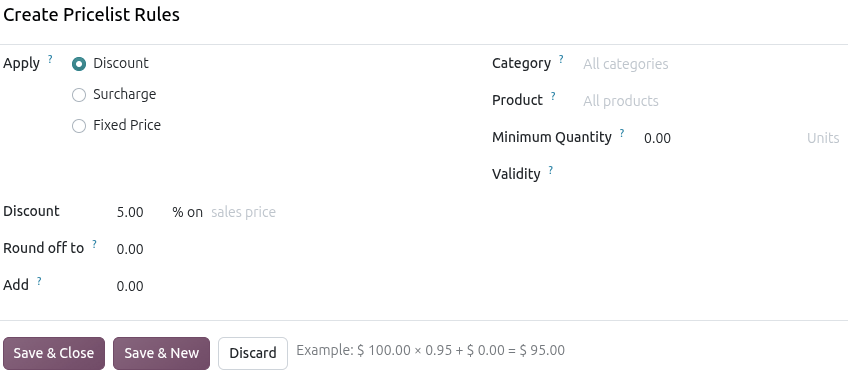

.. _sales/pricing/surcharge:

Configuring a surcharge
~~~~~~~~~~~~~~~~~~~~~~~

.. important::
   If a pricelist is applied to a sales quotation with the :guilabel:`Apply` field set to
   :guilabel:`Surcharge`, the surcharge is *not* visible to the customer.

To configure a percentage surcharge, follow these steps:

1. Select :guilabel:`Surcharge` for the :guilabel:`Apply` field.
#. Enter the percentage to be added in the :guilabel:`Surcharge` field.
#. Select the base price option Odoo uses to calculate the surcharge percentage: :guilabel:`Sales
   Price`, :guilabel:`Cost` (both pulled from the product form), or :guilabel:`Other Pricelist`.
#. **Optional**: Enter a value for the :guilabel:`Round off to` field. This field rounds the price
   to the nearest multiple of this value and is applied *after* the surcharge.
#. **Optional**: Enter a price for the :guilabel:`Add` field. The price is added to the amount (or
   subtracted, if negative) calculated with the surcharge.
#. **Optional**: Enter the minimum amount of margin over the base price in the :guilabel:`Margins`
   fields.

.. tip::
   A negative surcharge becomes a discount. To have prices that end in 9.99, set the
   :guilabel:`Round off to` value to `10` and the :guilabel:`Add` to `-0.01`.

.. _sales/pricing/fixed-price:

Configuring a fixed price
~~~~~~~~~~~~~~~~~~~~~~~~~

To configure a :guilabel:`Fixed Price`, enter the new value in the :guilabel:`Fixed Price` field.
This value overrides the *Sales Price* value on a product form. The :guilabel:`Fixed Price` value is
applied per unit. When applied to a quotation, the *Unit Price* for the order line uses the
:guilabel:`Fixed Price` value.

.. note::
   For a package, the :guilabel:`Fixed Price` field is for an individual unit in the package, not
   the package as a whole. Refer to the :ref:`sales/pricing/packaging-fixed-price` use case as an
   example.

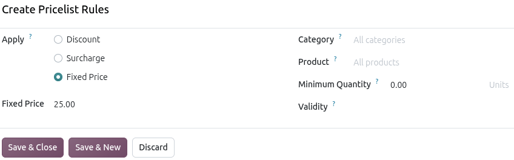

.. _sales/pricing/company-settings:

Company settings
~~~~~~~~~~~~~~~~

When in :ref:`Developer Mode <developer-mode/activation>`, the *Create Pricelist Rules* pop-up form
displays a *Company Settings* section. The section has the following configuration options:

- :guilabel:`Currency`: Assign a currency for the individual price rule.
- :guilabel:`Company`: Assign a company for the individual price rule.

Once all configurations are complete, either click :guilabel:`Save & Close` to save the advanced
pricelist rule, or click :guilabel:`Save & New` to save changes and immediately create another
advanced pricelist rule on a fresh form.

.. _sales/pricing/daily-rate-members:

Daily rates and members
-----------------------

At the top of the *Pricelists* page, there are two smart buttons: :guilabel:`Daily Rates` and
:guilabel:`Members`:

- :guilabel:`Daily Rates`: Daily Rates allows users to apply price rules to specific days using a
  calendar view. This feature allows users to quickly assign price rules for specific days of the
  week or seasons.
- :guilabel:`Members`: Members allows users to assign the pricelist to specific contacts or partners
  within the database.

.. _sales/pricing/daily-rate:

Create a new daily rate
~~~~~~~~~~~~~~~~~~~~~~~

A date can have more than one daily rate configured on it. For dates with multiple daily rates,
:ref:`Odoo pricelist logic<sales/pricing/logic>` applies.

To create daily rates for a pricelist, follow these steps:

1. Click the :guilabel:`Daily Rates` smart button.
#. Click on a date or click and drag to select multiple dates on the calendar.

   - To select multiple non-consecutive dates, press and hold the :kbd:`Ctrl` key and click the
     desired dates.

#. Click :guilabel:`Add` at the top of the calendar.
#. In the pop-up window, configure the price rule for the selected dates.

   .. image:: pricing/daily-rate-form.png
      :alt: The Price rule pop-up window to add a daily rate in Odoo Sales.

#. Click :guilabel:`Add` to save the change.

Once a price rule has been added, it appears on the calendar dates showing the price type and
product or category selected. On the pricelist's page, the price rules appear as individual line
items in the *Rules* tab.

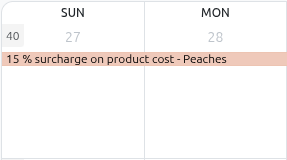

To move a price rule to a different date, click and drag the price rule banner to the desired date
on the calendar. To edit or delete a price rule on a specific date:

1. Click the existing price rule on the preferred date.
#. Click :guilabel:`Edit` or :guilabel:`Delete`.

   - Choosing :guilabel:`Edit` opens the price rule pop-up window.
   - Choosing :guilabel:`Delete` triggers a confirmation window; click :guilabel:`Delete` to confirm
     the change.

.. _sales/pricing/members:

Add a member
~~~~~~~~~~~~

.. important::
   Members **cannot** be added to the default pricelist in the database. Odoo designates the
   pricelist at the top of the *Pricelists* page as the default pricelist for the database.

To add a contact or partner to the pricelist, follow these steps:

1. Click the :guilabel:`Members` smart button.
#. Click :guilabel:`New` to open a blank contact form.
#. In the :guilabel:`Name` field, click and type the name of an existing contact and select it or
   :doc:`create a new one <../../../../essentials/contacts>`.

Another way to do this is through the :ref:`customer contact form
<sales/pricing/customer-pricelist-application>`.

.. _sales/pricing/logic:

Pricelist rule logic
====================

Odoo automatically selects a pricelist for a quotation when none has been manually assigned. It
checks the pricelists in the order they appear on the *Pricelists* page, from top to bottom, and
applies the first one whose conditions match the quotation's details.

When multiple pricelist rules apply to the same product on the same pricelist, Odoo determines
priority using this order:

1. :ref:`Most specific to least specific <sales/pricing/most-to-least-specific>`: More specific
   rules take priority over general ones.
#. :ref:`Minimum quantity (largest first) <sales/pricing/minimum-quantity>`: The higher quantity
   thresholds take priority over lower ones.
#. :ref:`Category order <sales/pricing/category-order>`: Manually configured category hierarchy
   breaks remaining ties, with the subcategory taking priority over the parent category.
#. :ref:`Creation date (newest first) <sales/pricing/creation-date>`: The most recently created rule
   takes priority if all else is equal.

.. _sales/pricing/most-to-least-specific:

1. Most specific to least specific
----------------------------------

A rule on a specific variant always takes priority over a broader rule, so a special price for one
variant overrides a general category discount.

1. **Product variant**: Applies to the selected variant of the product.
#. **Product**: Applies to all variants of a product.
#. **Subcategory**: Applies to all products within the subcategory.
#. **Parent category**: Applies to all products in the parent category.
#. **All products**: Applies to all products within the database.
#. **All categories**: Applies to all products with an assigned category. This doesn't include
   uncategorized products.

.. _sales/pricing/minimum-quantity:

2. Minimum quantity (largest first)
-----------------------------------

If the product specificity is the same, then rules with a higher minimum quantity take priority over
rules with a lower (or no) minimum. This keeps bulk-pricing rules (e.g., 10 units) from being
overridden by a generic rule that also matches.

.. _sales/pricing/category-order:

3. Category order
-----------------

If rules have the same specificity and same minimum quantity, Odoo uses the manually configured
category hierarchy, meaning the sequence is set on the categories themselves.

.. _sales/pricing/creation-date:

4. Creation date (newest first)
-------------------------------

If everything else is equal, the most recently created rule takes priority. This allows newer rules
to override older ones with identical conditions, which is useful when rules are updated or replaced
without deleting the old ones immediately.

.. _sales/pricing/customer-pricelist-application:

Customer-specific pricelists
============================

Another way to add a member to a pricelist is through the customer's contact form. When a customer
is added to the database, the *Default* pricelist is automatically applied to the *Pricelist* field
on their contact form. Even if the field is left blank during :ref:`contact creation
<contacts/contact-form>`, the *Default* pricelist is automatically assigned when that contact form
is opened again.

To assign a specific pricelist to a customer, go to :menuselection:`Sales app --> Orders -->
Customers` and select the customer from the *Customers* page, or click the customer's name on a
sales order.

On the customer's contact form, click the *Sales & Purchase* tab. In the *Sales* section, select a
pricelist using the :guilabel:`Pricelist` field drop-down menu.

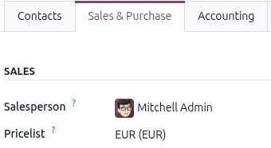

When the customer is added to a quotation, the *Pricelist* field is auto-populated based on the
information from their contact form. Users can manually change the pricelist using the *Pricelist*
field on the quotation.

.. _sales/pricing/price-type-use-cases:

Price type use cases
====================

- :ref:`sales/pricing/discount-use-cases`
- :ref:`sales/pricing/surcharge-use-cases`
- :ref:`sales/pricing/fixed-price-use-cases`

.. _sales/pricing/discount-use-cases:

Discount use cases
------------------

The *Discount* price type is used when doing simple discount calculations on a product's sales price
or when using another pricelist as the base value.

Seasonal discount pricelist
~~~~~~~~~~~~~~~~~~~~~~~~~~~

A retail store holds a yearly summer sale. The sale is 25% off all summer dresses.

Navigate to :menuselection:`Sales app --> Products --> Pricelists` and select an existing pricelist
or click :guilabel:`New` to create a new one.

On the pricelist form, click :guilabel:`Add a line` to open the *Create Pricelist Rules* pop-up
window.

Configure the form using the following settings:

- :guilabel:`Apply`: Select :guilabel:`Discount`.
- :guilabel:`Category`: Select *Summer dresses* from the drop-down menu.
- :guilabel:`Discount`: Enter `25` and for the :guilabel:`% on` field, leave the default
  :guilabel:`sales price`.
- :guilabel:`Validity`: Select :guilabel:`Range` and set the date range from `July 1` to `Aug 31`.

Click :guilabel:`Save & Close` to add the pricelist rule to the pricelist.

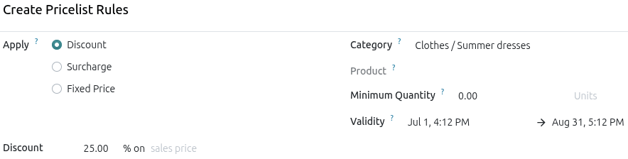

20% discounts with prices rounded up to $9.99
~~~~~~~~~~~~~~~~~~~~~~~~~~~~~~~~~~~~~~~~~~~~~

A grocery store is having a flash sale on their chicken products in the butcher section. All the
chicken meat products are on sale for 20% off and rounded to 9.99.

Navigate to :menuselection:`Sales app --> Products --> Pricelists` and select an existing pricelist
or click :guilabel:`New` to create a new one.

On the *Create Pricelist Rules* pop-up window, follow these settings:

- :guilabel:`Apply`: Select :guilabel:`Discount`.
- :guilabel:`Category`: Select *Meat/Chicken* from the drop-down menu.
- :guilabel:`Discount`: Enter `20` and for the :guilabel:`% on` field, leave the default
  :guilabel:`sales price`.
- :guilabel:`Round off to`: Enter `10`.
- :guilabel:`Add`: Enter `-0.01`.

Click :guilabel:`Save & Close` to add the pricelist rule to the pricelist.

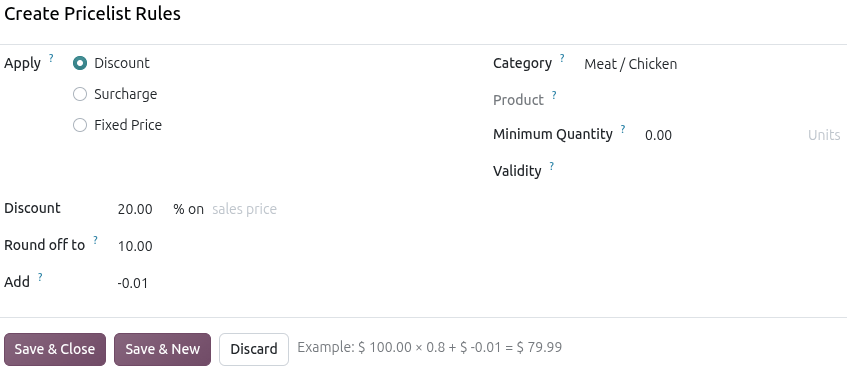

.. _sales/pricing/surcharge-use-cases:

Surcharge use cases
-------------------

The *Surcharge* price type is another way to add fees to the :guilabel:`Sales Price` or
:guilabel:`Cost` of a product. Using a surcharge price rule is useful for recovering specific,
fluctuating operational costs without permanently raising the :guilabel:`Sales Price` or
:guilabel:`Cost`, or adjusting prices for months when sales are historically high.

Applying a 15% markup on cost
~~~~~~~~~~~~~~~~~~~~~~~~~~~~~

A farmer wants to add a fee on their peaches to cover some unexpected costs for labor. The farmer
adds a 15% markup on the cost of peaches. The wholesale price for a pound of peaches is $4.50 and
the cost is $2.00 per pound.

First, navigate to :menuselection:`Sales app --> Products --> Pricelists` and select an existing
pricelist or click :guilabel:`New` to create a new one.

On the *Create Pricelist Rules* pop-up window, follow these settings:

- :guilabel:`Apply`: Select :guilabel:`Surcharge`.
- :guilabel:`Product`: Select *Peaches* from the drop-down menu.
- :guilabel:`Surcharge`: Enter `15` and select :guilabel:`Cost` from the :guilabel:`% on` drop-down
  menu.
- :guilabel:`Validity`: Select :guilabel:`Range` and select `May 1` to `Dec 30`.

Click :guilabel:`Save & Close` to add the pricelist rule to the pricelist.

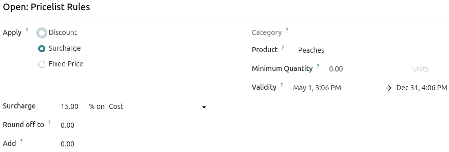

Then create a quotation for a pound of peaches and select the desired pricelist from the
:guilabel:`Pricelist` drop-down menu.

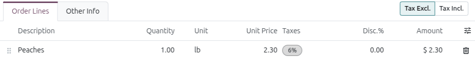

.. seealso::
   :doc:`../../sales_quotations/margin`

Applying a 10% markup on sales price
~~~~~~~~~~~~~~~~~~~~~~~~~~~~~~~~~~~~

A shoe store has increased sales targets for the year, and the company decided to add an additional
10% to the sales price of their rain boots. The wholesale price for the rain boots is $40.

Navigate to :menuselection:`Sales app --> Products --> Pricelists` and select an existing pricelist
or click :guilabel:`New` to create a new one.

On the *Create Pricelist Rules* pop-up window, follow these settings:

- :guilabel:`Apply`: Select :guilabel:`Surcharge`.
- :guilabel:`Product`: Select *Rain boots* from the drop-down menu.
- :guilabel:`Surcharge`: Enter `10` and for the :guilabel:`% on` field, leave the default
  :guilabel:`Sales Price`.

Click :guilabel:`Save & Close` to add the pricelist rule to the pricelist.

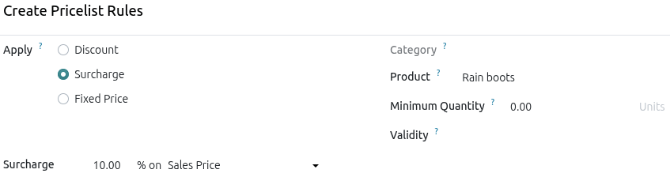

.. _sales/pricing/fixed-price-use-cases:

Fixed price use cases
---------------------

The *Fixed Price* price type is useful when applying flat rate pricing. The following are scenarios
where flat rate pricing is applicable:

- Store-wide clearance sales.
- Configuring pricing for different units of packaging.

Flat sales price for a subcategory
~~~~~~~~~~~~~~~~~~~~~~~~~~~~~~~~~~

A sports store is having a sale on all their fishing lures. All the lures are only $9.99 during the
sale.

Navigate to :menuselection:`Sales app --> Products --> Pricelists` and select an existing pricelist
or click :guilabel:`New` to create a new one.

On the *Create Pricelist Rules* pop-up window, follow these settings:

- :guilabel:`Apply`: Select :guilabel:`Fixed Price`.
- :guilabel:`Category`: Select *Fishing/Lures* from the drop-down menu.
- :guilabel:`Fixed Price`: Enter `9.99`.

Click :guilabel:`Save & Close` to add the pricelist rule to the pricelist.

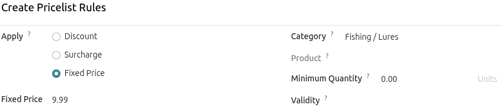

.. _sales/pricing/packaging-fixed-price:

Set different product packaging prices
~~~~~~~~~~~~~~~~~~~~~~~~~~~~~~~~~~~~~~

A wine and liquor store sells beer for $4 per can. Next month, it will sell the beer in three
different packages: four-pack, six-pack, and twelve-pack.

The store intends to offer discounts based on volumetric pricing, with prices for each pack being
the following:

- Four-pack is $12
- Six-pack is $15
- Twelve-pack is $24

Navigate to :menuselection:`Sales app --> Products --> Pricelists` and select an existing pricelist
or click :guilabel:`New` to create a new one.

On the *Create Pricelist Rules* pop-up window, follow these settings:

- :guilabel:`Apply`: Select :guilabel:`Fixed Price`.
- :guilabel:`Product`: Select *Beer* from the drop-down menu.

To set the packaging:

- :guilabel:`Minimum Quantity`: Select :guilabel:`Pack of 4` from the :guilabel:`Units` drop-down
  menu.
- :guilabel:`Fixed Price`: Enter `3`.

Click :guilabel:`Save & New` to add the pricelist rule to the pricelist and start a new one.

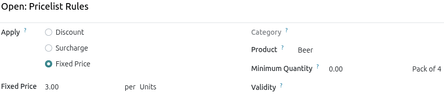

For the second pricelist rule, select the same options except for:

- :guilabel:`Minimum Quantity`: Select :guilabel:`Pack of 6` from the :guilabel:`Units` drop-down
  menu.
- :guilabel:`Fixed Price`: Enter `2.50`.

Click :guilabel:`Save & New` to add the pricelist rule to the pricelist, and in the last pricelist
rule form, repeat the same options except for:

- :guilabel:`Minimum Quantity`: Select :guilabel:`Pack of 12` from the :guilabel:`Units` drop-down
  menu.
- :guilabel:`Fixed Price`: Enter `2`.

Click :guilabel:`Save & Close` to add the pricelist rule to the pricelist. The pricelist should now
have three pricelist rules for all the package types.

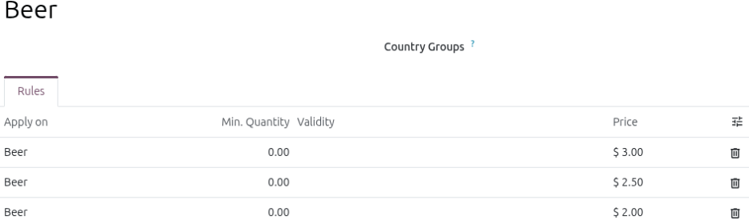

.. seealso::
   - :doc:`../../sales_quotations/margin`
   - :doc:`discounts`
