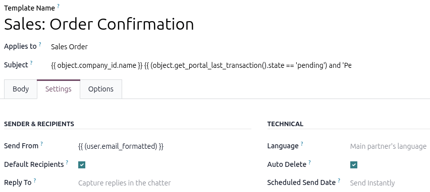
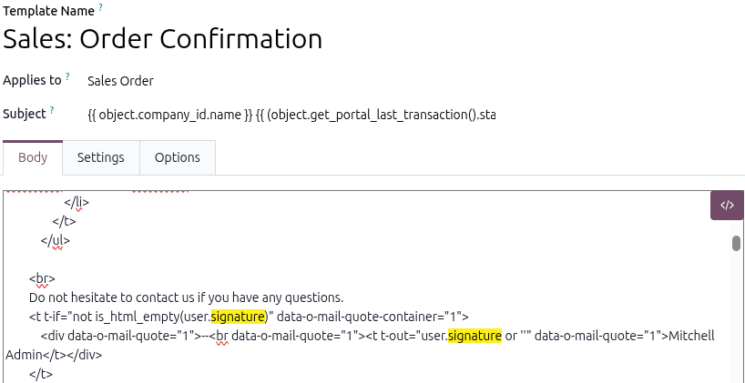

.. meta::
   :description: This page explains how to customize email template signatures so outgoing emails
                 display the contact information of the employee responsible for customer follow-up,
                 rather than the employee associated with the sales order for commission purposes.
                 It covers updating the Send From field in the Settings tab and replacing
                 object.user_id.signature with user.signature in the email body code.

=======================
Custom email signatures
=======================

Some business workflows require email template signatures to be updated so outgoing communications
display the appropriate contact information for customer follow-up and correspondence.

This is particularly important when responsibility for a customer opportunity is shared between team
members. In these cases, the employee responsible for managing quotes and customer communications
may differ from the employee associated with the sales order for commission purposes.

By default, email templates use the signature of the employee assigned to the record. Modify the
template to show the contact information of the employee responsible for customer follow-up, so
customers know who to contact with questions, approvals, and other correspondence.

.. note::
   The `Sales: Order Confirmation` email template is used as the example throughout this article to
   demonstrate how email signatures can be customized.

Open the email template
=======================

To modify an email template, first :ref:`activate developer mode <developer-mode/activation>`, then
navigate to :menuselection:`Settings app --> Technical --> Email Templates`. Click the email
template to modify. For this example, it is the `Sales: Order Confirmation` template.

Update the code for the sender
==============================

On the email template, open the *Settings* tab. Delete the default text in the :guilabel:`Send From`
field and replace it with: `{{ (user.email_formatted) }}`.

Modify the code for the email body text
=======================================

To modify the code in the email body text, follow these steps:

#. Click the *Body* tab.
#. Highlight some text so the toolbar is visible.
#. Click the :icon:`oi-ellipsis-v` :guilabel:`(Expand toolbar)` icon, then click the :icon:`fa-code`
   :guilabel:`(Code view)` icon.
#. Search the code for `signature` to find the two instances of the code `object.user_id.signature`.
#. Replace both `object.user_id.signature` instances with `user.signature`.

.. tip::
   If a user has not set up their email signature, the company name can be displayed instead of the
   default `Mitchell Admin` signature.

   To do this, search for `Mitchell Admin` in the code, and replace it with the company name.
