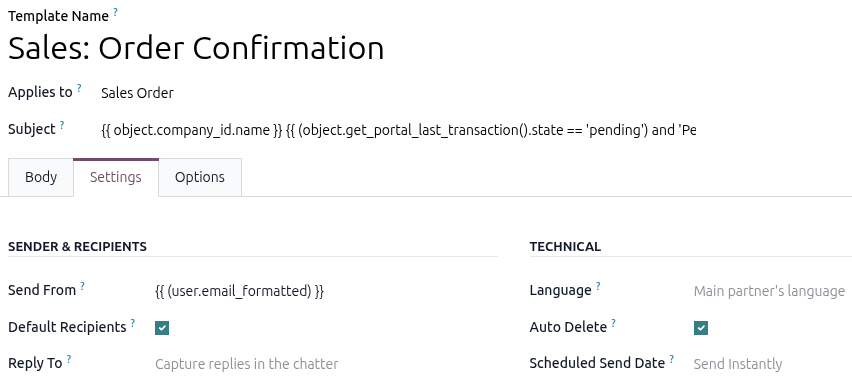
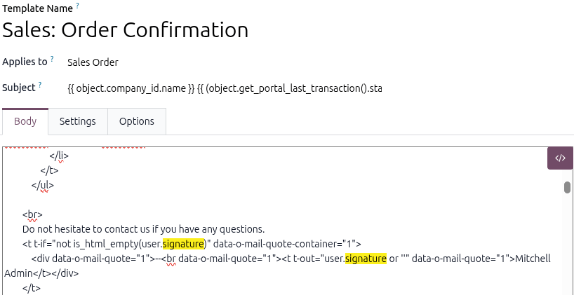

.. meta::
   :description: This page explains how to customize email template signatures so outgoing emails
                 display the contact information of the employee responsible for customer follow-up,
                 rather than the employee associated with the sales order for commission purposes.
                 It covers updating the Send From field in the Settings tab and replacing
                 object.user_id.signature with user.signature in the email body code.

=======================
Custom email signatures
=======================

Some business workflows email template's signature needs updating so customers see the right contact
for follow-ups. This is matters when sales team members share responsibility for a customer
opportunity. For example, one employee may handle quotes and customer communications, while another
is linked to the sales order for commission.

By default, email templates use the signature of the employee assigned to the record. However, the
email template can be customized to dynamically fill in the contact information of the employee
sending the follow-up email, so customers know who to contact with questions, approvals, and other
correspondence.

.. note::
   The `Sales: Order Confirmation` email template is used as the example throughout this article to
   demonstrate how email signatures can be customized.

Open the email template
=======================

To modify an email template, first :ref:`activate developer mode <developer-mode/activation>`, then
navigate to :menuselection:`Settings app --> Technical --> Email Templates`. Click the email
template to modify. For this example, it is the `Sales: Order Confirmation` template.

Modify the sender
=================

On the email template, open the *Settings* tab. Delete the default text in the :guilabel:`Send From`
field and replace it with: `{{ (user.email_formatted) }}`.

Modify the email signature
==========================

To modify the signature in the email body text, follow these steps:

#. Click the *Body* tab.
#. Highlight some text so the toolbar is visible.
#. Click the :icon:`oi-ellipsis-v` :guilabel:`(Expand toolbar)` icon, then click the :icon:`fa-code`
   :guilabel:`(Code view)` icon.
#. Search for `signature` to find the two instances of `object.user_id.signature`.
#. Replace both instances of `object.user_id.signature` with `user.signature`.

.. tip::
   If a user has not set up their email signature, the default signature uses `Mitchell Admin` as a
   placeholder. To display the company name instead, search for `Mitchell Admin` in the code, and
   replace it with the company name.

.. seealso::
   :doc:`../../../general/companies/email_template`
