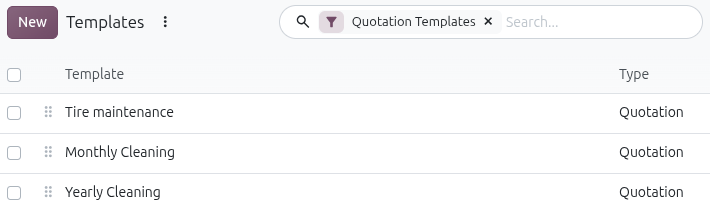
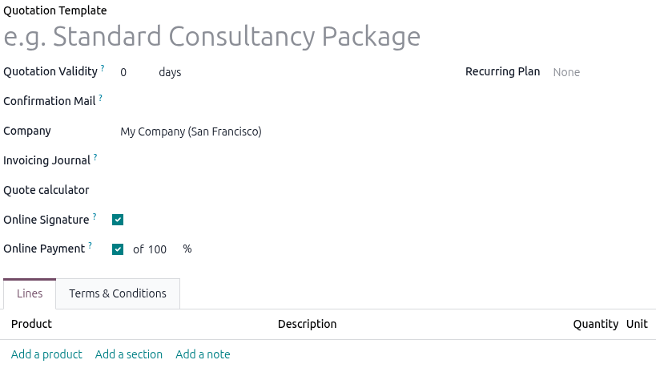
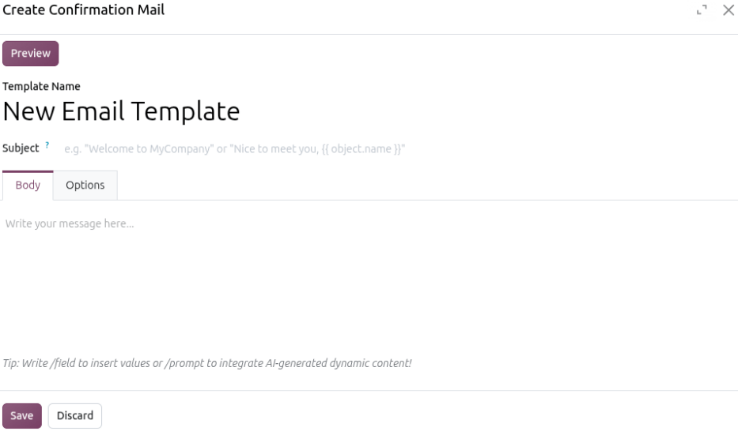
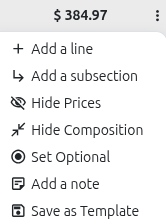
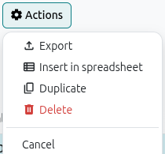

.. meta::
   :description: Create quotation and section templates in the Odoo Sales app, from scratch or from
                 an existing quotation, and configure their terms and settings. Apply templates to
                 quotations, preview them in the customer portal, and cancel multiple quotations at
                 once.

.. _quote-calculator: https://youtu.be/W_0-gUc87WI?si=GMIuIMXP9-lOPtob

===============================
Quotation and section templates
===============================

Quotation and section templates are reusable building blocks for quotations in Odoo's **Sales** app.
A quotation template prefills an entire quotation. A section template prefills one section of a
quotation.

Use templates for products or services that are sold often. Templates let salespeople send tailored
quotations faster, without building each quotation from scratch.

Both template types are permanently enabled features in the **Sales** app. No settings need to be
activated before creating them.

.. _sales/quote_template/create_templates:

Create a quotation or section template
======================================

Create a quotation or section template by going to :menuselection:`Sales app --> Configuration -->
Templates`. The *Templates* page displays, where quotation and section templates can be created,
viewed, and edited.

Click :guilabel:`New` to open a blank template form. Fill in the fields described in the following
list, then :ref:`add products to the template <sales/quote_template/product>`:

- :guilabel:`Template`: The name of the template.
- :guilabel:`Type`: Set the template type to :guilabel:`Quotation` or :guilabel:`Section`. The
  :guilabel:`Quotation` option is the default.
- :guilabel:`Quote calculator`: Links to a new or existing spreadsheet that performs complex
  calculations for the template. When a spreadsheet is selected, a :guilabel:`Quote calculator`
  smart button displays on the sales quotation form.
- :guilabel:`Share`: Makes the template accessible to specific sales teams. Select which teams can
  access it in the :guilabel:`Sales Team` field. Leave blank to make it visible to all database
  users.
- :guilabel:`Company`: Restricts the template to one company in a :doc:`multi-company environment
  <../../../general/companies/multi_company>`.

Section templates have only the *Lines* tab. The *Terms & Conditions*, *Quote Builder*, and
*Settings* tabs are available only on quotation templates.

In the *Lines* tab, three kinds of lines can be added. Products are added by clicking :guilabel:`Add
a product` or :guilabel:`Catalog`. Sections are added by clicking :guilabel:`Add a section` and
organize products under headers. Notes are added by clicking :guilabel:`Add a note` and hold extra
information such as warranty details or terms.

.. _sales/quote_template/product:

Add a product
-------------

Add a product to a template by clicking :guilabel:`Add a product` in the *Lines* tab and selecting
the product. Templates do not support combo products due to the product variations the combo
requires.

To add a product, follow these steps:

1. Click :guilabel:`Add a product`. A blank field appears in the :guilabel:`Product` column.
#. Type the product name in the :guilabel:`Product` field, then select the product from the
   drop-down menu.
#. Edit the :guilabel:`Quantity` field if needed. The default quantity is `1`.
#. To reorder the line, drag the :icon:`drag_indicator` :guilabel:`(six-squares)` icon on the left
   side of the line to the desired position.

To add several products at once, click :guilabel:`Catalog` instead of :guilabel:`Add a product`. On
the :ref:`Product catalog <essentials/product_catalog/database-record>` page, select multiple
products and quantities, and click :guilabel:`Back to Template` to return to the template.

.. tip::
   It is possible to add event-related products (booths and registrations) to quotation templates.
   To do so, click the :guilabel:`Product` field, type in `Event`, and select the desired
   event-related product from the resulting drop-down menu.

.. _sales/quote_template/section:

Add sections to a quotation or section template
-----------------------------------------------

Add a section to a template by clicking :guilabel:`Add a section` in the *Lines* tab and typing the
section name. A section is a header that groups the lines of a quotation. In a section template, an
added section becomes a subsection.

To add a section, follow these steps:

1. Click :guilabel:`Add a section`. A blank field appears.
#. Type the section name and, if needed, a description. Click outside the field to save it.
#. To reorder the section, drag the :icon:`drag_indicator` :guilabel:`(six-squares)` icon on the
   left side of the line to the desired position.
#. :ref:`Add products <sales/quote_template/product>` below the section header to include them in
   the section.

The section header can set the quantity and unit for every product in the section at once. Enter the
new values in the :guilabel:`Quantity` and :guilabel:`Unit` fields on the section header line. Odoo
updates the :guilabel:`Quantity` and :guilabel:`Unit` fields of every product in that section
automatically.

Configuration options in the section header drop-down menu
~~~~~~~~~~~~~~~~~~~~~~~~~~~~~~~~~~~~~~~~~~~~~~~~~~~~~~~~~~

More section configuration options are available from the :icon:`fa-ellipsis-v` :guilabel:`(vertical
ellipsis)` icon on the section header line. The following list describes the drop-down menu options:

- :icon:`fa-plus` :guilabel:`Add a line`: Adds a product line to the section.
- :icon:`subdirectory_arrow_right` :guilabel:`Add a subsection`: Adds a section inside the current
  section.
- :icon:`fa-eye-slash` :guilabel:`Hide Prices`: Shows the product list and section subtotal, but
  hides individual product prices on the customer portal and on the quotation or sales order PDF. A
  :icon:`fa-eye-slash` :guilabel:`(Hide Prices)` icon appears on the section header. To disable it,
  select :icon:`fa-eye` :guilabel:`Show Prices` from the same menu.
- :icon:`fa-compress` :guilabel:`Hide Composition`: Shows only the section header and subtotal and
  hides the products on the customer portal and on the quotation or sales order. Products appear
  grayed out on the template, and a :icon:`fa-compress` :guilabel:`(Hide Composition)` icon appears
  on the section header. To disable it, select :icon:`fa-expand` :guilabel:`Show Composition` from
  the same menu.
- :icon:`fa-dot-circle-o` :guilabel:`Set Optional`: Turns the section into an :ref:`optional
  products section <sales/optional_products/sections>`. A :icon:`fa-dot-circle-o` :guilabel:`(Set
  Optional)` icon appears on the section header. To disable it, select :icon:`fa-dot-circle-o`
  :guilabel:`Unset Optional` from the same menu.
- :icon:`fa-sticky-note-o` :guilabel:`Add a note`: :ref:`Adds a note <sales/quote_template/note>`
  inside the section.
- :icon:`fa-arrow-up` :guilabel:`Move Up`: Moves the section and its contents up one line.
- :icon:`fa-arrow-down` :guilabel:`Move Down`: Moves the section and its contents down one line.
- :icon:`fa-clone` :guilabel:`Duplicate`: Copies the section and its contents directly below the
  original section.
- :icon:`delete` :guilabel:`Delete`: Removes the section and every product and note inside it.

.. seealso::
   - :doc:`optional_products`

.. _sales/quote_template/note:

Add notes to a template
-----------------------

Add a note to a template by clicking :guilabel:`Add a note` in the *Lines* tab and typing the text.
A note appears on the quotation as text for the customer.

To add a note, follow these steps:

1. Click :guilabel:`Add a note`. A blank field appears.
#. Type the note, then click outside the field to save it.
#. To reorder the note, drag the :icon:`drag_indicator` :guilabel:`(six-squares)` icon on the left
   side of the line to the desired position.

.. _sales/quote_template/delete:

Delete a line from a template
-----------------------------

Delete any product, section, or note from the *Lines* tab by clicking the :icon:`delete`
:guilabel:`(remove record)` icon on the far-right side of that line. Deleting a section also deletes
every product and note inside it.

.. _sales/quote_template/terms-conditions:

Add Terms & Conditions to a quotation template
----------------------------------------------

Add terms and conditions to a quotation template by typing them in the *Terms & Conditions* tab of
the template form. Use the tab for contractual points, such as returns and refunds, warranty, and
after-sale services.

Terms and conditions are optional. A quotation template can be saved without them. The *Terms &
Conditions* tab is not available on section templates.

For company-wide terms that apply to every quotation, see the Odoo documentation on :doc:`default
terms and conditions <../../../finance/accounting/customer_invoices/terms_conditions>`.

.. _sales/quote_template/quote-builder:

Use the PDF quote builder in a quotation template
-------------------------------------------------

.. important::
   The *Quote Builder* tab requires the :ref:`PDF Quote builder
   <sales/pdf_quote_builder/configuration>` setting. If the setting is not enabled, the tab does not
   appear on the quotation template form. The tab is not available on section templates.

The *Quote Builder* tab :ref:`assigns specific headers and footers to a quotation template
<pdf_quote_builder/add_pdf_quotes/add-to-quote-template>`. Those headers and footers are available
on a quotation only when the quotation template is applied to it.

.. _sales/quote_template/settings:

Configure quotation template settings
-------------------------------------

The *Settings* tab of a quotation template controls how quotations are confirmed and which journal
invoices them. The tab has a *Confirmation* and an *Invoicing* section. The *Settings* tab is not
available on section templates.

The following list describes the fields in the *Confirmation* section:

- :guilabel:`Quotation Validity`: The number of days the quotation template is valid. The default
  value of `0` keeps the template valid indefinitely.
- :guilabel:`Online Signature`: A global setting that applies to all sales orders. It requests an
  online signature from the customer to confirm an order, even if *Online Signature* isn't enabled
  on the **Sales** *Settings* page.
- :guilabel:`Prepayment`: A global setting that applies to all sales orders. It sets the percentage
  of the sales order total that the customer must pay before the order is confirmed. It allows
  online payment, even if *Online Payment* isn't enabled on the Sales *Settings* page.

  .. note::
     :guilabel:`Online Signature` and :guilabel:`Prepayment` can be enabled at the same time. When
     both are enabled, the customer must sign **and** pay to confirm an order.

- :guilabel:`Confirmation Mail`: The email template sent to the customer when an order is confirmed.
  Select an existing email template or :ref:`create a new one
  <sales/quote_template/create-confirmation-mail>`.

In the *Invoicing* section, the :guilabel:`Invoicing Journal` field sets the journal that invoices
every sales order from the quotation template. If the field is empty, Odoo uses the sales journal
with the lowest sequence.

.. _sales/quote_template/create-confirmation-mail:

Create a confirmation email template from a quotation template
~~~~~~~~~~~~~~~~~~~~~~~~~~~~~~~~~~~~~~~~~~~~~~~~~~~~~~~~~~~~~~

Create a confirmation email template directly from the quotation template by typing a new name in
the :guilabel:`Confirmation Mail` field. The field is in the *Confirmation* section of the quotation
template's *Settings* tab.

To create the confirmation email template, follow these steps:

1. In the :guilabel:`Confirmation Mail` field, type the name of the new email template.
#. From the drop-down menu, select either :guilabel:`Create` or :guilabel:`Create and edit`.

   - Selecting :guilabel:`Create` saves the email template immediately. It can be edited later.
   - Selecting :guilabel:`Create and edit` saves the email template and opens the *Create
     Confirmation Mail* pop-up window, where the email template can be configured.
#. Click :guilabel:`Save & Close` to save the email template and return to the quotation template
   form.

.. _sales/quote_template/section-templates:

Create a template from an existing quotation or sales order
-----------------------------------------------------------

Create a quotation template from an existing quotation or sales order with the :guilabel:`Save as
template` action. Create a section template from an existing section with the :guilabel:`Save as
Template` option on the section header line.

Save a quotation or sales order as a quotation template
~~~~~~~~~~~~~~~~~~~~~~~~~~~~~~~~~~~~~~~~~~~~~~~~~~~~~~~

1. In the **Sales** app, open the desired quotation or sales order from the *Quotations* dashboard.
#. Click the :icon:`fa-ellipsis-v` :guilabel:`Actions` icon at the top of the form.
#. Select :guilabel:`Save as template`.
#. Configure the :guilabel:`Template` name, :guilabel:`Type`, :guilabel:`Quote calculator`, and
   :guilabel:`Share` fields.

Save a section as a section template
~~~~~~~~~~~~~~~~~~~~~~~~~~~~~~~~~~~~

1. Go to :menuselection:`Sales app --> Orders`, select :guilabel:`Quotations` or :guilabel:`Orders`,
   and open the desired quotation or sales order.
#. On the section header line, click the :icon:`fa-ellipsis-v` :guilabel:`(vertical ellipsis menu)`
   icon on the right side.
#. Select :icon:`fa-save` :guilabel:`Save as Template`. Odoo saves the section as a section template
   with the same name as the section.

A section template can be saved even if the section contains no products. Any subsections or notes
inside the section are saved with the template.

To find a section template, go to :menuselection:`Sales app --> Configuration --> Templates`. In the
search bar, delete the :guilabel:`Quotation Templates` filter to display all template types.

.. _sales/quote_template/use-templates:

Use a template on a quotation
=============================

Apply a quotation template by clicking :guilabel:`New` on the *Quotations* dashboard and selecting a
template from the drop-down menu. Apply a section template by clicking :guilabel:`Add a section` on
a quotation and selecting the section template from the drop-down menu.

The quotation templates in the :guilabel:`New` drop-down menu appear in the same order as on the
*Templates* page. The order of the templates on the *Templates* page does **not** affect anything
else.

Preview a quotation in the customer portal
------------------------------------------

Preview the quotation as the customer sees it by clicking the :guilabel:`Preview` button at the top
of the quotation. The preview shows the quotation on the front-end of the website, through Odoo's
customer portal.

To return to the quotation, click the :icon:`apps` :guilabel:`(Apps)` icon to open the Odoo home
page. Go to :menuselection:`Sales app --> Orders --> Quotations` and select the desired quotation.

.. _sales/quote_templates/mass-cancel:

Cancel multiple quotations or sales orders at once
==================================================

Cancel several quotations or sales orders at once by selecting them in the *Quotations* list view
and choosing :menuselection:`Actions --> Cancel`. Quotations can be canceled at any stage, including
after they are confirmed as sales orders.

To cancel multiple quotations or sales orders, follow these steps:

1. Go to :menuselection:`Sales app --> Orders --> Quotations`. The dashboard opens in list view by
   default.
#. In the search bar, remove the :guilabel:`My Quotations` filter.
#. Click the search bar and select the :guilabel:`Quotations` filter, the :guilabel:`Sales Orders`
   filter, or both.
#. Select the checkbox on the left side of each record to cancel. To select every record in the
   table, select the checkbox in the column header. The number of selected records appears at the
   top of the page.
#. Click the :icon:`fa-cog` :guilabel:`Actions` button, then select :guilabel:`Cancel`.
#. In the *Cancel* confirmation pop-up window, click :guilabel:`Cancel`.

   The :guilabel:`Cancel` option on the :guilabel:`Actions` drop-down menu to cancel multiple sales
   quotations.

Cancellation fails for an order that belongs to an ongoing subscription with an invoice. In that
case, Odoo displays an error pop-up message.

.. seealso::
   - :doc:`get_signature_to_validate`
   - :doc:`get_paid_to_validate`
   - `Tutorial: Quote Calculator Basics <quote-calculator_>`_
