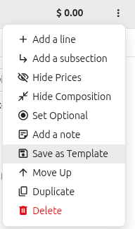

.. _quote-calculator: https://youtu.be/W_0-gUc87WI?si=GMIuIMXP9-lOPtob

=============================
Quotation & section templates
=============================

Reusable quotation and section templates can be made in Odoo's **Sales** app for common products or
services.

By using these templates, quotations can be tailored and sent to customers at a quicker pace,
without having to create new quotations from scratch every time a sales negotiation occurs.

.. _sales/quote_template/create_templates:

Create quotation and section templates
======================================

.. important::
   Section templates only have the *Lines* tab. All other tabs listed in this section are available
   for the quotation templates.

Quotation and section templates are permanently enabled features in the **Sales** app. To create
either template, navigate to :menuselection:`Sales app --> Configuration --> Templates`. The
*Templates* page displays, where quotation and section templates can be created, viewed, and edited.

.. image:: quote_template/quotation-templates-page.png
   :alt: Quotation templates page in the Odoo Sales application.

Click the :guilabel:`New` button, located in the upper-left corner. Doing so reveals a blank
template form that can be customized. To create a new template, configure the following fields:

.. image:: quote_template/blank-quotation-form.png
   :alt: Create a new quotation template on Odoo Sales.

#. :guilabel:`Template`: Enter the name of the template.
#. :guilabel:`Type`: Choose either :guilabel:`Quotation` or :guilabel:`Section` option from the
   drop-down menu. The :guilabel:`Quotation` option is the default.
#. :guilabel:`Quote calculator`: If necessary, create or select an existing spreadsheet to do
   complex calculations for the template.

   .. important::
      The :guilabel:`Quote calculator` field is only available for quotation templates.

#. :guilabel:`Share`: Enable the checkbox to make the template accessible to specific sales teams.
   Select which teams can access it in the :guilabel:`Sales Team` field.
#. :guilabel:`Company`: If working in a :doc:`multi-company environment
   <../../../general/companies/multi_company>`, use this field to designate to which company can
   access the template.

.. _sales/quote_template/lines-tab:

Lines tab
---------

In the :guilabel:`Lines` tab, products can be added to the quotation or section template by clicking
:guilabel:`Add a product` or :guilabel:`Catalog`, organized by clicking :guilabel:`Add a section`
(and dragging/dropping section headers), and further explained with discretionary information (such
as warranty details, terms, etc.) by clicking :guilabel:`Add a note`.

.. _sales/quote_template/product:

Add a product
~~~~~~~~~~~~~

.. important::
   Templates to do not support combo products due to the variations the combo requires.

To add a product to a template, do the following steps:

1. Click :guilabel:`Add a product`, doing so reveals a blank field in the :guilabel:`Product`
   column.
#. Type in the name of the product in the :guilabel:`Product` field and the option appears in the
   drop-down menu to select. The default :guilabel:`Quantity` for the product is `1`, but that can
   be edited at any time.

   Products can also added by clicking :guilabel:`Catalog` and selecting multiple products and
   quantities from the :ref:`Product catalog <essentials/product_catalog/database-record>` page.

   .. tip::
      It is possible to add event-related products (booths and registrations) to quotation
      templates. To do so, click the :guilabel:`Product` field, type in `Event`, and select the
      desired event-related product from the resulting drop-down menu.

#. Drag and drop the product to the desired position, via the :guilabel:`six squares` icon, located
   to the left of each line item.

.. _sales/quote_template/section:

Add a section
~~~~~~~~~~~~~

A *section* serves as a header to organize the lines of a sales order. When added to a section
template it serves as a sub-section. To add a *section*, do the following steps:

1. Click :guilabel:`Add a section`. When clicked, a blank field appears.
#. Type the name of the section and click away to save the change.
#. Drag and drop the section name to the desired position, via the :icon:`oi-apps` :guilabel:`(six
   squares)` icon, located to the left of each line item.

.. _sales/quote_template/note:

Add a note
~~~~~~~~~~

A note appears as a piece of text for the customer on the quotation. To add a note, do the following
steps:

1. Click :guilabel:`Add a note`. When clicked, a blank field appears, in which the desired note can
   be typed. When the note has been entered, click away to secure the note.
#. Drag and drop the note to the desired position, via the :icon:`oi-apps` (:guilabel:`six
   squares`)icon.

To delete any line item from the :guilabel:`Lines` tab (product, section, and/or note), click the
:icon:`fa-trash` :guilabel:`(remove record)` icon on the far-right side of the line.

.. _sales/quote_template/terms-conditions:

Terms & Conditions tab
----------------------

The :guilabel:`Terms & Conditions` tab provides the opportunity to add terms and conditions to a
quotation template. To add terms and conditions, type the desired terms and conditions in this tab.

.. seealso::
   :doc:`../../../finance/accounting/customer_invoices/terms_conditions`

.. note::
   Terms and conditions are **not** required to create a quotation template.

.. _sales/quote_template/quote-builder:

Quote Builder tab
-----------------

.. important::
   The :ref:`PDF Quote builder checkbox <sales/pdf_quote_builder/configuration>` must be enabled for
   this tab to become available.

The :guilabel:`Quote Builder` tab allows specific headers and footers to become available when a
quotation template is used on a sales quote. Any headers or footers that are :ref:`assigned to the
template <pdf_quote_builder/add_pdf_quotes/add-to-quote-template>` are not available to use unless
the template is applied.

.. _sales/quote_template/settings:

Settings tab
------------

The :guilabel:`Settings` tab provides extra confirmation and invoicing settings to a quotation
template.

In the *Confirmation* section, the following fields are available:

- :guilabel:`Quotation Validity`: This field designates how many days the quotation template is
  valid for, or leave the field on the default `0` to keep the template valid indefinitely.
- :guilabel:`Online Signature`: Enables the ability to request an online signature from the customer
  to confirm an order for all sales orders, even if *Online Signature* isn't enabled on the
  *Settings* page.
- :guilabel:`Prepayment`: Configures the percentage of sales order's total needed to be paid before
  confirming it.

  .. note::
     Both features, :guilabel:`Online Signature` and :guilabel:`Prepayment`, can be enabled
     simultaneously, in which case the customer must provide **both** a signature **and** a payment
     to confirm an order.

- :guilabel:`Confirmation Mail`: Click the blank drop-down menu to select or :ref:`create a
  preconfigured email template <sales/quote_template/create-confirmation-mail>` to be sent to
  customers upon confirmation of an order.

In the *Invoicing* section, the :guilabel:`Invoicing Journal` field designates all sales orders
using this template are invoiced in the selected journal. If no journal is selected, the sales
journal with the lowest sequence is used.

.. _sales/quote_template/create-confirmation-mail:

Create a confirmation mail template from a template form
~~~~~~~~~~~~~~~~~~~~~~~~~~~~~~~~~~~~~~~~~~~~~~~~~~~~~~~~

To create a new email template directly from the :guilabel:`Confirmation Mail` field, follow these
steps:

1. Type the name of the new email template in the field, and select either :guilabel:`Create` or
   :guilabel:`Create and edit...` from the drop-down menu that appears.

  + Selecting :guilabel:`Create` creates the email template, which can be edited later.
  + Selecting :guilabel:`Create and edit...` creates the email template, and a *Create Confirmation
    Mail* pop-up window appears, in which the email template can be customized and configured
    immediately.

.. image:: quote_template/create-confirmation-mail-popup.png
   :alt: Create confirmation mail pop-up window from the quotation template form in Odoo Sales.

#. When all modifications are complete, click :guilabel:`Save & Close` to save the email template
   and return to the quotation form.

.. _sales/quote_template/section-templates:

Create a section template from a sales quote or order
-----------------------------------------------------

Section templates can also be created from a sales quote or order. Navigate to :menuselection:`Sales
app --> Orders --> Quotations` and :ref:`create a new quote
<sales/create_quotations/create-quotation>` or select an existing one. To save a section as a
template from a sales quotation, follow these steps:

1. :ref:`Add a section <sales/quote_template/section>` and the desired products in the
   :guilabel:`Order Lines` tab.
#. Click the :icon:`fa-ellipsis-v` :guilabel:`Ellipsis` icon on the right side of the section header
   order line to access the drop-down menu.
#. Select the :icon:`fa-save` :guilabel:`Save as Template` option. Odoo saves the section as a
   section template using the name given the section on the sales quote.

.. note::
   Section templates can be saved without any products added in the section.

To find a section template, navigate to :menuselection:`Sales --> Configuration --> Templates`. In
the search bar, delete the :guilabel:`Quotation Templates filter` to display all template types.

.. _sales/quote_template/use-templates:

Use templates
=============

When :ref:`creating a quote <sales/create_quotations/create-quotation>`, click the :guilabel:`New`
button. A drop-down menu displays with all the preconfigured quotation templates to use or edit.

.. note::
   The order of the templates in the :guilabel:`New` button's drop-down menu is determined by the
   order of the templates in the Quotation Templates form. The order of the quotations in the
   Quotation Templates form does **not** affect anything else.

To apply a section template, click :guilabel:`Add a section` and select a template from the
drop-down menu.

To view what the customer sees, click the :guilabel:`Preview` button at the top of the page to see
how the quotation template appears on the front-end of the website through Odoo's customer portal.

When all blocks and customizations are complete, click the :guilabel:`Save` button to save the
configuration.

The blue banner located at the top of the quotation template preview can be used to return
:icon:`fa-arrow-right` :guilabel:`Back to edit mode`. When clicked, Odoo returns to the quotation
form in the back-end of the *Sales* application.

.. _sales/quote_templates/mass-cancel:

Mass cancel quotations/sales orders
===================================

Cancel multiple quotations (or sales orders) by navigating to the :menuselection:`Sales app -->
Orders --> Quotations` dashboard, landing, by default, in the list view.

1. In the search bar, remove the :guilabel:`My Quotations` filter.
#. Click the search bar and select the :guilabel:`Quotations`, :guilabel:`Sales Orders` filters or
   both.
#. On the left side of the table, select the checkboxes for the quotations to be canceled.

   .. tip::
      Select all records in the table by selecting the checkbox column header at the top-left of the
      table; the total number of selected items are displayed at the top of the page.

#. Click the :icon:`fa-cog` :guilabel:`Actions` button to reveal a drop-down menu.
#. Select :guilabel:`Cancel`.

   .. image:: quote_template/cancel-quotations.png
      :alt: The Cancel quotations option on the Actions drop-down menu in the Sales application.

   .. note::
      This action can be performed for quotations in *any* stage, even if it is confirmed as a sales
      order.

#. On the *Cancel quotations* confirmation pop-up window, click the :guilabel:`Cancel quotations`
   button.

   .. note::
      An error pop-up message appears when attempting to cancel an order for an ongoing subscription
      that has an invoice.

.. seealso::
   - :doc:`get_signature_to_validate`
   - :doc:`get_paid_to_validate`
   - `Tutorial: Quote calculator Basics <quote-calculator_>`_

