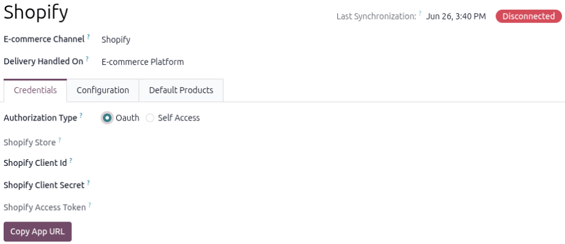
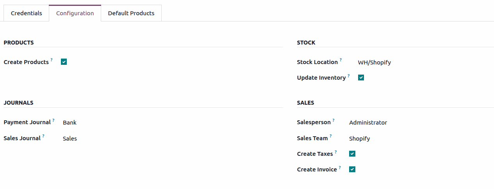
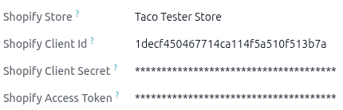

:orphan:
:nosearch:

.. _Odoo-SH: http://odoo.sh/
.. _access-tokens: https://shopify.dev/docs/apps/build/authentication-authorization/access-tokens/generate-app-access-tokens-admin
.. _shopify-account-configuration: https://youtu.be/n0_MO0CWo6s?si=nZMuNXrLjqS248S1
.. _set-up-shopify-connector: https://youtu.be/6SHsfl8gVbk?si=gTvEzvDFInlRafEP

===============================
Shopify Connector configuration
===============================

Odoo allows users to register one or more Shopify stores in the database. Each Shopify store
requires a separate account configuration in Odoo, and orders, products, and inventory are scoped
per connected store.

.. seealso::
   - `Tutorial: Configure a Shopify connector account <shopify-account-configuration_>`_
   - `Tutorial: Set up the Shopify connector <set-up-shopify-connector_>`_

.. _shopify/setup/prerequisites:

Prerequisites
=============

This integration only works with Odoo-SH_ and requires version 19.0 or 20.0. Before configuring the
*Shopify connector*, users need the following:

- A Shopify account
- The **Shopify connector** app
- Odoo **Sales** app (this app auto-installs with the **Shopify connector** app)

.. tip::
   It is recommended to have the Odoo database and Shopify account dashboard in different tabs in
   the same browser for the setup.

.. _shopify/setup/create-account-form:

Create a Shopify account in Odoo
================================

.. important::
   Users must be in :ref:`developer mode <developer-mode>` to configure the Shopify account form.

There are two ways to create a Shopify account in Odoo:

- Using the :ref:`Public app setup <shopify/setup/public-app>` to link the Shopify store to Odoo and
  open a Shopify account in the **Sales** app.
- :ref:`Manually creating an Odoo Shopify account <shopify/setup/manual>` in the **Sales** app and
  creating a custom app in Shopify.

.. _shopify/setup/public-app:

Create an Odoo Shopify account using the Shopify Public app
-----------------------------------------------------------

The Shopify Public app allows users to create a Shopify account in Odoo starting from their Shopify
store. Each store requires going through the Public app process to connect to Odoo. The Public app
is only available in the USA and Canada.

To create a Shopify account in Odoo using the Shopify Public app, follow these steps:

1. Log in to the Shopify store that is to be linked to the **Sales** app.
#. From the navigation panel, click :guilabel:`Apps`.
#. In the pop-up window, click :guilabel:`All recommended apps`.
#. In the *Picked for you* pop-up window, click :guilabel:`Shopify App Store`.
#. In the address bar, delete the URL and paste `https://apps.shopify.com/odoo`, and then hit
   :kbd:`Enter`.
#. Click :guilabel:`Install`, then click :guilabel:`Install` again in the *Install app* pop-up
   window.
#. Select a payment plan and click :guilabel:`Test with this plan`.
#. On the *Approve charge* page, click :guilabel:`Approve`.
#. Copy the URL for the Odoo database landing page, then paste it in the :guilabel:`Odoo Instance
   URL` field, and click :guilabel:`Continue to your Odoo`.

   .. tip::
      It's recommended to have separate tabs open in the same browser, one for Odoo and one for
      Shopify, to make the copy and paste steps easier.

Shopify automatically opens a new browser tab that lands on a blank Shopify account form in the
**Sales** app. Next, :ref:`configure the account form <shopify/setup/manual>` before connecting Odoo
to the Shopify store.

.. _shopify/setup/manual:

Manually create an Odoo Shopify account
---------------------------------------

To create a new Shopify account, navigate to :menuselection:`Sales app --> Configuration -->
Shopify: Accounts`. Alternatively, from the Odoo home page, start typing `Shopify` to open the
:menuselection:`Sales --> Configuration --> Shopify: Accounts` menu item. Then, click
:guilabel:`New`.

On the blank *Shopify account form* page, follow these steps:

1. Choose a name for the account (e.g., American Marketplace).
#. Select :guilabel:`Shopify` for the :guilabel:`E-commerce Channel`.
#. Select an option from the :guilabel:`Delivery Handled On` drop-down menu: :guilabel:`Odoo` or
   :guilabel:`E-commerce Platform`.

To learn more about how each option affects the delivery flow, refer to the
:ref:`shopify/fulfillment/delivery-modes` section on the *Shopify delivery and return management*
page.

.. _shopify/setup/authentication:

Select an authentication method
-------------------------------

If following the Public app setup process, skip this step since the :guilabel:`Public app` option in
the *Credentials* tab is pre-selected. Continue to the *Configuration* tab to :ref:`configure
administrative settings <shopify/setup/administrative-settings>`.

In the *Credentials* tab of the Shopify account form, select an authentication method for the
:guilabel:`Authorization Type` field:

- :guilabel:`Oauth`: Mandatory for stores created on or after January 1, 2026.
- :guilabel:`Self Access`: An admin API Access Token. Stores created before January 1, 2026 can use
  this method.

If using the :guilabel:`Self Access` option, refer to Shopify's `access tokens documentation
<access-tokens_>`_.

If using the :guilabel:`Oauth` option, click the :guilabel:`Copy App URL` button.

.. _shopify/setup/administrative-settings:

Configure administrative settings
---------------------------------

The *Configuration* tab settings can be changed anytime, even while the Shopify account is
connected. All changes are logged in the account form's chatter. These settings control how data is
imported and processed.

Select any of the listed features to configure the administrative settings:

- :guilabel:`Create Products`: Controls what happens when a Shopify product is pulled and no Odoo
  product matches it.

  Odoo always looks for a product whose internal reference equals the Shopify SKU. When
  :guilabel:`Create Products` is enabled, if no match is found, a new Odoo product is created from
  the Shopify data. Once an offer is mapped, its title and Shopify identifiers are refreshed on
  every pull, regardless of this setting. However, the mapped Odoo product itself is not updated
  afterward, since cost, description, weight, barcode, and image are only read when the product is
  first created. When :guilabel:`Create Products` is disabled, the offer is mapped to the default
  :guilabel:`E-commerce Sale` product instead.

  .. important::
     A product must have a SKU in Shopify to be imported into Odoo.

- :guilabel:`Stock Location`: A stock location must be defined and must belong to the selected
  company. If not configured, Odoo automatically creates a dedicated Shopify stock location. In a
  multi-location setup, complete the new Shopify account form and connect to Shopify. Click the
  :icon:`fa-refresh` :guilabel:`Fetch Locations` button in the *Operations* tab to pull all
  locations from Shopify. By default, they are all mapped to the defined default warehouse location,
  and the mapping can be changed as needed.
- :guilabel:`Update Inventory`: When enabled, the scheduled action that pushes inventory from Odoo
  to Shopify runs for this account. If users do not want to push inventory from Odoo to Shopify,
  keep it disabled.
- :guilabel:`Payment Journal` and :guilabel:`Sales Journal`: Journals used to register payments and
  create sales orders during order synchronization. If no existing journal is found, Odoo
  automatically uses one of the journals of the current company.
- :guilabel:`Sales Team` and :guilabel:`Salesperson`: The responsible team and user assigned to
  orders imported from Shopify. If no existing team is found, Odoo automatically creates one and
  assigns it to the account.
- :guilabel:`Create Taxes`: Import taxes from Shopify with the sales order. Odoo tries to find a
  matching tax and creates one if no match exists. If disabled, taxes are determined using the
  order's fiscal position and the product's configured taxes in Odoo.
- :guilabel:`Create Invoice`: Automatically create an invoice and register payment when importing
  paid orders from Shopify. If disabled, the user must manually create the invoice from the sales
  order.

.. _shopify/setup/create-custom-app:

Create a custom app in Shopify
==============================

.. important::
   If following the Shopify Public app process, skip this section and go to the
   :ref:`shopify/setup/connect-shopify-to-odoo` section.

To create a custom app in Shopify, follow these steps:

1. Sign in to an existing admin account, or create a new one.
#. From the Shopify homepage, open the :guilabel:`Settings` menu and select :guilabel:`App
   development`.

   .. image:: setup/shopify-app-development.png
      :alt: Example of using the search bar to find App development.

#. Click :guilabel:`Build app in Dev Dashboard` to open a new tab for the dev dashboard.
#. Click :guilabel:`Create app`, and in the *Start from Dev Dashboard* option, enter the app name
   and click :guilabel:`Create`.
#. On the *Create Version* page, enter the following information in the listed fields:

   - :guilabel:`App URL`: Paste the copied URL from the :ref:`Credentials tab
     <shopify/setup/authentication>` of the Shopify account form.
   - :guilabel:`Embed app in Shopify admin`: Disable this checkbox.
   - :guilabel:`Webhooks API version`: 2026-10

   .. note::
      Check the *Release Notes* page on the Shopify connector's app store page for the latest
      version of the Webhooks API.

   - In the *API access* section, ensure the *Scopes* tab is selected. Then copy the following
     scopes and paste them into the tab:
     `read_assigned_fulfillment_orders,write_assigned_fulfillment_orders,read_customers,write_inventory,read_inventory,read_locations,read_merchant_managed_fulfillment_orders,write_merchant_managed_fulfillment_orders,read_orders,read_products,read_third_party_fulfillment_orders,write_third_party_fulfillment_orders,read_fulfillments,write_fulfillments,read_returns`

   .. image:: setup/shopify-app-config.png
      :alt: Example of a Shopify app with the recommended settings.

#. Click the :guilabel:`Release` button at the top of the page, then click :guilabel:`Release` again
   to release the app with the version name.

.. _shopify/setup/connect-shopify-to-odoo:

Connect Shopify to Odoo
=======================

.. important::
   This process also applies to reconnecting a Shopify app to an existing Shopify account form.

To connect Shopify to Odoo using Shopify's Public app process, click :guilabel:`Connect`.

To connect Shopify to Odoo using Shopify's custom app process:

1. Go to the Shopify app's *Settings* page by clicking :guilabel:`Settings` in the navigation bar.
#. Copy the :guilabel:`Client ID` and :guilabel:`Client Secret` from the *Credentials* section.
#. In the Odoo browser tab, paste these into the :guilabel:`Shopify Client Id` and
   :guilabel:`Shopify Client Secret` fields in the *Credentials* tab.
#. In the Shopify browser tab, click the app's name. Click :guilabel:`Install app`, then, on the new
   page, select the Shopify store to link to Odoo, and click :guilabel:`Install`.

After installing the app in the Shopify store, the page is automatically redirected to the Shopify
account form in Odoo with the *Operations* tab open. Verify that the app is connected by checking
the account connection status in the top-right corner. Click the :guilabel:`Credentials` tab and
confirm that the access token has been fetched in the :guilabel:`Shopify Access Token` field.

.. _shopify/setup/multi-store:

Multi-store and multi-company management
========================================

The **Sales** app supports configuring multiple Shopify stores under the same Odoo company. Each
Shopify store requires a Shopify account form and operates independently, with its own sync
timestamps and configuration. All orders, products, and inventory are scoped per connected Shopify
store. Multi-company environments are supported, with a separate configuration per company.

The only exception is when the same internal Odoo location is synced with more than one Shopify
store location: the Shopify account forms share the same inventory from that Odoo location instead
of having separate inventory scopes.

.. seealso::
   - :doc:`../shopify_connector`
   - :doc:`manage`
   - :doc:`fulfillment`
