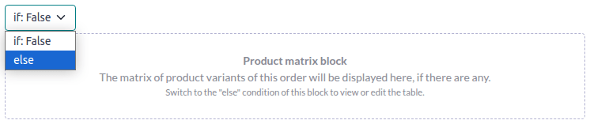
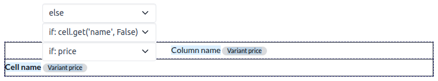
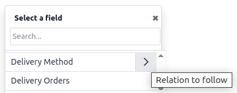
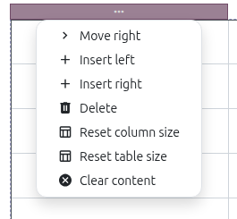

===========
PDF reports
===========

With Studio, you can :ref:`edit existing PDF reports <studio/pdf-reports/edit>` (e.g., invoices,
quotations, etc.) or :ref:`create new ones <studio/pdf-reports/create>`.

.. _studio/pdf-reports/default-layout:

Default layout
==============

The default layout of reports is managed outside Studio. Go to the Settings app then, in
the :guilabel:`Companies` section of the main page, click :guilabel:`Configure Document Layout`.
Layout settings are company-specific but apply to all reports.

.. tip::
   A preview on the right side of the :guilabel:`Configure your document layout` window shows how
   the different settings affect the report layout. When creating or editing a report using Studio,
   display a preview by clicking the :icon:`visibility` :guilabel:`Preview` tab in the left panel.

Use the following settings:

.. _studio/pdf-reports/default-layout-layout:

- :guilabel:`Layout` and :guilabel:`Tables`: Select a document layout and table format independently
  to customize the look of all reports.

.. _studio/pdf-reports/default-layout-font:

- :guilabel:`Text`: Eight fonts are available: Lato, Roboto, Open Sans, Montserrat, Oswald,
  Raleway, Tajawal (which supports Arabic and Latin scripts), and Noto Sans Mono. Go to the `Google
  Fonts website <https://fonts.google.com/>`_ to preview them.

.. _studio/pdf-reports/default-layout-logo:

- :guilabel:`Logo`: Hover over the image and click :icon:`fa-pencil` (:guilabel:`Edit`) to
  upload or change the logo. This adds the logo to the company’s record on the *Company* model,
  which can be accessed via the Settings app by clicking :guilabel:`Update Info` in the
  :guilabel:`Companies` section.

.. _studio/pdf-reports/default-layout-colors:

- :guilabel:`Colors`: Change the primary and secondary colors used to structure reports. The default
  colors are automatically generated based on the colors of the logo.

.. _studio/pdf-reports/default-layout-address:

- :guilabel:`Address`: The company address is displayed in the header of :ref:`external
  reports <studio/pdf-reports/header-footer>`. You can add multiple lines of text.

.. _studio/pdf-reports/default-layout-tagline:

- :guilabel:`Tagline`: This is displayed in the header of :ref:`external reports
  <studio/pdf-reports/header-footer>` using the :guilabel:`Bubble`, :guilabel:`Wave`,
  :guilabel:`Folder`, :guilabel:`Center` and :guilabel:`Compact` layouts and in the footer of
  external reports using the :guilabel:`Light`, :guilabel:`Dual` and :guilabel:`Lines` layouts. You
  can add multiple lines of text.

.. _studio/pdf-reports/default-layout-footer:

- :guilabel:`Footer`: This text is used in the footer of :ref:`external reports
  <studio/pdf-reports/header-footer>`. You can add multiple lines of text. You can also
  edit the footer using the :ref:`report editor <studio/pdf-reports/edit>`.

.. _studio/pdf-reports/default-layout-paper:

- :guilabel:`Paper format`: This defines the default paper size of reports. You can select
  :guilabel:`A4` (21 cm x 29.7 cm) and :guilabel:`US Letter` (21.59 cm x 27.54 cm). This can also be
  defined for individual reports in the :guilabel:`Paper format` field in
  :ref:`Studio <studio/pdf-reports/report-editor-properties>`.

  .. note::
     Other paper formats may be available depending on which apps or modules you have installed, for
     example, label sheets for the Inventory app or event badges for the Events app.

- :guilabel:`Tax ID`: The tax identification number of the company, if applicable. This field
  contains the value of the :guilabel:`Tax ID` field in the company's record on the *Company* model.
  This may be the company's tax identification number, `/` to indicate that the company has no tax
  identification number, or blank. Updating this field updates the value on the company's record,
  and vice versa.

- :guilabel:`Bank Account Number`: The bank account to which the invoice amount should be paid. This
  field contains the :guilabel:`Bank Account Number` indicated in the company's main bank journal.
  Updating this field updates the value in the company's main bank journal, and vice versa.

- :guilabel:`QR Code`: If the company is located in a country for which the :doc:`EPC QR code
  feature <../finance/accounting/customer_invoices/epc_qr_code>` is available, enabling this option
  adds an EPC QR code to invoices. This option can also be updated in
  :menuselection:`Accounting --> Configuration --> Settings`, in the :guilabel:`Customer Payments`
  section.

.. _studio/pdf-reports/create:

Create a new PDF report
=======================

To create a new report for a :doc:`model </applications/studio/models_modules_apps>` access the
model, click the :icon:`oi-studio` (:guilabel:`Toggle Studio`) button, then click
:guilabel:`Reports`. Click :guilabel:`New` and, in the popup window that opens, select the type of
report. This is solely used to determine what is displayed in the header and footer:

.. _studio/pdf-reports/header-footer:

- :guilabel:`External`:

  - The header displays the company's :ref:`logo <studio/pdf-reports/default-layout-logo>` and its
    :ref:`address <studio/pdf-reports/default-layout-address>`. When using the :guilabel:`Bubble`,
    :guilabel:`Wave`, :guilabel:`Folder`, :guilabel:`Center` and :guilabel:`Compact` layouts
    document layouts, the :ref:`tagline <studio/pdf-reports/default-layout-tagline>`, if set, also
    appears in the header.

  - The footer displays the values set in the
    :ref:`Footer <studio/pdf-reports/default-layout-footer>` field and the page number. For
    reports using the :guilabel:`Light`, :guilabel:`Dual` and :guilabel:`Lines` document layouts,
    the :ref:`tagline <studio/pdf-reports/default-layout-tagline>`, if set, also appears in the
    footer.

- :guilabel:`Internal`: The header displays the date and time of the user's local device, the
  company's name and the page number. There is no footer.

- :guilabel:`Blank`: There is neither a header nor a footer. Click in the upper left corner of the
  page to edit the report.

Once you have created the report, you can start :ref:`editing it <studio/pdf-reports/edit-tabs>`.

.. _studio/pdf-reports/edit:

Edit a PDF report
=================

To access the reports available for a model, access the model, click the :icon:`oi-studio`
(:guilabel:`Toggle Studio`) button, then click :guilabel:`Reports`. Select an existing
report to open it.

.. important::
   It is strongly recommended to **duplicate** the standard report and make changes in the
   duplicated version. To duplicate a report, hover over the top right corner of the report, click
   the :icon:`more_vert` (:guilabel:`Dropdown menu`) icon, and then select :guilabel:`Duplicate`.

.. _studio/pdf-reports/edit-tabs:

The report opens in the main view. A panel on the left side contains the following tabs:

- :icon:`edit` :ref:`Editor <studio/pdf-reports/report-editor>`: With this tab selected, modify
  the report's properties and visibility in the left panel, and edit the content and formatting of
  the report in the main view.
- :icon:`fa-eye` :guilabel:`Preview`: Display a preview of the report in the main view. By default,
  the preview shows data from the most recent record; use the :icon:`arrow_forward_ios`
  (:guilabel:`Next`) or :icon:`arrow_back_ios_new` (:guilabel:`Previous`) buttons to navigate
  between previews of the report for the last ten records or select a :guilabel:`Record` from the
  dropdown to see preview the report for that record.
- :icon:`code` :ref:`Sources <studio/pdf-reports/XML-editing>`: Access and edit the report's XML.

.. tip::
  - Changes are saved automatically upon navigating away from the report or manually using the
    :guilabel:`Save` button. Click :guilabel:`Discard` to discard any unsaved changes.
  - :guilabel:`Undo` or :guilabel:`Redo` changes using the related buttons or the shortcuts
    `CTRL` + `Z` and `CTRL` + `Y`.
  - Click :guilabel:`Print` at any time to download a preview.
  - For reports that must not be changed in any way after being generated, e.g., invoices, opt
    to save the report as an attachment the first time it is generated and :ref:`reload the
    original version <studio/pdf-reports/save-as-attachment>` any subsequent time.

.. _studio/pdf-reports/report-editor:

Report editor
-------------

.. _studio/pdf-reports/report-editor-properties:

Properties
~~~~~~~~~~

The :guilabel:`Properties` section of the :icon:`edit` :guilabel:`Editor` tab contains the following
fields:

- :guilabel:`Name`: The report name identifies the report in Studio and in the :icon:`print`
  :guilabel:`Print` menu under the :icon:`more_vert` (:guilabel:`Actions`) icon in the form view.
- Paper :guilabel:`Format`: If no value is selected, the format defined in the :ref:`default layout
  <studio/pdf-reports/default-layout-paper>` is used.

.. tip::
   The file name of a downloaded report can be edited via the :ref:`advanced report settings
   <studio/pdf-reports/advanced-settings>`.

.. _studio/pdf-reports/report-editor-visibility:

Visibility
~~~~~~~~~~

The :guilabel:`Visibility` section of the :icon:`edit` :guilabel:`Editor` tab contains the
following fields:

- :guilabel:`Print Menu`: To add the report to the :icon:`print` :guilabel:`Print` menu under the
  :icon:`more_vert` (:guilabel:`Actions`) icon in the form view, select :guilabel:`Visible`.
  Optionally, to define conditions for the report to be visible, click :guilabel:`Set`, add the
  relevant rules, then click :guilabel:`Confirm`. To hide the report from the :guilabel:`Print`
  menu, select :guilabel:`Hidden`.
- :guilabel:`Groups`: To limit the availability of the PDF report to one or more specific
  :doc:`user groups <../general/users/access_rights>`, select the relevant groups from the dropdown.

.. _studio/pdf-reports/report-editor-content:

Content
~~~~~~~

The report's content can be edited directly in the main view when the :icon:`edit`
:guilabel:`Editor` tab is selected.

.. note::
   When selecting a report block that is shared by several PDF reports, a warning message is
   displayed in the left panel. Any edits to such blocks are applied to all standard and custom
   reports in which the block is used.

Conditional blocks
******************

The dashed rectangles represent **conditional blocks** (*if/else* statements). These are used to
show/hide content based on specific conditions. Click on the block to view the conditions.

Select a value to preview its corresponding output and edit it if necessary.

.. note::
   Conditions can only be edited in the :ref:`report's XML <studio/pdf-reports/XML-editing>`.

Other content
*************

There are two types of text content in reports:

- **Static text**, i.e., the text that is not highlighted in blue, which can be added or modified
  directly in the report.

- **Dynamic text**, i.e., the text that is highlighted in blue, which is replaced by
  :doc:`field </applications/studio/fields>` values when the report is generated, e.g., the sales
  order number or the quotation date.

Content such as :ref:`fields <studio/pdf-reports/add-field>`, lists, :ref:`tables
<studio/pdf-reports/add-edit-table>`, images, banners, columns, etc. can be added to the report
using commands. Type `/` to open the :ref:`powerbox <essentials/html_editor/commands>`, then type
the command's name or select it from the list.

For more advanced changes, the report's :ref:`XML can be edited directly
<studio/pdf-reports/XML-editing>`.

.. _studio/pdf-reports/add-field:

Add a field
^^^^^^^^^^^

To add a field, position the cursor where the field should appear, then follow these steps:

#. Type `/` and select the :guilabel:`Field` command.
#. In the list that opens, select or search for the field; click the right arrow next to the field
   name to access the list of related fields if needed.
#. Specify the default value that will be shown if the field is not completed in the record and
   click :guilabel:`Update`.

.. _studio/pdf-reports/add-edit-table:

Add or edit a table
^^^^^^^^^^^^^^^^^^^

There are two types of tables in reports:

- :ref:`Static tables <studio/pdf-reports/static-table>`, which are used to display static text or
  fields. For this type of table, the number of columns and rows are defined when adding the table,
  and the table does not expand automatically.
- :ref:`Dynamic tables <studio/pdf-reports/dynamic-table>`, which are used to display data from
  :ref:`relational fields <studio/fields/relational-fields>`. For this type of table, only the
  number of columns is defined when adding the table. The number of rows in the generated report
  is determined by the number of records in the related model that are linked with the current
  model.

  .. example::
     In a sales order report, a dynamic table is used to show the order lines related to the sales
     order. If the sales order contains 10 order lines, the table in the generated report has 10
     rows; if the sales order contains two order lines, the table has two rows.

.. _studio/pdf-reports/table-options:

To edit the table structure of a newly added static or dynamic table, access the table options by
hovering over a cell in the top row or leftmost column, then clicking the purple rectangle. Select
the desired option for the column or row.

.. tip::
   - Resize a column in a newly added static or dynamic table by dragging the column border to the
     desired position. Reset a column to its standard size by selecting :guilabel:`Reset column
     size` from the table options; to reset the entire table to its original structure, click
     :guilabel:`Reset table size`.
   - Columns can be used to add text in a structured way without using a table. To do so, position
     the cursor where the columns should appear, type `/`, then select the appropriate command:
     :guilabel:`2 columns`, :guilabel:`3 columns` or :guilabel:`4 columns`.

.. _studio/pdf-reports/static-table:

Add or edit a static table
^^^^^^^^^^^^^^^^^^^^^^^^^^

To add a static table, follow these steps:

#. Position the cursor where the table should appear, type `/` and select the :guilabel:`Table`
   command.
#. Determine the number of columns and rows for the table using the grid.

Once the table has been added, it can be edited:

- :ref:`Add fields <studio/pdf-reports/add-field>` or add static text by typing.

- Move a column or row using the :ref:`table options <studio/pdf-reports/table-options>` or hover
  over the top cell of the column or leftmost cell of the row, click and hold the purple bar until
  the column or row turns blue, then drag the column or row to the desired position.

- Clear the content of a column or row by accessing the table options for the relevant column or
  row, then selecting :guilabel:`Clear content`.

- Make the top row a header row by accessing the table options for the row, then selecting
  :guilabel:`Turn into header`.

.. _studio/pdf-reports/dynamic-table:

Add or edit a dynamic table
^^^^^^^^^^^^^^^^^^^^^^^^^^^

.. note::
   - Only relations of type `one2many` or `many2many` can be displayed as dynamic tables.
   - An existing dynamic table in a standard report has a more complex structure than a dynamic
     table that is added. For such tables, it is possible to insert or delete columns; it is not
     possible to move or resize columns or to insert, move or delete rows.

To add a dynamic table, follow these steps:

#. Position the cursor where the table should appear, then type `/` and select the
   :guilabel:`Dynamic Table` command.
#. Click under :guilabel:`Field`, then, in the list that opens, select or search for the relational
   field the table will be based on and click :guilabel:`Update`.

A newly inserted dynamic table contains a single column with two rows: a header cell, for the column
title, and a data cell.

Once the table has been added, it can be edited:

- To insert additional columns, use the :ref:`table options <studio/pdf-reports/table-options>`;
  edit the column names, as needed. It is also possible to insert static rows that will appear above
  or below the generated rows.

- To add a field to a cell, delete any placeholder text then :ref:`add the field
  <studio/pdf-reports/add-field>`.

.. note::
   In the final report, a row is generated automatically for each field value (e.g., one row per
   order line).

.. example::
   In the example, a dynamic table has been added to a sales order report, based on the relational
   field :guilabel:`Order Lines`. Columns have been added for :guilabel:`Product`,
   :guilabel:`Quantity`, :guilabel:`Unit Price`, :guilabel:`Taxes`, and :guilabel:`Amount`, and the
   relevant :ref:`fields added <studio/pdf-reports/add-field>`.

   In the preview of the report, one row is generated for each order line of the sales order.

   .. image:: pdf_reports/dynamic-table.gif
      :alt: Adding a field to a dynamic table and previewing the report

.. _studio/pdf-reports/report-editor-formatting:

Formatting
~~~~~~~~~~

To format text in the report, select it, then format it using the options in the
:doc:`text editor </applications/essentials/html_editor>`. Additional table-related formatting
options are available when formatting text in a table.

  .. image:: pdf_reports/text-editor.png
     :alt: Text and table formatting using the text editor

.. _studio/pdf-reports/XML-editing:

Edit the report's XML
---------------------

.. warning::
   Modifying the XML directly may result in report issues during :doc:`upgrades
   <../../../administration/upgrade>`. If this happens, simply copy your changes from the old
   database into your upgraded database.

To edit the report's XML, click the :icon:`code` :guilabel:`Sources` tab.

The main view shows the code and a preview of the report side-by-side. Navigate the code via the
:guilabel:`Structure` section in the left panel or click on an element in the preview to see the
corresponding code. Edit the code as needed.

By default, the preview shows data from the most recent record; in the :guilabel:`Preview` section
of the left panel, use the :icon:`arrow_forward_ios` (:guilabel:`Next`) or
:icon:`arrow_back_ios_new` (:guilabel:`Previous`) buttons to navigate between previews of the report
for the last ten records or select a :guilabel:`Record` from the dropdown to see preview the report
for that record.

Examples
~~~~~~~~

.. spoiler:: Modify the widget of a field

   To change how data is presented in your report, you can modify a field's default
   :doc:`widget </applications/studio/fields>` manually. In the example below, the order date shows
   the date and time by default, while the unit price defaults to a precision of two decimal
   places.

   .. code-block:: xml
      :emphasize-lines: 2,3

      

       
       
      

  By using `t-options`, in this case the `widget` option, these fields can be modified to show
  only the date and a precision of four decimal places, respectively:

   .. code-block:: xml
      :emphasize-lines: 2,3

      

       
       
      

.. spoiler:: Conditional blocks

   If you want to show/hide content based on specific conditions, you can manually add `if/else`
   control statements in the report XML.

   For example, if you want to hide a custom data table if there are no tags, you can use the `t-if`
   attribute to define the condition, which is then evaluated as `True` or `False`. The table will
   not be displayed if there are no tags in the quotation.

   .. code-block:: xml
      :emphasize-lines: 2

      <!-- table root element -->
      <table class="table" t-if="len(doc.tag_ids) > 0">
          <!-- thead = table header, the row with column titles -->
          <thead>
              <!-- table row element -->
              <tr>
                  <!-- table header element -->
                  <th>ID</th>
                  <th>Name</th>
              </tr>
          </thead>
          <!-- table body, the main content -->
          <tbody>
              <!-- we create a row for each subrecord with t-foreach -->
              <tr t-foreach="doc.tag_ids" t-as="tag">
                  <!-- for each line, we output the name and price as table cells -->
                  <td t-out="tag.id"/>
                  <td t-out="tag.name"/>
              </tr>
          </tbody>
      </table>

   If you want to display another block in case the `t-if` statement is evaluated as `False`, you
   can specify it using the `t-else` statement. The `t-else` block must directly follow the `t-if`
   block in the document structure. There is no need to specify any condition in the `t-else`
   attribute. As an example, let's show a quick message explaining that there are no tags on the
   quotation:

   .. code-block:: xml
      :emphasize-lines: 22

      <!-- table root element -->
      <table class="table" t-if="len(doc.tag_ids) > 0">
          <!-- thead = table header, the row with column titles -->
          <thead>
              <!-- table row element -->
              <tr>
                  <!-- table header element -->
                  <th>ID</th>
                  <th>Name</th>
              </tr>
          </thead>
          <!-- table body, the main content -->
          <tbody>
              <!-- we create a row for each subrecord with t-foreach -->
              <tr t-foreach="doc.tag_ids" t-as="tag">
                  <!-- for each line, we output the name and price as table cells -->
                  <td t-out="tag.id"/>
                  <td t-out="tag.name"/>
              </tr>
          </tbody>
      </table>
      
No tag present on this document.

   By using the `t-if/t-else` notation, the report editor recognizes that these sections are
   mutually exclusive and should be displayed as conditional blocks:

   .. image:: pdf_reports/XML-condition-if.png
      :alt: Output preview if there are tags.

   You can switch conditions using the editor to preview their output:

   .. image:: pdf_reports/XML-condition-else.png
      :alt: Output preview if there are no tags.

   If you wish to have multiple options, you can also use `t-elif` directives to add intermediary
   conditions. For example, this is how the title of sales order reports changes based on the
   condition of the underlying document.

   .. code-block:: xml

      <h2 class="mt-4">
          Pro-Forma Invoice # 
          Quotation # 
          Order # 
          SO0000
      </h2>

   The title *Pro-Forma Invoice* is used depending on some contextual conditions. If these
   conditions are not met and the state of the document is either `draft` or `sent`, then
   *Quotation* is used. If none of those conditions are met, the report's title is *Order*.

.. spoiler:: Images

   Working with images in a report can be challenging, as precise control over image size and
   behavior is not always obvious. You can insert image fields using the report editor
   (by using the :ref:`Field command <studio/pdf-reports/add-field>`), but inserting them in XML
   using the `t-field` directive and accompanying `t-options` attributes provides better sizing and
   positioning control.

   For example, the following code outputs the field `image_128` of the line's product as a
   64px-wide image (with an automatic height based on the image's aspect ratio).

   .. code-block:: xml

      

   The following options are available for image widgets:

   - `width`: width of the image, usually in pixels or CSS length units (e.g., `rem`) (leave empty
     for auto-width).
   - `height`: height of the image, usually in pixels or CSS length units (e.g., `rem`) (leave empty
     for auto-height).
   - `class`: CSS classes applied on the `img` tag; `Bootstrap classes
     <https://getbootstrap.com/docs/5.1/content/tables>`_ are available.
   - `alt`: alternative text of the image
   - `style`: style attribute; it allows you to override styles more freely than with
     `Bootstrap classes <https://getbootstrap.com/docs/5.1/content/tables>`_.

   These attributes must contain strings, i.e., text enclosed within quotes within quotes, e.g.,
   `t-options-width="'64px'"` (or, alternatively, a valid Python expression).

   .. note::
      The image widget cannot be used on an `img` tag. Instead, set the `t-field` directive on a
      `span` (for inline content) or `div` (for block content) node.

   For example, let's add a column with the product image in the quotation table:

   .. code-block:: xml
      :emphasize-lines: 4,14-20

      <table class="table table-sm o_main_table table-borderless mt-4">
          <thead style="display: table-row-group">
              <tr>
                  <th>Image</th>
                  <th name="th_description" class="text-start">Description</th>
                  <th>Product Category</th>
                  <th name="th_quantity" class="text-end">Quantity</th>
                  <th name="th_priceunit" class="text-end">Unit Price</th>
      [...]
              <t t-foreach="lines_to_report" t-as="line">
                  <t t-set="current_subtotal" t-value="current_subtotal + line.price_subtotal"/>
                  <tr t-att-class="'bg-200 fw-bold o_line_section' if line.display_type == 'line_section' else 'fst-italic o_line_note' if line.display_type == 'line_note' else ''">
                      <t t-if="not line.display_type">
                         <td>
                             
                         </td>
                          <td name="td_name">Bacon Burger</td>
                          <td t-out="line.product_id.categ_id.display_name"/>

   The `t-options-width` attribute restricts the image width to 64 pixels, and the Bootstrap classes
   used in `t-options-class` create a thumbnail-like border with rounded corners and a shadow.

   .. image:: pdf_reports/XML-images.png
      :alt: Add a column with the product image in the quotation table.

.. seealso::
   :doc:`../../developer/reference/frontend/qweb`

.. _studio/pdf-reports/advanced-settings:

Advanced settings
-----------------

To access advanced report settings outside Studio, :ref:`activate developer mode <developer-mode>`
then, in the **Settings** app, go to :menuselection:`Technical --> Report Actions` and select the
relevant report.

The following settings are available:

- :guilabel:`Add to the 'Print' menu` or :guilabel:`Remove from the 'Print' menu`: Click the button
  to add the report to, or remove the report from, the :icon:`print` :guilabel:`Print` menu under
  the :icon:`more_vert` (:guilabel:`Actions`) icon in the form view.
- :guilabel:`Model`: The model the report is associated with.
- :guilabel:`Format`: Determines how the report is rendered when printed or downloaded from the form
  view or when sent via email.

  .. note::
     Defining a :guilabel:`Paper Size` for a PDF report changes the paper size for the current
     report only; other reports default to the paper format selected when :ref:`configuring the
     default document layout <studio/pdf-reports/default-layout>`.

In the :guilabel:`Visibility` tab:

- :guilabel:`Groups`: To limit the availability of the report to one or more specific :doc:`user
  groups <../general/users/access_rights>`, select the relevant groups from the dropdown.
- :guilabel:`Domain`: By default, the report is visible on all records.

.. _studio/pdf-reports/save-as-attachment:

In the :guilabel:`Settings` tab:

- :guilabel:`File Name`: The name of the file that will be saved on the user's computer, written as
  a Python expression, for example:

  .. code-block:: python

    (object.state in ('draft', 'sent') and 'Quotation - %s' % (object.name)) or 'Order - %s' % (object.name)

  Click on the file name to edit it.

- :guilabel:`Save as attachment:` Enable this option to save the file as an attachment in the
  record's chatter the first time it is downloaded via the :icon:`print` :guilabel:`Print` menu.
  Enter the :guilabel:`Attachment Name` as a Python expression.

  For reports such as invoices that, legally, cannot be changed after their generation, enable
  :guilabel:`Reload from attachment`. The original version is then retrieved any time the report is
  downloaded via the :icon:`print` :guilabel:`Print` menu, even if changes were made to the
  layout or settings or the report after the initial generation.

- :guilabel:`Technical Name`: The technical name of the report.
