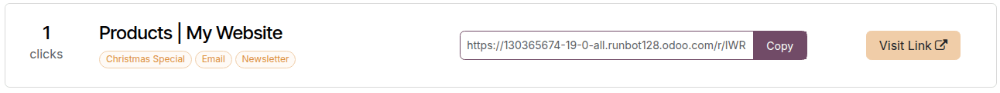

============
Link tracker
============

The link tracker allows you to create shortened, trackable URLs to measure the effectiveness of
:ref:`marketing campaigns <marketing_automation/marketing_automation/campaigns>` or monitor
individual day-to-day interactions such as sending personal offers. By adding tracking parameters to
URLs, you can easily identify exactly which channels, platforms, or specific emails drive traffic to
the website and make more data-driven decisions.

.. note::
   To create and manage tracked links, the :guilabel:`Link Tracker` module must be :ref:`installed
   <general/install>`.

.. _website/link_tracker/create-urls:

Create trackable URLs
=====================

To create and manage tracked links, navigate to the page you want to track. Then, go to
:menuselection:`Website --> Site --> Link Tracker`. Under :guilabel:`Create a Link tracker`, fill in
the following information:

#. :guilabel:`Target Link`: The specific URL on your website that the visitor should land on. This
   field is automatically populated with the URL used to access the menu.
#. :guilabel:`Campaign`: The specific campaign the link should be associated with. This parameter is
   used to distinguish the different campaigns.
#. :guilabel:`Medium`: The channel or method through which visitors reach the target link, such as
   organic search, paid search, social media ads, or email.
#. :guilabel:`Source`: The specific platform, website, or channel that directs visitors to your
   website, such as a search engine, newsletter, or referral website.
#. :guilabel:`Name`: A descriptive name for the tracked link, making it easier to identify and
   manage.

Once completed, click :guilabel:`Generate Link Tracker` to create a shortened tracking URL. Then,
click the :icon:`fa-files-o` :guilabel:`Copy` button to copy the URL and use it in your campaign.

.. tip::
   The :guilabel:`Campaign`, :guilabel:`Medium`, and :guilabel:`Source` are :abbr:`UTM (Urchin
   Tracking Module)` :ref:`parameters <crm/marketing_attribution/add-utm-parameters>` embedded in
   the tracked URL. Beyond analytics, Odoo allows you to use these parameters to customize the
   :ref:`visibility <website/visibility/conditions>` of website building blocks.

.. example::
   Suppose you want to measure the performance of a link directing visitors to a new blog post. You
   plan to share the link in your monthly newsletter. From the relevant blog post page, create a
   tracked link and configure it as follows:

   - Create the :guilabel:`Campaign` and name it `Boost traffic` to identify the campaign's primary
     objective.
   - Set the :guilabel:`Source` to `Newsletter October` to identify the newsletter as the traffic
     source.
   - As the newsletter is distributed by email, set the :guilabel:`Medium` to `Email`.
   - The :guilabel:`Name` is `Blog Post - October Newsletter Blast` to easily identify the tracked
     link in a larger campaign.

   Generate the tracked link and include it in the newsletter to monitor its performance.

   .. image:: link_tracker/link-tracker-example.png
      :alt: Example of a link tracker.
      :scale: 75%

.. _website/link_tracker/tracked-links-overview:

Tracked links overview
======================

To view all tracked links, navigate to :menuselection:`Website --> Site --> Link Tracker` and scroll
down to the :guilabel:`Your tracked links` section.

This dashboard provides a quick overview of the tracked links, including their total number of
:guilabel:`clicks` and associated campaign, medium, and source parameters.

Additionally, you can perform the following actions:

- :guilabel:`Copy` the link to share it with your audience.
- Click :guilabel:`Visit Link` :icon:`fa-external-link` to open the destination page associated with
  the tracked URL.

.. _website/link_tracker/statistics:

Statistics
----------

To analyze the performance of a tracked link, click the link and scroll down to the
:guilabel:`Statistics` section. The following charts become available once the link has been clicked
at least once:

- A line chart showing the number of clicks over time. Use the options on the right side of the
  chart heading to change the reporting period to :guilabel:`Last Month` or :guilabel:`Last Week`.
- A pie chart showing the countries from which visitors clicked the tracked link.

.. seealso::
   - :ref:`Link tracker for Marketing Automation
     <marketing_automation/understanding_metrics/link-statistics>`
   - :doc:`Analyze visitors' behavior <analytics>`
