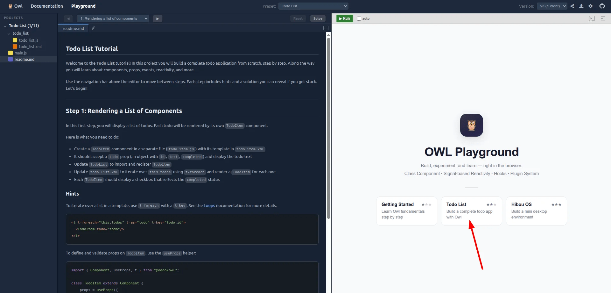
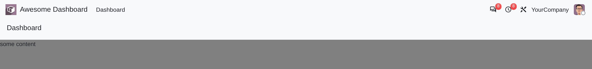
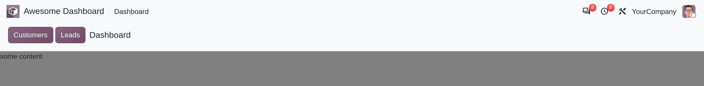
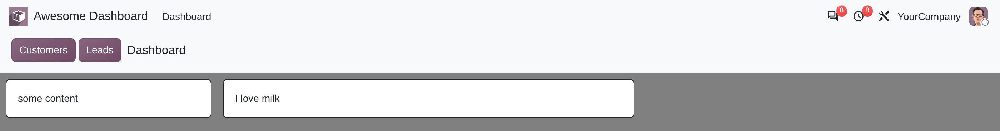
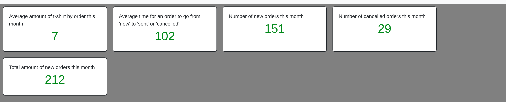
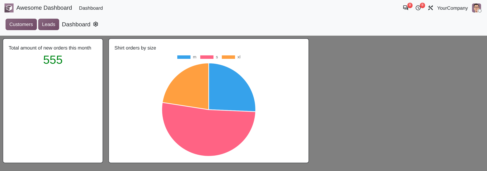
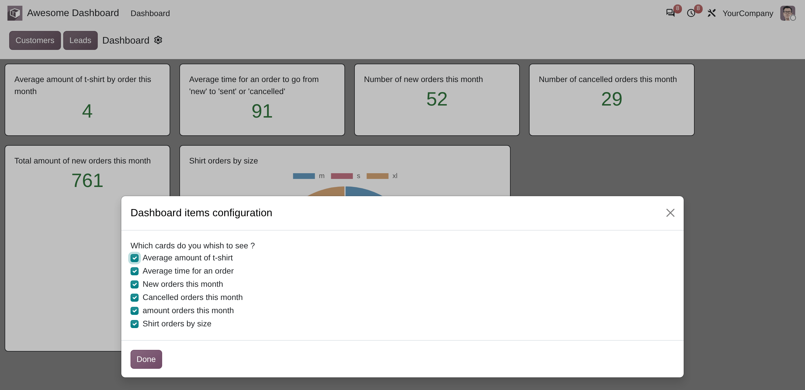

====================
Client framework 101
====================

This two-part tutorial introduces the Odoo web framework, the JavaScript code behind the web client.
Whether you are new to the framework or have some prior experience, it will give you a solid
foundation for your own projects.

The first part is about `Owl <https://github.com/odoo/owl>`_, the component framework the web client
is built on. Owl has its own interactive tutorials, which run in the browser, so this part is short:
an overview of the main ideas, then two tutorials to follow in the Owl playground. The second part
builds a dashboard in an Odoo addon. It is mostly an excuse to discover and practice many features
of the web framework: the common layout, plugins, server calls, lazy loading, registries, and
dialogs.

This tutorial assumes that you have some basic knowledge of development with Odoo in general
(models, controllers, QWeb, ...). If you are new to Odoo, we recommend that you start with the
:doc:`/developer/tutorials/server_framework_101` tutorial before proceeding with this one.

.. note::
   Each part of this tutorial is an independent project. If you feel comfortable with Owl, you can
   start directly with :ref:`part 2 <tutorials/client_framework_101/dashboard>`.

.. _tutorials/client_framework_101/owl:

Part 1: Owl components
======================

The Odoo web client is built with `Owl <https://github.com/odoo/owl>`_, a JavaScript framework
developed by Odoo, in the same family as React and Vue. Everything on screen in Odoo is an Owl
component: the navbar, the views, each field of a form. Learning Owl is the first step to working
with the web framework.

This part starts with a short overview of Owl. The exercises themselves are in the `Owl playground
<https://odoo.github.io/owl/playground/>`_, a page that runs Owl code in the browser, with nothing
to install. The playground comes with two tutorials: *Getting Started*, then *Todo List*.

Owl in a nutshell
-----------------

Owl provides four things:

- A `Component` class. Each part of the user interface is a component: a JavaScript class and a
  template.
- Templates, written in QWeb, the same template language as on the server, with a few additions for
  components.
- Reactivity, built on *signals*. When a signal changes, Owl re-renders the components that read it.
- Hooks, functions that plug into the lifecycle of a component, such as `onWillStart` or
  `onMounted`.

Example: a `Counter` component
~~~~~~~~~~~~~~~~~~~~~~~~~~~~~~

The `Counter` component below displays a number, and increments it each time the user clicks on the
button.

.. code-block:: js
   :caption: ``counter.js``

   import { Component, signal } from "@odoo/owl";

   export class Counter extends Component {
       static template = "my_module.Counter";

       count = signal(0);

       increment() {
           this.count.set(this.count() + 1);
       }
   }

.. code-block:: xml
   :caption: ``counter.xml``

   <templates xml:space="preserve">
       <t t-name="my_module.Counter">
           
Counter: <t t-out="this.count()"/>

           <button class="btn btn-primary" t-on-click="this.increment">Increment</button>
       </t>
   </templates>

A few things to notice:

- `static template` gives the name of the template. That name is what ties the two files together.
- Owl evaluates the template with the component as `this`. Each directive value is a JavaScript
  expression: `this.count()` reads the signal, and `this.increment` is the method to call on click.
- `signal(0)` creates a reactive value. Call it to read it, call `set` to write it. During
  rendering, a component records the signals it reads, and re-renders when one of them changes.
  There is nothing else to declare.

In an Odoo addon, the template lives in an XML file of the addon, and the manifest adds both files
to an assets bundle. In the playground, a template can also be written inline in the JavaScript
file, with the `xml` tagged template from `@odoo/owl`.

.. seealso::
   - `Owl documentation <https://odoo.github.io/owl/documentation/>`_
   - `Signals <https://odoo.github.io/owl/documentation/v3/owl/reference/signals.html>`_
   - `Template syntax
     <https://odoo.github.io/owl/documentation/v3/owl/reference/template_syntax.html>`_
   - `Hooks <https://odoo.github.io/owl/documentation/v3/owl/reference/hooks.html>`_

Playground exercise 1: Getting Started
--------------------------------------

Open the `Getting Started tutorial <https://odoo.github.io/owl/playground/#getting_started>`_ in the
Owl playground. You can also open the playground and pick :guilabel:`Getting Started` on its home
page.

.. image:: client_framework_101/playground-getting-started.png
   :align: center
   :alt: The Owl playground, with the instructions of the Getting Started tutorial on the left, and
         the home page of the playground on the right.

On the left, the playground shows the instructions of the current step and an editor for its files.
On the right, it runs the code: click :guilabel:`Run` to see the result. The navigation bar above
the editor moves between steps, and each step has hints and a solution that you can reveal with
:guilabel:`Solve` if you get stuck.

This first tutorial covers the fundamentals of Owl: signals to hold reactive state, templates and
event handlers, splitting the interface into sub components, passing data down with props and
validating them, deriving values with `computed` and binding inputs with `t-model`, and running code
at key moments of a component's life with lifecycle hooks.

Playground exercise 2: Todo List
--------------------------------

Once you are done with Getting Started, open the `Todo List tutorial
<https://odoo.github.io/owl/playground/#todo_list>`_.

         home page of the playground on the right.

This second tutorial builds a complete todo application and introduces the concepts a real
application needs: rendering lists of components, handling user input, dynamic classes, references
to DOM elements and custom hooks, callback props, effects that react to data changes, plugins to
separate the business logic from the interface, computed values, persisting data, and when to use a
`proxy` rather than signals.

.. tip::
   The playground has a third project, *Hibou OS*, which builds a small desktop environment. It goes
   further into plugins and registries, if you want more practice before part 2.

.. _tutorials/client_framework_101/dashboard:

Part 2: Build a dashboard
=========================

The first part of this tutorial introduced you to Owl. It is now time to learn about the Odoo
JavaScript framework in its entirety, as used by the web client. This part is a complete standalone
project, in which we implement a dashboard client action. It is mostly an excuse to discover and
practice many features of the Odoo web framework!

For this part, we will start from the empty dashboard provided by the `awesome_dashboard` addon. We
will progressively add features to it, using the Odoo JavaScript framework.

.. admonition:: Goal

   .. image:: client_framework_101/overview.png
      :align: center
      :alt: The finished dashboard: a control panel with two buttons and a gear icon, five cards
            with statistics, and a pie chart of t-shirt orders by size.

Each exercise comes with a solution, hidden in a :guilabel:`Solution` block. Each solution starts
from the solution of the previous exercise. Try to solve the exercises first without looking at the
solution!

.. tip::
   The Odoo JavaScript files downloaded by the browser are minified. For debugging purposes, switch
   to :ref:`debug mode with assets <developer-mode/activation>`, so that the files are not minified.

.. _tutorials/client_framework_101/setup:

Setup
-----

To get started, you need a running Odoo server and a development environment setup, with the
`awesome_dashboard` addon installed:

#. Clone the `official Odoo tutorials repository <https://github.com/odoo/tutorials>`_ and switch to
   the branch `{CURRENT_MAJOR_BRANCH}`.
#. Add the cloned repository to your :option:`--addons-path <odoo-bin --addons-path>`.
#. Start a new Odoo database and install the `awesome_dashboard` module.

1. A common layout
------------------

Most screens in the Odoo web client use a common layout: a control panel on top, with some buttons,
and a main content zone just below. This is done using the `Layout component
<{GITHUB_PATH}/addons/web/static/src/search/layout.js>`_, available in `@web/search/layout`.

#. Update the `AwesomeDashboard` component located in :file:`awesome_dashboard/static/src/` to use
   the `Layout` component. You can use `{controlPanel: {} }` for the `display` props of the `Layout`
   component.
#. Add a `className` prop to `Layout`: `className="'o_dashboard h-100'"`.
#. Add a :file:`dashboard.scss` file in which you set the `background-color` of `.o_dashboard` to
   gray (or your favorite color).

Open http://localhost:8069/odoo, then open the :guilabel:`Awesome Dashboard` app, and see the
result.

.. seealso::
   - `Example: use of Layout in a client action
     <{GITHUB_PATH}/addons/web/static/src/webclient/actions/reports/report_action.js>`_ and `its
     template <{GITHUB_PATH}/addons/web/static/src/webclient/actions/reports/report_action.xml>`_
   - `Example: use of Layout in the kanban view
     <{GITHUB_PATH}/addons/web/static/src/views/kanban/kanban_controller.xml>`_

.. spoiler:: Solution

   .. code-block:: js
      :caption: ``awesome_dashboard/static/src/dashboard.js``

      import { Component } from "@odoo/owl";
      import { registry } from "@web/core/registry";
      import { Layout } from "@web/search/layout";

      class AwesomeDashboard extends Component {
          static template = "awesome_dashboard.AwesomeDashboard";
          static components = { Layout };
      }

      registry.category("actions").add("awesome_dashboard.dashboard", AwesomeDashboard);

   .. code-block:: xml
      :caption: ``awesome_dashboard/static/src/dashboard.xml``

      <?xml version="1.0" encoding="UTF-8" ?>
      <templates xml:space="preserve">
          <t t-name="awesome_dashboard.AwesomeDashboard">
              <Layout display="{controlPanel: {} }" className="'o_dashboard h-100'">
                  some content
              </Layout>
          </t>
      </templates>

   .. code-block:: scss
      :caption: ``awesome_dashboard/static/src/dashboard.scss``

      .o_dashboard {
          background-color: gray;
      }

.. _tutorials/client_framework_101/plugins:
.. _tutorials/client_framework_101/services:

Theory: plugins
---------------

Owl destroys a component when it leaves the screen, and its state goes with it. This is fine in many
cases, but some code has to outlive a screen. For example, Discuss should not reload all its
messages every time we display a channel. Also, some code is not a component at all: the code that
processes barcodes, or the code that listens to the server bus.

In Odoo, this code lives in *plugins*. A plugin is a class that extends `Plugin`. The web client
starts it once, and keeps it alive until the browser tab is closed. The following example defines a
plugin that displays a notification every 5 seconds:

.. code-block:: js
   :caption: ``my_addon/static/src/tick_tock_plugin.js``

   import { Plugin, onWillDestroy, usePlugin } from "@odoo/owl";
   import { NotificationPlugin } from "@web/core/notifications/notification_plugin";
   import { services } from "@web/core/services";

   class TickTockPlugin extends Plugin {
       notification = usePlugin(NotificationPlugin);

       setup() {
           let counter = 1;
           const id = setInterval(() => {
               this.notification.add(`Tick Tock ${counter++}`);
           }, 5000);
           onWillDestroy(() => clearInterval(id));
       }
   }

   services.add(TickTockPlugin);

- `services.add` registers the plugin, and the web client starts it with all the others. There is no
  manifest entry to write, and no registration order to care about.
- A plugin uses other plugins with `usePlugin`, as a component does. Here, `NotificationPlugin`
  displays the notifications.
- `setup` is where a plugin starts its timers and listeners. Owl cleans up signals and computed
  values by itself. For anything else, such as the interval above, use `onWillDestroy`.

Components reach a plugin with the same `usePlugin` function, in a class field or in `setup`:

.. code-block:: js
   :caption: ``my_addon/static/src/uploader.js``

   import { Component, usePlugin } from "@odoo/owl";
   import { ORM } from "@web/core/orm_plugin";
   import { NotificationPlugin } from "@web/core/notifications/notification_plugin";

   export class Uploader extends Component {
       static template = "my_addon.Uploader";

       orm = usePlugin(ORM);
       notification = usePlugin(NotificationPlugin);

       async onUpload(data) {
           const [id] = await this.orm.create("ir.attachment", [data]);
           this.notification.add(`Uploaded ${id}`);
       }
   }

`usePlugin` takes the plugin class, and returns the plugin instance. There is only one instance per
browser tab, so two components that use the same plugin share its state. When a plugin holds
signals, a component that reads them re-renders when they change, as it does with its own signals.

The web client starts many plugins. Here are some of the most common ones:

.. list-table::
   :header-rows: 1

   * - Plugin
     - Purpose
     - Imported from
   * - `ORM`
     - Read and write records
     - `@web/core/orm_plugin`
   * - `NotificationPlugin`
     - Display notifications in the top right corner
     - `@web/core/notifications/notification_plugin`
   * - `DialogPlugin`
     - Open a dialog over the current screen
     - `@web/core/dialog/dialog_plugin`
   * - `EffectPlugin`
     - Display the rainbow man, and other effects
     - `@web/core/effects/effect_plugin`
   * - `HotkeyPlugin`
     - Register keyboard shortcuts
     - `@web/core/hotkeys/hotkey_plugin`
   * - `ActionPlugin`
     - Execute actions, the ones that open a screen
     - `@web/webclient/actions/action_plugin`

.. note::
   Before Owl 3, *services* played this role. A service was an object registered in the `services`
   category of the registry, and components reached it with `useService("name")`. Many services are
   still written that way in the Odoo codebase, and the ones converted to plugins keep a
   `useService` alias, so that older code keeps working. Write plugins for new code.

.. seealso::
   `Owl documentation: plugins
   <https://odoo.github.io/owl/documentation/v3/owl/reference/plugins.html>`_

2. Add some buttons for quick navigation
----------------------------------------

One important plugin provided by Odoo is the `ActionPlugin`: it can execute all kinds of standard
actions defined by Odoo. For example, here is how a component could execute an action by its XML id:

.. code-block:: js

   import { usePlugin } from "@odoo/owl";
   import { ActionPlugin } from "@web/webclient/actions/action_plugin";
   ...
   action = usePlugin(ActionPlugin);
   ...
   openSettings() {
       this.action.doAction("base_setup.action_general_configuration");
   }
   ...

Let us now add two buttons to our control panel:

#. A button `Customers`, which opens a kanban view with all customers. This action already exists,
   so you should use `its XML id <{GITHUB_PATH}/odoo/addons/base/views/res_partner_views.xml>`_.
#. A button `Leads`, which opens a dynamic action on the `crm.lead` model with a list and a form
   view.

.. seealso::
   - `Code: the Layout template, and its slots
     <{GITHUB_PATH}/addons/web/static/src/search/layout.xml>`_
   - `Code: the action plugin
     <{GITHUB_PATH}/addons/web/static/src/webclient/actions/action_plugin.js>`_

.. spoiler:: Solution

   .. code-block:: js
      :caption: ``awesome_dashboard/static/src/dashboard.js``

      import { Component, usePlugin } from "@odoo/owl";
      import { registry } from "@web/core/registry";
      import { Layout } from "@web/search/layout";
      import { ActionPlugin } from "@web/webclient/actions/action_plugin";

      class AwesomeDashboard extends Component {
          static template = "awesome_dashboard.AwesomeDashboard";
          static components = { Layout };

          action = usePlugin(ActionPlugin);

          openCustomerView() {
              this.action.doAction("base.action_partner_form");
          }

          openLeads() {
              this.action.doAction({
                  type: "ir.actions.act_window",
                  name: "All leads",
                  res_model: "crm.lead",
                  views: [
                      [false, "list"],
                      [false, "form"],
                  ],
              });
          }
      }

      registry.category("actions").add("awesome_dashboard.dashboard", AwesomeDashboard);

   .. code-block:: xml
      :caption: ``awesome_dashboard/static/src/dashboard.xml``

      <Layout display="{controlPanel: {buttons: true} }" className="'o_dashboard h-100'">
          <t t-set-slot="control-panel-buttons">
              <button class="btn btn-primary" t-on-click="this.openCustomerView">Customers</button>
              <button class="btn btn-primary" t-on-click="this.openLeads">Leads</button>
          </t>
          some content
      </Layout>

3. Add a dashboard item
-----------------------

Let us now improve the content of this dashboard.

#. Create a generic `DashboardItem` component that displays its default slot in a nice card layout.
   It should take an optional `size` number prop, which defaults to `1`. The width should be
   hardcoded to `(18*size)rem`.
#. Add two cards to the dashboard. One with no size, and the other with a size of 2.

.. seealso::
   `Owl documentation: slots
   <https://odoo.github.io/owl/documentation/v3/owl/reference/slots.html>`_

.. spoiler:: Solution

   .. code-block:: js
      :caption: ``awesome_dashboard/static/src/dashboard_item.js``

      import { Component, useProps, types as t } from "@odoo/owl";

      export class DashboardItem extends Component {
          static template = "awesome_dashboard.DashboardItem";

          props = useProps({
              size: t.number().optional(1),
          });
      }

   .. code-block:: xml
      :caption: ``awesome_dashboard/static/src/dashboard_item.xml``

      <?xml version="1.0" encoding="UTF-8" ?>
      <templates xml:space="preserve">
          <t t-name="awesome_dashboard.DashboardItem">
              

                  

                      <t t-call-slot="default"/>
                  

              

          </t>
      </templates>

   .. code-block:: xml
      :caption: ``awesome_dashboard/static/src/dashboard.xml``

      <Layout display="{controlPanel: {buttons: true} }" className="'o_dashboard h-100'">
          ...
          

              <DashboardItem>
                  some content
              </DashboardItem>
              <DashboardItem size="2">
                  I love milk
              </DashboardItem>
          

      </Layout>

   :file:`dashboard.js` imports `DashboardItem` and adds it to `static components`, the same way it
   already does for `Layout`.

4. Call the server, add some statistics
---------------------------------------

Let us improve the dashboard by adding a few dashboard items to display *real* business data. The
`awesome_dashboard` addon provides a `/awesome_dashboard/statistics` route that is meant to return
some interesting information.

To call a specific controller, we need to use the `rpc` function. A call to :code:`rpc(route,
params, settings)` sends a JSON-RPC request to the server, and returns a promise with the result. A
basic request could look like this:

.. code-block:: js

   import { onWillStart } from "@odoo/owl";
   import { rpc } from "@web/core/network/rpc";
   ...
   setup() {
       onWillStart(async () => {
           const result = await rpc("/my/controller", { a: 1, b: 2 });
           // ...
       });
   }
   ...

`onWillStart` runs before the first render of the component, and the render waits for the promise it
returns. Use it for the data that the screen cannot render without.

#. Update `AwesomeDashboard` so that it uses the `rpc` function.
#. Call the statistics route `/awesome_dashboard/statistics` in the `onWillStart` hook, and store
   the result in a signal.
#. Display a few cards in the dashboard containing:

   - Number of new orders this month
   - Total amount of new orders this month
   - Average amount of t-shirt by order this month
   - Number of cancelled orders this month
   - Average time for an order to go from 'new' to 'sent' or 'cancelled'

.. seealso::
   `Code: rpc <{GITHUB_PATH}/addons/web/static/src/core/network/rpc.js>`_

.. spoiler:: Solution

   .. code-block:: js
      :caption: ``awesome_dashboard/static/src/dashboard.js``

      import { Component, onWillStart, signal, usePlugin } from "@odoo/owl";
      import { rpc } from "@web/core/network/rpc";
      ...

      class AwesomeDashboard extends Component {
          ...
          action = usePlugin(ActionPlugin);
          statistics = signal(null);

          setup() {
              onWillStart(async () => {
                  const data = await rpc("/awesome_dashboard/statistics");
                  this.statistics.set(data);
              });
          }
          ...
      }

   .. code-block:: xml
      :caption: ``awesome_dashboard/static/src/dashboard.xml``

      

          <DashboardItem>
              Average amount of t-shirt by order this month
              

                  <t t-out="this.statistics().average_quantity"/>
              

          </DashboardItem>
          <DashboardItem>
              Average time for an order to go from 'new' to 'sent' or 'cancelled'
              

                  <t t-out="this.statistics().average_time"/>
              

          </DashboardItem>
          <DashboardItem>
              Number of new orders this month
              

                  <t t-out="this.statistics().nb_new_orders"/>
              

          </DashboardItem>
          <DashboardItem>
              Number of cancelled orders this month
              

                  <t t-out="this.statistics().nb_cancelled_orders"/>
              

          </DashboardItem>
          <DashboardItem>
              Total amount of new orders this month
              

                  <t t-out="this.statistics().total_amount"/>
              

          </DashboardItem>
      

5. Cache network calls, create a plugin
---------------------------------------

If you open the :guilabel:`Network` tab of your browser's dev tools, you will see that the call to
`/awesome_dashboard/statistics` is done every time the client action is displayed. This is because
the `onWillStart` hook is called each time the `AwesomeDashboard` component is mounted. But in this
case, we would prefer to do it only the first time, so we actually need to maintain some state
outside of the component. This is a nice use case for a plugin!

#. Create a `ReportingPlugin` class that extends `Plugin`, in a new
   :file:`static/src/reporting_plugin.js` file, and register it with `services.add`.
#. Give it a `loadStatistics` method that performs the actual rpc, and always returns the same
   information.
#. Use the cache of the `rpc` function: `rpc(route, {}, { cache: true })` caches the result by URL
   and parameters.
#. Use this plugin in the `AwesomeDashboard` component, with `usePlugin(ReportingPlugin)`.
#. Check that it works as expected: there should be only one call to `/awesome_dashboard/statistics`
   in the :guilabel:`Network` tab, even after leaving and reopening the dashboard.

.. seealso::
   - `Example: a simple plugin
     <{GITHUB_PATH}/addons/web/static/src/core/notifications/notification_plugin.js>`_
   - `Example: a plugin that depends on other plugins
     <{GITHUB_PATH}/addons/bus/static/src/services/bus_plugin.js>`_
   - `Code: the settings of the rpc cache
     <{GITHUB_PATH}/addons/web/static/src/core/network/rpc_cache.js>`_
   - `Example: an rpc call with the cache
     <{GITHUB_PATH}/addons/website/static/src/builder/plugins/options/footer_copyright_option.js>`_

.. spoiler:: Solution

   .. code-block:: js
      :caption: ``awesome_dashboard/static/src/reporting_plugin.js``

      import { Plugin } from "@odoo/owl";
      import { services } from "@web/core/services";
      import { rpc } from "@web/core/network/rpc";

      export class ReportingPlugin extends Plugin {
          loadStatistics() {
              return rpc("/awesome_dashboard/statistics", {}, { cache: true });
          }
      }

      services.add(ReportingPlugin);

   .. code-block:: js
      :caption: ``awesome_dashboard/static/src/dashboard.js``

      import { ReportingPlugin } from "./reporting_plugin";
      ...
          reporting = usePlugin(ReportingPlugin);
          statistics = signal(null);

          setup() {
              onWillStart(async () => {
                  const data = await this.reporting.loadStatistics();
                  this.statistics.set(data);
              });
          }

   The `rpc` import moves from :file:`dashboard.js` to the plugin.

6. Cleanup
----------

The plugin owns the network call now, but the component still holds the data: a `statistics` signal,
and an `onWillStart` whose only job is to fill it. Two dashboards on screen would each keep their
own copy of the same figures. The data belongs where the call already is.

#. Move the signal into `ReportingPlugin`: `stats = signal(null)`.
#. Have `loadStatistics` set it, instead of returning the data.
#. In `AwesomeDashboard`, drop the `statistics` signal. `onWillStart` only has to wait for the load.
#. Read the plugin directly from the template: add `<t t-set="stats"
   t-value="this.reporting.stats"/>` at the top of the template, and use `stats().xxx` in each card.

The component no longer holds anything of its own: no copy of the data, and no line that only exists
to pass it along.

.. spoiler:: Solution

   .. code-block:: js
      :caption: ``awesome_dashboard/static/src/reporting_plugin.js``

      import { Plugin, signal } from "@odoo/owl";
      ...

      export class ReportingPlugin extends Plugin {
          stats = signal(null);

          async loadStatistics() {
              const data = await rpc("/awesome_dashboard/statistics", {}, { cache: true });
              this.stats.set(data);
          }
      }

   .. code-block:: js
      :caption: ``awesome_dashboard/static/src/dashboard.js``

          reporting = usePlugin(ReportingPlugin);

          setup() {
              onWillStart(() => this.reporting.loadStatistics());
          }

   .. code-block:: xml
      :caption: ``awesome_dashboard/static/src/dashboard.xml``

      <t t-name="awesome_dashboard.AwesomeDashboard">
          <t t-set="stats" t-value="this.reporting.stats"/>
          <Layout display="{controlPanel: {buttons: true} }" className="'o_dashboard h-100'">
              ...
              

                  <DashboardItem>
                      Average amount of t-shirt by order this month
                      

                          <t t-out="stats().average_quantity"/>
                      

                  </DashboardItem>
                  <!-- four more, one per statistic -->
              

          </Layout>
      </t>

   :file:`dashboard.js` no longer imports `signal`. The `t-set` runs at the top of the template on
   each render, and the variable is in scope everywhere below it, inside the slots of `Layout` too.
   `onWillStart` still waits for the first load, so the first render has its data.

7. Display a pie chart
----------------------

Everyone likes charts (!), so let us add a pie chart in our dashboard. It will display the
proportions of t-shirts sold for each size: S/M/L/XL/XXL.

For this exercise, we will use `Chart.js <https://www.chartjs.org/>`_. It is the chart library used
by the graph view. However, it is not loaded by default, so we will need to either add it to our
assets bundle, or lazy load it. Lazy loading is usually better, since our users will not have to
load the Chart.js code every time if they don't need it.

#. Create a `PieChart` component.
#. In its `onWillStart` hook, load Chart.js. You can use the `loadJS
   <{GITHUB_PATH}/addons/web/static/src/core/assets.js>`_ function to load
   :file:`/web/static/lib/Chart/Chart.js`.
#. Use the `PieChart` component in a `DashboardItem` to display a `pie chart
   <https://www.chartjs.org/docs/latest/charts/doughnut.html>`_ that shows the quantity of t-shirts
   sold in each size (that information is available in the `/statistics` route). Note that you can
   use the `size` prop to make it look larger.
#. Give the canvas a real height to draw into. Chart.js needs one to size itself, and the `card` of
   a `DashboardItem` only sizes to its content. Add a :file:`pie_chart.scss` file with a wrapper
   `div` sized by `aspect-ratio`, and the canvas absolutely positioned to fill it:

   .. code-block:: css

      .o_pie_chart {
          position: relative;
          width: 100%;
          aspect-ratio: 16 / 9;
      }

      .o_pie_chart canvas {
          position: absolute;
          inset: 0;
          width: 100%;
          height: 100%;
      }

   Do not put the `aspect-ratio` on the canvas itself. Chart.js resizes the canvas from the size of
   its *parent*, and the two would feed off each other and grow without limit. Try it if you like,
   it is a fun way to freeze a browser tab once. But don't ship it.
#. The `PieChart` component needs to render a canvas, and draw on it using Chart.js. The sizes are a
   fixed, known set, so give each one its own color. You can use this code to create the pie chart:

   .. code-block:: js

      const SIZE_COLORS = {
          s: "#36A2EB",
          m: "#FF6384",
          l: "#4BC0C0",
          xl: "#FF9F40",
          xxl: "#9C6DF4",
      };
      ...
      renderChart(canvas) {
          const keys = Object.keys(this.props.data);
          const data = Object.values(this.props.data);
          const color = keys.map((key) => SIZE_COLORS[key]);
          return new Chart(canvas, {
              type: "pie",
              data: {
                  labels: keys,
                  datasets: [
                      {
                          label: this.props.label,
                          data: data,
                          backgroundColor: color,
                      },
                  ],
              },
          });
      }

#. Make it work!

.. seealso::
   - `Example: lazy loading a JavaScript file
     <{GITHUB_PATH}/addons/web/static/src/core/barcode/barcode_video_scanner.js>`_
   - `Owl documentation: refs
     <https://odoo.github.io/owl/documentation/v3/owl/reference/refs.html>`_
   - `Owl documentation: effects
     <https://odoo.github.io/owl/documentation/v3/owl/reference/effects.html>`_

.. spoiler:: Solution

   .. code-block:: js
      :caption: ``awesome_dashboard/static/src/pie_chart/pie_chart.js``

      import { loadJS } from "@web/core/assets";
      import { Component, useProps, types as t, signal, onWillStart, useEffect } from "@odoo/owl";

      const SIZE_COLORS = {
          s: "#36A2EB",
          m: "#FF6384",
          l: "#4BC0C0",
          xl: "#FF9F40",
          xxl: "#9C6DF4",
      };

      export class PieChart extends Component {
          static template = "awesome_dashboard.PieChart";

          props = useProps({
              label: t.string(),
              data: t.object(),
          });

          canvasRef = signal.ref();

          setup() {
              onWillStart(() => loadJS("/web/static/lib/Chart/Chart.js"));
              useEffect(() => {
                  const canvas = this.canvasRef();
                  if (canvas) {
                      const chart = this.renderChart(canvas);
                      return () => chart.destroy();
                  }
              });
          }

          renderChart(canvas) {
              const keys = Object.keys(this.props.data);
              const data = Object.values(this.props.data);
              const color = keys.map((key) => SIZE_COLORS[key]);
              return new Chart(canvas, {
                  type: "pie",
                  data: {
                      labels: keys,
                      datasets: [
                          {
                              label: this.props.label,
                              data: data,
                              backgroundColor: color,
                          },
                      ],
                  },
                  options: {
                      maintainAspectRatio: false,
                  },
              });
          }
      }

   .. code-block:: xml
      :caption: ``awesome_dashboard/static/src/pie_chart/pie_chart.xml``

      <?xml version="1.0" encoding="UTF-8" ?>
      <templates xml:space="preserve">
          <t t-name="awesome_dashboard.PieChart">
              

                  <canvas t-ref="this.canvasRef"/>
              

          </t>
      </templates>

   .. code-block:: css
      :caption: ``awesome_dashboard/static/src/pie_chart/pie_chart.scss``

      .o_pie_chart {
          position: relative;
          width: 100%;
          aspect-ratio: 16 / 9;
      }

      .o_pie_chart canvas {
          position: absolute;
          inset: 0;
          width: 100%;
          height: 100%;
      }

   .. code-block:: xml
      :caption: ``awesome_dashboard/static/src/dashboard.xml``

      

          ...
          <DashboardItem size="2">
              Shirt orders by size
              <PieChart data="stats().orders_by_size" label="'Shirt orders by size'"/>
          </DashboardItem>
      

   :file:`dashboard.js` imports `PieChart` and adds it to `static components`, next to
   `DashboardItem`.

   A reference to a DOM element is a `signal.ref()` class field. The template binds it with
   `t-ref="this.canvasRef"`, and the code reads it by calling it: `this.canvasRef()` returns the
   canvas, or `null` before the component is mounted.

   A single `useEffect` manages the chart. The effect reads the ref and the props, so it runs once
   the canvas exists, and again whenever the data changes. The function it returns is the cleanup:
   Owl calls `chart.destroy()` before the next run, and when the component is destroyed. Nothing is
   stored on `this`. The chart only exists as long as the effect that created it.

   Why position the canvas absolutely? To decide the size of the canvas, Chart.js measures its
   parent. If the `aspect-ratio` of the canvas gave that parent its height, each resize would read a
   parent that just grew because of the canvas, then grow the canvas to match, forever. A tooltip
   redraw on hover is enough to start the loop. With `position: absolute`, the canvas leaves the
   normal flow, and its size no longer affects the size of its parent.

8. Make it a generic hook
-------------------------

`PieChart` holds two different things. One is what a pie chart of t-shirt sizes looks like. The
other is the plumbing that every chart needs: load Chart.js, keep a ref to a canvas, create the
chart once that canvas exists, and destroy it when the data changes or the component goes away. Only
the first one is about pie charts.

#. Create a `useChart(descFn)` hook in :file:`static/src/use_chart.js`. It owns the ref, the
   `onWillStart` that loads Chart.js, and the effect. It returns the ref, so that a template can
   bind it with `t-ref`.
#. `descFn` is called inside the effect, and whatever it returns is given to `new Chart(canvas,
   ...)`. Reading props in `descFn` is what makes the chart redraw when they change.
#. Rewrite `PieChart` on top of it. It should be left with its props and the description of a pie
   chart, and nothing else.

Another type of chart is then just a component with a different `descFn`.

.. seealso::
   `Code: the chart hook of the web client
   <{GITHUB_PATH}/addons/web/static/src/core/utils/chart_hook.js>`_

.. spoiler:: Solution

   .. code-block:: js
      :caption: ``awesome_dashboard/static/src/use_chart.js``

      import { loadJS } from "@web/core/assets";
      import { signal, onWillStart, useEffect } from "@odoo/owl";

      export function useChart(descFn) {
          const canvasRef = signal.ref();

          onWillStart(() => loadJS("/web/static/lib/Chart/Chart.js"));

          useEffect(() => {
              const canvas = canvasRef();
              if (canvas) {
                  const chart = new Chart(canvas, descFn());
                  return () => chart.destroy();
              }
          });

          return canvasRef;
      }

   .. code-block:: js
      :caption: ``awesome_dashboard/static/src/pie_chart/pie_chart.js``

      import { Component, useProps, types as t } from "@odoo/owl";
      import { useChart } from "../use_chart";

      const SIZE_COLORS = { ... };

      export class PieChart extends Component {
          static template = "awesome_dashboard.PieChart";

          props = useProps({
              label: t.string(),
              data: t.object(),
          });

          canvasRef = useChart(() => {
              const keys = Object.keys(this.props.data);
              const data = Object.values(this.props.data);
              const color = keys.map((key) => SIZE_COLORS[key]);
              return {
                  type: "pie",
                  data: {
                      labels: keys,
                      datasets: [
                          {
                              label: this.props.label,
                              data: data,
                              backgroundColor: color,
                          },
                      ],
                  },
                  options: {
                      maintainAspectRatio: false,
                  },
              };
          });
      }

   The template does not change: `useChart` returns the same kind of ref that `t-ref` was already
   bound to. `PieChart` has no `setup` left. The description is a function, so it only runs inside
   the effect, where reading `this.props.data` subscribes the chart to it.

9. Periodic updates
-------------------

Since we moved the data loading in a cache, it never updates. But let us say that we are looking at
fast moving data, so we want to periodically (for example, every 10 minutes) reload fresh data.

This is quite simple to implement, with a `setTimeout` or `setInterval` in the reporting plugin.
However, here is the tricky part: if the dashboard is currently being displayed, it should be
updated immediately.

The plugin already owns the `stats` signal, and the template reads it. A component re-renders when a
signal it read changes, with no subscription to set up. So the reload only has to set the signal
again.

#. Update `ReportingPlugin` to reload data every 10 minutes (to test it, use 5 seconds instead!).
#. Drop `loadStatistics`: the plugin loads the data in its own `setup`, then on a timer, and sets
   `stats` each time. Clear that timer in an `onWillDestroy` hook.
#. `stats` starts at `null`, so the template has to check whether the data is loaded: guard the
   cards with `t-if="stats()"`.

.. seealso::
   - `Owl documentation: signals
     <https://odoo.github.io/owl/documentation/v3/owl/reference/signals.html>`_
   - `Example: a plugin that owns reactive state
     <{GITHUB_PATH}/addons/web/static/src/core/browser/title_plugin.js>`_

.. spoiler:: Solution

   .. code-block:: js
      :caption: ``awesome_dashboard/static/src/reporting_plugin.js``

      import { Plugin, signal, onWillDestroy } from "@odoo/owl";
      import { services } from "@web/core/services";
      import { rpc } from "@web/core/network/rpc";

      export class ReportingPlugin extends Plugin {
          stats = signal(null);

          setup() {
              this.loadData();
              const id = setInterval(() => this.loadData(), 5 * 1000);
              onWillDestroy(() => clearInterval(id));
          }

          async loadData() {
              const data = await rpc("/awesome_dashboard/statistics");
              this.stats.set(data);
          }
      }

      services.add(ReportingPlugin);

   The plugin now pushes fresh data on its own schedule, instead of waiting to be asked. The `rpc`
   cache from step 5 would keep serving the first response forever, so the plugin uses a plain `rpc`
   call, sent again on each tick. Each response replaces the value of the signal, and every
   component that reads it re-renders. The `null` initial value is enough to know whether the data
   has arrived.

   The interval is the one thing Owl cannot clean up by itself, hence `onWillDestroy`. A plugin
   started with the web client lives as long as the browser tab, so this rarely runs in practice.
   But a plugin can also be destroyed, in a test for example.

   .. code-block:: js
      :caption: ``awesome_dashboard/static/src/dashboard.js``

      import { Component, usePlugin } from "@odoo/owl";
      ...
          reporting = usePlugin(ReportingPlugin);

   The component has no `setup` and no `onWillStart` anymore. The plugin loads the data on its own
   schedule, and the template reads `stats()` on each render.

   .. code-block:: xml
      :caption: ``awesome_dashboard/static/src/dashboard.xml``

      

          <DashboardItem>
              Average amount of t-shirt by order this month
              

                  <t t-out="stats().average_quantity"/>
              

          </DashboardItem>
          <!-- four more, one per statistic, and the pie chart -->
      

   Nothing blocks the first render anymore, so the wrapping `div` needs `t-if="stats()"` to skip the
   cards until the first load is done.

10. Lazy loading the dashboard
------------------------------

Let us imagine that our dashboard is getting quite big, and is only of interest to some of our
users. In that case, it could make sense to lazy load our dashboard, and all related assets, so we
only pay the cost of loading the code when we actually want to look at it.

One way to do this is to use `LazyComponent` (from `@web/core/lazy_component`) as an intermediate
that will load an asset bundle before displaying our component.

.. example::

   :file:`example_action.js`:

   .. code-block:: javascript

      export class ExampleComponentLoader extends Component {
          static components = { LazyComponent };
          static template = xml`
              <LazyComponent bundle="'example_module.example_assets'" Component="'ExampleComponent'" />
          `;
      }

      registry.category("actions").add("example_module.example_action", ExampleComponentLoader);

#. Move all dashboard assets into a sub folder :file:`/dashboard` to make it easier to add to a
   bundle.
#. Create an `awesome_dashboard.dashboard` assets bundle containing all content of the
   :file:`/dashboard` folder.
#. Modify :file:`dashboard.js` to register itself to the `lazy_components` registry instead of
   `actions`.
#. In :file:`src/dashboard_loader.js`, create an intermediate component that uses `LazyComponent`
   and register it to the `actions` registry.

.. spoiler:: Solution

   Move every existing file from :file:`static/src/` to :file:`static/src/dashboard/`. The relative
   imports between them do not change.

   .. code-block:: python
      :caption: ``awesome_dashboard/__manifest__.py``

      'assets': {
          'web.assets_backend': [
              'awesome_dashboard/static/src/**/*',
              ('remove', 'awesome_dashboard/static/src/dashboard/**/*'),
          ],
          'awesome_dashboard.dashboard': [
              'awesome_dashboard/static/src/dashboard/**/*',
          ],
      },

   .. code-block:: js
      :caption: ``awesome_dashboard/static/src/dashboard_loader.js``

      import { registry } from "@web/core/registry";
      import { LazyComponent } from "@web/core/lazy_component";
      import { Component, xml, useProps } from "@odoo/owl";

      class AwesomeDashboardLoader extends Component {
          static components = { LazyComponent };
          static template = xml`
              <LazyComponent bundle="'awesome_dashboard.dashboard'" Component="'AwesomeDashboard'" props="this.props"/>
          `;
          props = useProps();
      }

      registry.category("actions").add("awesome_dashboard.dashboard", AwesomeDashboardLoader);

   .. code-block:: js
      :caption: ``awesome_dashboard/static/src/dashboard/dashboard.js``

      registry.category("lazy_components").add("AwesomeDashboard", AwesomeDashboard);

   In Owl 3, a component has no `this.props` unless it declares it with `useProps`. Called without a
   schema, `useProps()` accepts all the props of the client action, and `props="this.props"` passes
   them on to the dashboard.

11. Making our dashboard generic
--------------------------------

So far, we have a nice working dashboard. But it is currently hardcoded in the dashboard template.
What if we want to customize our dashboard? Maybe some users have different needs and want to see
other data.

So, the next step is to make our dashboard generic: instead of hard-coding its content in the
template, it can just iterate over a list of dashboard items. But then, many questions come up: how
to represent a dashboard item, how to register it, what data should it receive, and so on. There are
many different ways to design such a system, with different trade-offs.

For this tutorial, we will say that a dashboard item is an object with the following structure:

.. code-block:: js

   const item = {
       id: "average_quantity",
       description: "Average amount of t-shirt",
       Component: StandardItem,
       // size and props are optional
       size: 3,
       props: (data) => ({
           title: "Average amount of t-shirt by order this month",
           value: data.average_quantity,
       }),
   };

The `description` value will be useful in a later exercise to show the name of items that the user
can add to their dashboard. The `size` number is optional, and simply describes the size of the
dashboard item that will be displayed. Finally, the `props` function is optional. If not given, we
will simply give the `statistics` object as data. But if it is defined, it will be used to compute
specific props for the component.

The goal is to replace the content of the dashboard with something that looks like the following
snippet:

.. code-block:: xml

   <t t-foreach="this.items" t-as="item" t-key="item.id">
       <DashboardItem size="item.size || 1">
           <t t-set="itemProp" t-value="item.props ? item.props(stats()) : {'data': stats()}"/>
           <t t-component="item.Component" t-props="itemProp"/>
       </DashboardItem>
   </t>

Note that the above example features two advanced features of Owl: dynamic components and dynamic
props.

We currently have two kinds of item components: number cards with a title and a number, and pie
cards with a title and a pie chart.

#. Create and implement two components: `NumberCard` and `PieChartCard`, with the corresponding
   props.
#. Create a :file:`dashboard_items.js` file in which you define and export a list of items, using
   `NumberCard` and `PieChartCard` to recreate our current dashboard.
#. Import that list of items in our `AwesomeDashboard` component, add it to the component, and
   update the template to use a `t-foreach` like shown above.

And now, our dashboard template is generic!

.. spoiler:: Solution

   .. code-block:: js
      :caption: ``awesome_dashboard/static/src/dashboard/number_card/number_card.js``

      import { Component, useProps, types as t } from "@odoo/owl";

      export class NumberCard extends Component {
          static template = "awesome_dashboard.NumberCard";

          props = useProps({
              title: t.string(),
              value: t.number(),
          });
      }

   .. code-block:: xml
      :caption: ``awesome_dashboard/static/src/dashboard/number_card/number_card.xml``

      <?xml version="1.0" encoding="UTF-8" ?>
      <templates xml:space="preserve">
          <t t-name="awesome_dashboard.NumberCard">
              <t t-out="this.props.title"/>
              

                  <t t-out="this.props.value"/>
              

          </t>
      </templates>

   .. code-block:: js
      :caption: ``awesome_dashboard/static/src/dashboard/pie_chart_card/pie_chart_card.js``

      import { Component, useProps, types as t } from "@odoo/owl";
      import { PieChart } from "../pie_chart/pie_chart";

      export class PieChartCard extends Component {
          static template = "awesome_dashboard.PieChartCard";
          static components = { PieChart };

          props = useProps({
              title: t.string(),
              values: t.object(),
          });
      }

   .. code-block:: xml
      :caption: ``awesome_dashboard/static/src/dashboard/pie_chart_card/pie_chart_card.xml``

      <?xml version="1.0" encoding="UTF-8" ?>
      <templates xml:space="preserve">
          <t t-name="awesome_dashboard.PieChartCard">
              <t t-out="this.props.title"/>
              <PieChart data="this.props.values" label="''"/>
          </t>
      </templates>

   .. code-block:: js
      :caption: ``awesome_dashboard/static/src/dashboard/dashboard_items.js``

      import { NumberCard } from "./number_card/number_card";
      import { PieChartCard } from "./pie_chart_card/pie_chart_card";

      export const items = [
          {
              id: "average_quantity",
              description: "Average amount of t-shirt",
              Component: NumberCard,
              props: (data) => ({
                  title: "Average amount of t-shirt by order this month",
                  value: data.average_quantity,
              }),
          },
          {
              id: "average_time",
              description: "Average time for an order",
              Component: NumberCard,
              props: (data) => ({
                  title: "Average time for an order to go from 'new' to 'sent' or 'cancelled'",
                  value: data.average_time,
              }),
          },
          {
              id: "number_new_orders",
              description: "New orders this month",
              Component: NumberCard,
              props: (data) => ({
                  title: "Number of new orders this month",
                  value: data.nb_new_orders,
              }),
          },
          {
              id: "cancelled_orders",
              description: "Cancelled orders this month",
              Component: NumberCard,
              props: (data) => ({
                  title: "Number of cancelled orders this month",
                  value: data.nb_cancelled_orders,
              }),
          },
          {
              id: "amount_new_orders",
              description: "Amount of orders this month",
              Component: NumberCard,
              props: (data) => ({
                  title: "Total amount of new orders this month",
                  value: data.total_amount,
              }),
          },
          {
              id: "pie_chart",
              description: "Shirt orders by size",
              Component: PieChartCard,
              size: 2,
              props: (data) => ({
                  title: "Shirt orders by size",
                  values: data.orders_by_size,
              }),
          },
      ];

   .. code-block:: js
      :caption: ``awesome_dashboard/static/src/dashboard/dashboard.js``

      import { items } from "./dashboard_items";
      ...
          static components = { Layout, DashboardItem };

          items = items;

   The template can only read `this.items`, not the imported `items`, so the list has to be put on
   the component first. A class field is enough: the name on the left is the field, the one on the
   right is the import.

   .. code-block:: xml
      :caption: ``awesome_dashboard/static/src/dashboard/dashboard.xml``

      

          <t t-foreach="this.items" t-as="item" t-key="item.id">
              <DashboardItem size="item.size || 1">
                  <t t-set="itemProp" t-value="item.props ? item.props(stats()) : {'data': stats()}"/>
                  <t t-component="item.Component" t-props="itemProp"/>
              </DashboardItem>
          </t>
      

12. Making our dashboard extensible
-----------------------------------

However, the content of our item list is still hardcoded. Let us fix that by using a registry. We
will use the `Registry` class of Owl 3, rather than the global registry of `@web/core/registry`. The
global registry still works, and most of the Odoo code still uses it, but it accepts anything under
any key. An Owl `Registry` can take a `validation` schema, and checks each entry against it when it
is added.

#. Instead of exporting a list, create and export a `Registry` (from `@odoo/owl`), with a validation
   schema that describes a dashboard item. Register each item on it with `addById`, since each item
   already has an `id`.
#. Read all the registered items from that registry in the `AwesomeDashboard` component.

The dashboard is now easily extensible. Any other Odoo addon that wants to add a new item to the
dashboard can import this registry and add to it. And if what it adds does not look like a dashboard
item, it gets a clear error right away.

.. seealso::
   `Owl documentation: registries
   <https://odoo.github.io/owl/documentation/v3/owl/reference/registries.html>`_

.. spoiler:: Solution

   .. code-block:: js
      :caption: ``awesome_dashboard/static/src/dashboard/dashboard_items.js``

      import { Registry, Component, types as t } from "@odoo/owl";
      import { NumberCard } from "./number_card/number_card";
      import { PieChartCard } from "./pie_chart_card/pie_chart_card";

      export const dashboardItems = new Registry({
          name: "awesome_dashboard",
          validation: t.object({
              id: t.string(),
              description: t.string(),
              Component: t.constructor(Component),
              size: t.number().optional(),
              props: t.function().optional(),
          }),
      });

      const items = [
          ...
      ];

      items.forEach((item) => dashboardItems.addById(item));

   `t.constructor(Component)` checks that `Component` is the `Component` class of Owl, or a class
   that extends it. It checks the class itself, not an instance of it.

   .. code-block:: js
      :caption: ``awesome_dashboard/static/src/dashboard/dashboard.js``

      import { dashboardItems } from "./dashboard_items";
      ...
          items = dashboardItems.items;

   .. code-block:: xml
      :caption: ``awesome_dashboard/static/src/dashboard/dashboard.xml``

      <t t-foreach="this.items()" t-as="item" t-key="item.id">

   `dashboardItems.items` is a computed value, so the template has to call it, like the `stats`
   signal of the plugin. And since it is reactive, the dashboard re-renders when another addon adds
   an item.

13. Add and remove dashboard items
----------------------------------

Let us see how we can make our dashboard customizable. To make it simple, we will save the user
dashboard configuration in the local storage, so that we don't have to deal with the server for now.

The dashboard configuration will be saved as a list of removed item ids.

#. Add a button in the control panel with a gear icon to indicate that it is a settings button.
#. Clicking on that button should open a dialog.
#. In that dialog, we want to see a list of all existing dashboard items, each with a checkbox.
#. Each checkbox should immediately update the list of unchecked item ids, and store it in the local
   storage. A :guilabel:`Done` button in the footer just closes the dialog.
#. Modify the `AwesomeDashboard` component to filter the current items by removing the ids of items
   from the configuration.

.. seealso::
   - `Code: the dialog plugin <{GITHUB_PATH}/addons/web/static/src/core/dialog/dialog_plugin.js>`_
   - `Code: the Dialog component <{GITHUB_PATH}/addons/web/static/src/core/dialog/dialog.js>`_
   - `Code: the CheckBox component <{GITHUB_PATH}/addons/web/static/src/core/checkbox/checkbox.js>`_

.. spoiler:: Solution

   .. code-block:: js
      :caption: ``awesome_dashboard/static/src/dashboard/dashboard.js``

      import { Component, signal, useProps, usePlugin } from "@odoo/owl";
      import { registry } from "@web/core/registry";
      import { Layout } from "@web/search/layout";
      import { DialogPlugin } from "@web/core/dialog/dialog_plugin";
      import { ActionPlugin } from "@web/webclient/actions/action_plugin";
      import { Dialog } from "@web/core/dialog/dialog";
      import { CheckBox } from "@web/core/checkbox/checkbox";
      import { ReportingPlugin } from "./reporting_plugin";
      import { dashboardItems } from "./dashboard_items";
      import { DashboardItem } from "./dashboard_item";

      class AwesomeDashboard extends Component {
          static template = "awesome_dashboard.AwesomeDashboard";
          static components = { Layout, DashboardItem };

          disabledItems = signal(
              window.localStorage.getItem("disabledDashboardItems")?.split(",") || []
          );
          action = usePlugin(ActionPlugin);
          reporting = usePlugin(ReportingPlugin);
          dialog = usePlugin(DialogPlugin);
          items = dashboardItems.items;

          openConfiguration() {
              this.dialog.add(ConfigurationDialog, {
                  items: this.items(),
                  disabledItems: this.disabledItems(),
                  onUpdateConfiguration: this.updateConfiguration.bind(this),
              });
          }

          updateConfiguration(newDisabledItems) {
              this.disabledItems.set(newDisabledItems);
              window.localStorage.setItem("disabledDashboardItems", newDisabledItems);
          }

          openCustomerView() { ... }

          openLeads() { ... }
      }

      class ConfigurationDialog extends Component {
          static template = "awesome_dashboard.ConfigurationDialog";
          static components = { Dialog, CheckBox };

          props = useProps(["close", "items", "disabledItems", "onUpdateConfiguration"]);

          disabledItems = signal(this.props.disabledItems);

          isEnabled(item) {
              return !this.disabledItems().includes(item.id);
          }

          done() {
              this.props.close();
          }

          onChange(checked, item) {
              const disabled = new Set(this.disabledItems());
              if (checked) {
                  disabled.delete(item.id);
              } else {
                  disabled.add(item.id);
              }
              const newDisabledItems = [...disabled];
              this.disabledItems.set(newDisabledItems);
              this.props.onUpdateConfiguration(newDisabledItems);
          }
      }

      registry.category("lazy_components").add("AwesomeDashboard", AwesomeDashboard);

   `useProps` also accepts a plain list of prop names, without type validation. The dialog plugin
   gives the `close` prop to the dialog component it opens.

   The dialog keeps a single source of truth: the list of disabled ids, in a plain signal. Whether
   an item is enabled is derived from that list. Keeping the items in a `signal.Array` with an
   `enabled` flag on each one would not work: Owl tracks the changes to the content of a
   `signal.Array` (adding, removing or replacing elements), but not the changes to the properties of
   its elements.

   .. code-block:: xml
      :caption: ``awesome_dashboard/static/src/dashboard/dashboard.xml``

      <t t-name="awesome_dashboard.AwesomeDashboard">
          <t t-set="stats" t-value="this.reporting.stats"/>
          <Layout display="{controlPanel: {buttons: true} }" className="'o_dashboard h-100'">
              <t t-set-slot="control-panel-buttons">
                  <button class="btn btn-primary" t-on-click="this.openCustomerView">Customers</button>
                  <button class="btn btn-primary" t-on-click="this.openLeads">Leads</button>
              </t>
              <t t-set-slot="control-panel-additional-actions">
                  <button t-on-click="this.openConfiguration" class="btn p-0 ms-1 border-0">
                      <i class="oi" data-icon="settings"/>
                  </button>
              </t>
              

                  <t t-foreach="this.items()" t-as="item" t-key="item.id">
                      <DashboardItem t-if="!this.disabledItems().includes(item.id)" size="item.size || 1">
                          <t t-set="itemProp" t-value="item.props ? item.props(stats()) : {'data': stats()}"/>
                          <t t-component="item.Component" t-props="itemProp"/>
                      </DashboardItem>
                  </t>
              

          </Layout>
      </t>

      <t t-name="awesome_dashboard.ConfigurationDialog">
          <Dialog title="'Dashboard items configuration'">
              Which cards do you wish to see?
              <t t-foreach="this.props.items" t-as="item" t-key="item.id">
                  <CheckBox value="this.isEnabled(item)" onChange="(checked) => this.onChange(checked, item)">
                      <t t-out="item.description"/>
                  </CheckBox>
              </t>
              <t t-set-slot="footer">
                  <button class="btn btn-primary" t-on-click="this.done">Done</button>
              </t>
          </Dialog>
      </t>

14. Going further
-----------------

Here is a list of some small (and not so small) improvements you could try to do if you have the
time:

#. Make sure your application can be :ref:`translated <reference/translations>` (with `_t`).
#. Clicking on a section of the pie chart should open a list view of all orders that have the
   corresponding size.
#. Save the content of the dashboard in a user setting on the server!
#. Make it responsive: in mobile mode, each card should take 100% of the width.
#. Update the dashboard in real time, by using the bus (hard).

.. seealso::
   `Code: the translation function <{GITHUB_PATH}/addons/web/static/src/core/l10n/translation.js>`_
