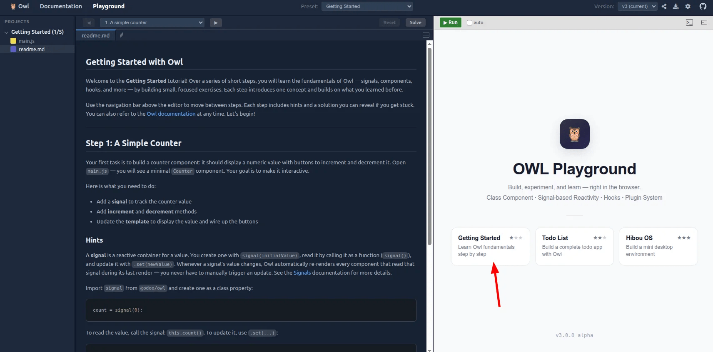

=========================
Chapter 1: Owl components
=========================

The Odoo web client is built with `Owl <https://github.com/odoo/owl>`_, a JavaScript framework
developed by Odoo, in the same family as React and Vue. Everything on screen in Odoo is an Owl
component: the navbar, the views, each field of a form. Learning Owl is the first step to working
with the web framework.

This chapter starts with a short overview of Owl. The exercises themselves are in the `Owl
playground <https://odoo.github.io/owl/playground/>`_, a page that runs Owl code in the browser,
with nothing to install. The playground comes with two tutorials: *Getting Started*, then *Todo
List*.

Owl in a nutshell
=================

Owl provides four things:

- A `Component` class. Each part of the user interface is a component: a JavaScript class and a
  template.
- Templates, written in QWeb, the same template language as on the server, with a few additions for
  components.
- Reactivity, built on *signals*. When a signal changes, Owl re-renders the components that read it.
- Hooks, functions that plug into the lifecycle of a component, such as `onWillStart` or
  `onMounted`.

Example: a `Counter` component
------------------------------

The `Counter` component below displays a number, and increments it each time the user clicks on the
button.

.. code-block:: js
   :caption: ``counter.js``

   import { Component, signal } from "@odoo/owl";

   export class Counter extends Component {
       static template = "my_module.Counter";

       count = signal(0);

       increment() {
           this.count.set(this.count() + 1);
       }
   }

.. code-block:: xml
   :caption: ``counter.xml``

   <templates xml:space="preserve">
       <t t-name="my_module.Counter">
           
Counter: <t t-out="this.count()"/>

           <button class="btn btn-primary" t-on-click="this.increment">Increment</button>
       </t>
   </templates>

A few things to notice:

- `static template` gives the name of the template. That name is what ties the two files together.
- Owl evaluates the template with the component as `this`. Each directive value is a JavaScript
  expression: `this.count()` reads the signal, and `this.increment` is the method to call on click.
- `signal(0)` creates a reactive value. Call it to read it, call `set` to write it. During
  rendering, a component records the signals it reads, and re-renders when one of them changes.
  There is nothing else to declare.

In an Odoo addon, the template lives in an XML file of the addon, and the manifest adds both files
to an assets bundle. In the playground, a template can also be written inline in the JavaScript
file, with the `xml` tagged template from `@odoo/owl`.

.. seealso::
   - `Owl documentation <https://odoo.github.io/owl/documentation/>`_
   - `Signals <https://odoo.github.io/owl/documentation/v3/owl/reference/signals.html>`_
   - `Template syntax
     <https://odoo.github.io/owl/documentation/v3/owl/reference/template_syntax.html>`_
   - `Hooks <https://odoo.github.io/owl/documentation/v3/owl/reference/hooks.html>`_

Tutorial 1: Getting Started
===========================

Open the `Getting Started tutorial <https://odoo.github.io/owl/playground/#getting_started>`_ in the
Owl playground. You can also open the playground and pick :guilabel:`Getting Started` on its home
page.

         the home page of the playground on the right.

On the left, the playground shows the instructions of the current step and an editor for its files.
On the right, it runs the code: click :guilabel:`Run` to see the result. The navigation bar above
the editor moves between steps, and each step has hints and a solution that you can reveal with
:guilabel:`Solve` if you get stuck.

This first tutorial covers the fundamentals of Owl: signals to hold reactive state, templates and
event handlers, splitting the interface into sub components, passing data down with props and
validating them, deriving values with `computed` and binding inputs with `t-model`, and running code
at key moments of a component's life with lifecycle hooks.

Tutorial 2: Todo List
=====================

Once you are done with Getting Started, open the `Todo List tutorial
<https://odoo.github.io/owl/playground/#todo_list>`_.

.. image:: 01_owl_components/playground-todo-list.png
   :align: center
   :alt: The Owl playground, with the instructions of the Todo List tutorial on the left, and the
         home page of the playground on the right.

This second tutorial builds a complete todo application and introduces the concepts a real
application needs: rendering lists of components, handling user input, dynamic classes, references
to DOM elements and custom hooks, callback props, effects that react to data changes, plugins to
separate the business logic from the interface, computed values, persisting data, and when to use a
`proxy` rather than signals.

.. tip::
   The playground has a third project, *Hibou OS*, which builds a small desktop environment. It goes
   further into plugins and registries, if you want more practice before chapter 2.
