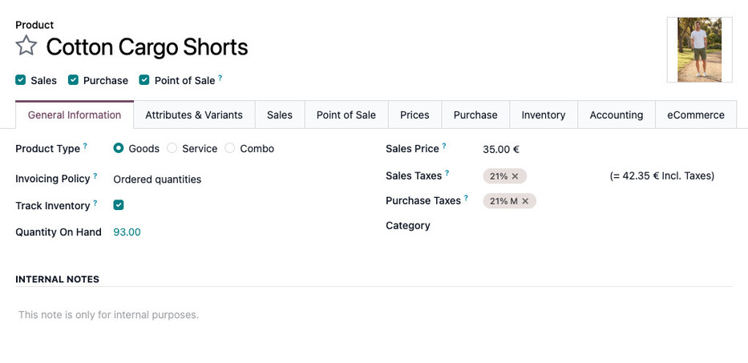
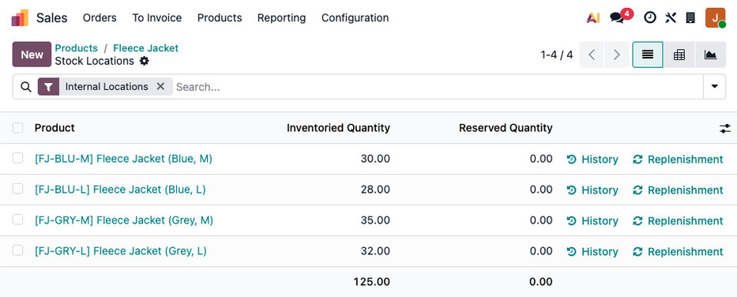
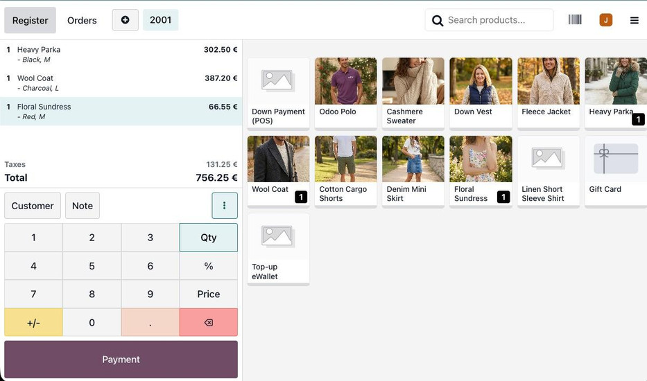
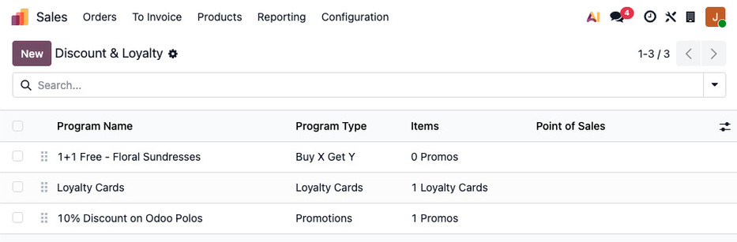

:industry_module: clothing_boutique
:knowledge_xmlid: clothing_boutique.welcome_article

.. _industries/clothing_boutique:

===============
Clothing stores
===============

The **Clothing Store** industry package helps clothing retailers manage product variants,
purchasing, and in-store and online sales in Odoo. It connects the collection's sizes and colors
with stock and sales so staff can follow each item from receipt to the fitting room or website
checkout.

The **Point of Sale** app supports counter sales, returns, and loyalty rewards, while the webshop
presents collections and product details. Stock and purchasing tools help track available sizes and
replenish the range, and marketing tools share new arrivals with customers. Whether managing one
store or a wider brand, the package brings the collection and everyday retail operations together.

.. _industries/clothing_boutique/basics:

Basics
======

The main dashboard provides access to every installed app in the database.

* The **Point of Sale** app: Sell clothing variants in the store and manage returns and loyalty
  rewards.
* The **eCommerce** app: Present clothing collections online with filters and look-based browsing.
* The **Inventory** app: Track stock by size and style, using barcode or RFID workflows where
  configured.
* The **Purchase** app: Order collections and replenish seasonal stock.
* The **Website** app: Publish new arrivals, lookbooks, and store information.
* The **Email Marketing** app: Send newsletters about collections, offers, and new arrivals.

.. _industries/clothing_boutique/create-and-manage-products:

Create and manage products
==========================

Open the product form to configure prices, sales availability, stock quantities, and attributes.
Use :guilabel:`Attributes & Variants` for size, color, gender, fit, and other product choices.

An attribute with several values, such as sizes S, M, and L, provides a choice of variants. A
single-value attribute, such as the material, can provide product information without offering
another choice to the customer.

The product catalog is shared across the **Sales**, **Point of Sale**, and **eCommerce** apps.
Changes made to a product are available across the connected sales channels.

.. seealso::
   :doc:`Configure product variants
   <../applications/sales/sales/products_prices/products/variants>`

.. _industries/clothing_boutique/purchase-and-replenish-products:

Purchase and replenish products
===============================

.. _industries/clothing_boutique/stock-counts:

Stock counts
------------

To record counted stock, open the product's :guilabel:`Quantity On Hand` link and add or update the
inventory lines for the relevant variants and locations.

.. seealso::
   :ref:`Record stock counts <inventory/create-adjustment>`

.. _industries/clothing_boutique/supplier-purchases:

Supplier purchases
------------------

Create a purchase order in the **Purchase** app, select the vendor, and send the order. Once it is
confirmed and the goods arrive, review and validate the receipt in the **Inventory** app. The
receipt updates the quantities on hand.

Use counts to record physical quantities and purchase receipts to follow supplier deliveries.
Reordering rules can replenish products according to the configured minimum stock levels.

.. seealso::
   :doc:`Create and confirm supplier orders
   <../applications/inventory_and_mrp/purchase/manage_deals/rfq>`

.. _industries/clothing_boutique/sell-clothing:

Sell clothing
=============

Use the **Point of Sale** app for counter sales, the **eCommerce** app for online purchases, and
the **Sales** app for customer quotations and orders.

.. _industries/clothing_boutique/in-store-sales:

In-store sales
--------------

Open the register in the **Point of Sale** app and select the clothing variants being purchased.
Select the customer to apply their loyalty rewards or assigned pricelist, and use the refund
workflow when processing returns.

Configure supported payment terminals and payment methods in the point-of-sale settings before
using them at the register.

.. seealso::
   :doc:`Make sales and process refunds <../applications/sales/point_of_sale/use>`

.. _industries/clothing_boutique/online-sales:

Online sales
------------

To publish a product in the webshop:

1. Open the product form.
2. Select the :guilabel:`eCommerce` tab.
3. Enable :guilabel:`Published`.

Use :guilabel:`Ribbons` to display extra information on product images in the catalog and product
pages. Use :guilabel:`Tags` to include an item in several groupings, such as the summer collection,
discounted items, and accessories.

.. seealso::
   :doc:`Publish and configure online products
   <../applications/websites/ecommerce/configuration/products>`

.. _industries/clothing_boutique/discounts-and-loyalty-programs:

Discounts and loyalty programs
------------------------------

Open :menuselection:`Point of Sale --> Products --> Discount & Loyalty` to review the preconfigured
promotions.

Configure loyalty cards, coupons for a later order, or other coupon programs to reward repeat
customers. Review the loyalty documentation when adapting the rewards to the store's offers.

.. seealso::
   :doc:`Configure discount and loyalty programs
   <../applications/sales/sales/products_prices/loyalty_discount>`

.. _industries/clothing_boutique/promote-collections:

Promote collections
===================

Use the **Email Marketing** app to prepare newsletters about new collections and offers. The package
includes an example newsletter to adapt to the store's branding and product range.

Coordinate promotions with the products and prices available at the register and on the website.
Review loyalty rewards and replenishment when preparing a campaign for a popular collection.

.. seealso::
   :ref:`Create an email campaign <email_marketing/create-mailing>`

.. _industries/clothing_boutique/go-further:
.. _industries/clothing_boutique/additional-apps:

Additional apps
===============

Store staffing, collection performance, and financial reporting can support the retail operation:

* Use the **Employees** app to maintain staff records for store teams.
* Use the **Accounting** app to reconcile payments and review the store's financial records.
* Use the **Dashboards** app to compare sales and collection performance across the business.
* Use the **Social Marketing** app to publish collection announcements on social channels.
* Use the **Marketing Automation** and **SMS Marketing** apps to organize customer campaigns and
  promotional messages.
* Use the **Events** app to manage collection launches and other store gatherings.
* Use the **Documents** and **Sign** apps to organize supplier agreements and obtain signatures.

For further training, explore `Odoo Tutorials
<https://www.odoo.com/slides/tag/odoo-tutorials-9?prevent_redirect=True>`__.

.. note::
   `Contact Odoo <https://www.odoo.com/contactus>`__ to discuss the setup or request a
   demonstration.
