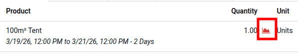
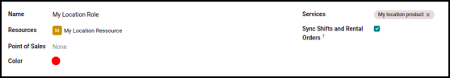

:industry_module: event_management
:knowledge_xmlid: event_management.welcome_article

.. _industries/event_management:

================
Event management
================

The **Event Management** industry package helps event organizers manage client briefs, quotations,
venues, supplier orders, equipment, staff schedules, and final billing in Odoo. It supports
corporate gatherings, workshops, festivals, and sports activities from the first inquiry through
event delivery.

Use the package to prepare corporate gatherings, workshops, festivals, or sports activities. Each
event can have its own project, with the tasks, documents, purchases, and rentals needed to turn the
agreed proposal into a working plan.

.. _industries/event_management/basics:

Basics
======

The main dashboard provides access to every installed app in the database.

* The **Website** app and the **CRM** app: Collect event requests and follow opportunities.
* The **Sales** app: Prepare proposals, confirm services, and request down payments.
* The **Contacts** app: Maintain venue, supplier, partner, and client details.
* The **Project** app and the **Documents** app: Organize event tasks, shared files, and financial
  information.
* The **Events** app: Publish events, sell tickets, and manage registrations and check-in.
* The **Rental** app and the **Inventory** app: Reserve equipment and follow deliveries and returns.
* The **Purchase** app: Compare supplier offers and order goods or services for an event.
* The **Maintenance** app: Schedule equipment inspections and repairs.
* The **Recruitment** app and the **Employees** app: Hire event staff and record their planning
  roles.
* The **Planning** app and the **Calendar** app: Assign shifts and organize meetings.
* The **Invoicing** app and the **Sign** app: Bill clients and collect signatures on agreements.

.. note::
   The Odoo mobile app provides access to the database from a phone.

.. _industries/event_management/organize-venues-and-suppliers:

Organize venues and suppliers
=============================

Open the **Contacts** app and add the venues, caterers, entertainers, food trucks, and other
partners used for events. Record the address, email, phone number, and main point of contact for
each business. Add notes about prices and practical constraints, then use :guilabel:`Log notes` in
the chatter to record feedback after an event.

Use tags such as Catering, Venue, and Photographer to find suitable partners. For venues, add a tag
indicating whether outside catering is allowed, such as *Catering Free: YES* or *NO*.

Keep practical information, including parking, seating capacity, and outdoor space, in The
**Knowledge** app articles. Use the clipboard to copy useful information into the contact's notes.

.. _industries/event_management/qualify-event-requests:

Qualify event requests
======================

Create a **Website** app form that records the activity, participant count, preferred dates,
duration, and budget. Configure the form to create an opportunity in the **CRM** app.

Assign the opportunity and its priority. Schedule a discovery call, a venue-availability check, or a
meeting, and keep client updates in the chatter.

For a straightforward equipment request, create the rental quotation from the opportunity. For a
more involved event, use the gear menu to create a linked pre-sales project. Store supplier prices,
documents, and preliminary schedules there while preparing the quotation, then keep the same project
for delivery of the confirmed event.

.. example::
   The demonstration opportunity *Rent Tent*, from Jessica Martinez, has a draft rental order.
   Confirm it when the client accepts, mark the opportunity :guilabel:`Won`, and create the
   invoice.
   Tracked rental equipment has delivery and return transfers.

   The *City Festival – Summer in the Square – Brussels* opportunity has a linked project and a
   purchase order for catering. Open the project to review the supplier request and build the
   sales quotation as the event requirements become clear.

.. _industries/event_management/prepare-the-proposal:

Prepare the proposal
====================

Create a quotation from the opportunity or the pre-sales project. Include the services, equipment,
supplier availability, and dates agreed with the client.

Choose products according to their role in the event:

* :guilabel:`Services`: Quote an overall service, such as a tent for 100 people, before deciding
  whether one large tent or two smaller tents fulfill the requirement.
* **Untracked goods:** Include items such as staff T-shirts or extension cords on picking lists when
  individual stock counts are not needed.
* **Tracked goods:** Follow the quantities and availability of limited equipment, such as a
  100-square-meter tent.

Use quotation templates for recurring offers. Add sections, notes, terms and conditions, and line
discounts to explain the proposal. The demonstration data includes quotation headers and footers;
adapt them to the business.

:doc:`Prepare quotation templates <../applications/sales/sales/sales_quotations/quote_template>`

`Outstanding Quotations video <https://www.youtube.com/watch?v=N4zw-2t6spk>`__

.. _industries/event_management/organize-the-event-project:

Organize the event project
==========================

Open the event in the **Project** app to follow tasks and related records. Use the smart buttons to
reach linked documents, purchases, rentals, and financial information.

Create project templates for recurring event types. Define the usual tasks once, then reuse them for
the next event. Set task deadlines, assignees, notes, subtasks, and stages to match the team's
preparation and delivery process.

Store contracts, venue authorizations, site plans, emergency contacts, and agendas in the project's
documents. Copy a document's :guilabel:`Share Link` when sending staff the information needed for a
shift. Enable the project's profitability dashboard to review the recorded revenue and costs.

.. _industries/event_management/source-goods-and-services:

Source goods and services
=========================

Create a request for quotation from the project's purchase smart button. Associate the purchase with
the event so its costs appear in the project information. Add alternative supplier quotations and
compare products, prices, and delivery dates before confirming the chosen offer. Cancel unused
alternatives once the selection is complete.

Before confirming the purchase order, choose the delivery destination:

* For goods needed at the warehouse, keep the warehouse receipt operation.
* For goods sent directly to the event, select :guilabel:`Dropship` in :guilabel:`Deliver To` and
  enter the venue or client delivery address.

Use the project's :guilabel:`Stock Moves` view to follow receipts and direct deliveries. Add
supplier warnings for ordering constraints, such as two weeks' notice for a large catering order.

.. _industries/event_management/reserve-and-move-equipment:

Reserve and move equipment
==========================

.. _industries/event_management/rental-availability:

Rental availability
-------------------

Use the **Rental** app for client equipment rentals, equipment included in a larger event package,
and periods when equipment is unavailable for maintenance. Equipment included in a separately priced
package can have a zero-priced rental line to record its reservation without billing it twice.

Open :guilabel:`Schedule` to review equipment availability. Remove the :guilabel:`Confirmed Orders`
filter to include draft quotations. A red shortage indicator on a rental line signals insufficient
stock for the selected dates; review the competing reservations before confirming the order.

Use the **Maintenance** app to schedule inspections and repairs, and reflect equipment downtime in
the rental schedule.

.. _industries/event_management/deliveries-and-returns:

Deliveries and returns
----------------------

Confirming a rental order for tracked equipment creates a delivery from the warehouse to the client
and a return transfer to the warehouse. Process both transfers as the equipment moves.

The project's :guilabel:`Stock Moves` view brings supplier deliveries, dropshipping, and rental
movements together. For items outside a rental order, create a picking list with the event location
as its destination, then set the products, quantities, and scheduled date.

.. _industries/event_management/recruit-and-schedule-staff:

Recruit and schedule staff
==========================

In the **Recruitment** app, create temporary positions for hosts, security staff, and activity
instructors. Publish the jobs on the website, follow applications, and record interviews and hiring
decisions.

On each hired employee's form, open :guilabel:`Work Information` and add the relevant planning
:guilabel:`Roles`. These roles determine which shifts the employee can fill.

In the **Planning** app:

1. Create the event shifts with their times, roles, and required staff. For example, schedule six
   setup shifts from 7:00 a.m. to 3:00 p.m. and four security shifts from 10:00 a.m. to 4:00 p.m.
2. Assign employees manually or use automatic assignment based on their roles and availability.
3. Review the assignments and click :guilabel:`Publish`. Include links to the event's shared
   documents in the notification. Staff receive an email and an ICS file for their personal
   calendar.

.. tip::
   Create shift templates for roles and hours that recur across events.

.. _industries/event_management/synchronize-meeting-calendars:

Synchronize meeting calendars
=============================

Open the **Settings** app, find the :guilabel:`Calendar` section, and use :guilabel:`Sync External
Calendar` to configure Google Calendar or Outlook integration. Connect each user's external account
so meetings can be synchronized between the external calendar and the **Calendar** app in Odoo.

:doc:`Google Calendar Integration <../applications/productivity/calendar/google>`

:doc:`Outlook Integration <../applications/productivity/calendar/outlook>`

.. _industries/event_management/invoice-the-event:

Invoice the event
=================

Confirm the quotation or rental order, then create and send the invoice from the order. Review the
invoicing policy and include every agreed billable item.

When reserving a venue or ordering catering, create a down-payment invoice for a fixed amount or a
percentage of the order. For example, invoice a EUR 1,000 deposit toward the event services.

After the event, add any agreed extra services or billable time to the order. Create the final
invoice for the remaining balance and deduct the invoiced down payment.

.. _industries/event_management/publish-events-and-check-in-attendees:

Publish events and check in attendees
=====================================

Use the **Events** app for company gatherings, workshops, and public events that need registrations.
Create and publish the event page on the website, then configure ticket tiers such as early bird,
VIP, and general admission with the corresponding prices.

Enable online registration and configure the emails that send tickets or badges to attendees. Follow
the registration list and use ticket scanning to check in guests at the entrance.

:doc:`Event <../applications/marketing/events>`

.. _industries/event_management/offer-venue-rentals-online:

Offer venue rentals online
==========================

If the business also rents out its own venue, install the **eCommerce** app and connect the venue's
rental product to its planning resources:

1. In the **Rental** app, create a product such as *My Location*. Set :guilabel:`Product Type` to
   :guilabel:`Service` and configure hourly or daily rental pricing on the :guilabel:`Sales` tab.
2. In :menuselection:`Planning --> Configuration`, create a role and open its settings with
   :guilabel:`View`.
3. Add the resources representing the bookable rooms. Two conference rooms need two resources if
   both can be booked at the same time.
4. Link the venue rental product under :guilabel:`Services` and enable :guilabel:`Sync Shifts and
   Rental Orders`.
5. Publish the rental product on the website.

The linked planning resources determine availability for online bookings. Record internal events and
setup shifts against the same venue resources so those periods are excluded from availability.

.. _industries/event_management/go-further:
.. _industries/event_management/additional-apps:

Additional apps
===============

Ticket sales at the entrance, supplier communication during setup, and financial follow-up can be
organized alongside the event project:

* Use the **Point of Sale** app to sell admission tickets and other products at the venue.
* Use the **VoIP** app and the **WhatsApp** app to contact suppliers and staff from Odoo during
  event preparation.
* Use the **SMS Marketing** app to send event updates to the relevant contact groups.
* Use the **Social Marketing** app to schedule the social posts included in a client event campaign.
* Use the **Accounting** app to manage vendor bills, event payments, and financial reporting.

For further training, explore `Odoo Tutorials
<https://www.odoo.com/slides/tag/odoo-tutorials-9?prevent_redirect=True>`__.

.. note::
   `Contact Odoo <https://www.odoo.com/contactus>`__ to discuss the setup or request a
   demonstration.
