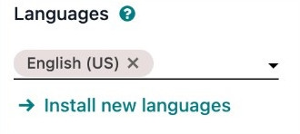

:industry_module: guided_tours
:knowledge_xmlid: guided_tours.welcome_article

.. _industries/guided_tours:

============
Guided tours
============

The **Guided Tours** industry package helps tour operators manage tour pages, scheduled group
departures, private bookings, ticket sales, and participant check-in in Odoo. It connects each
destination, language, and meeting point with the visitors expected for the tour.

Use the package for scheduled group tours, private appointments, and walk-in ticket purchases. Tour
pages and booking messages help guests prepare, while the guide can follow registrations and check
in participants on site.

.. _industries/guided_tours/basics:

Basics
======

The main dashboard provides access to every installed app in the database.

* The **Website** app: Present tour destinations, languages, and booking information.
* The **Events** app: Manage scheduled group tours, tickets, registrations, and check-in.
* The **Appointments** app: Book private tours around guide or resource availability.
* The **Point of Sale** app: Sell available tour places in person and issue receipts.

.. note::
   The Odoo mobile app provides access to the database from a phone.

Use a separate `Odoo trial database <http://Odoo.com/trial>`__ to explore the booking flows.

.. _industries/guided_tours/present-the-tours:

Present the tours
=================

Create tour pages in the **Website** app with descriptions, images, videos, and practical
information. Use the website editor to arrange the pages and connect booking buttons to the
appropriate group event or private appointment.

Configure website languages for international visitors and complete the search-engine information
for the tour pages. Keep seasonal offers, meeting points, and tour details current.

:doc:`Configure website languages <../applications/websites/website/configuration/translate>`

.. _industries/guided_tours/take-bookings:

Take bookings
=============

.. _industries/guided_tours/group-tours:

Group tours
-----------

In the **Events** app, create the scheduled tours with their dates, times, and capacities. Configure
ticket categories and prices, such as adult and child tickets, then publish the booking page.

Set up confirmation and reminder emails with the meeting location and arrival instructions. Guests
receive digital tickets with QR codes. Use the Events check-in feature on site to scan tickets and
follow attendance, including from a supported mobile device.

:doc:`Events app Documentation <../applications/marketing/events>`

.. _industries/guided_tours/private-tours:

Private tours
-------------

Create appointment types for the destinations and languages offered. Configure guide availability,
booking duration, capacity, and online payment when required.

Appointments can be based on users or resources. The demonstration uses resources, which can be
shared or linked for larger groups. Keep the availability aligned with the **Planning** app when the
booking and planning integration is configured.

Add the meeting point to the booking confirmation and reminder templates. Publish the private-tour
booking page and follow reservations from the **Appointments** app.

:doc:`Configure private-tour appointment types
<../applications/productivity/appointments/appointment_types>`

.. _industries/guided_tours/walk-in-ticket-sales:

Walk-in ticket sales
--------------------

Open a **Point of Sale** app session and select the relevant tour. Review the remaining places for
today's or a future departure, sell the tickets, and complete payment. Print the receipt with the
booking details.

Use the register on a supported mobile device when taking last-minute bookings away from the
counter. Train staff to select the correct departure and check availability before completing the
sale.

.. _industries/guided_tours/go-further:
.. _industries/guided_tours/additional-apps:

Additional apps
===============

Hiring guides, gathering visitor feedback, and following demand by tour and language can support the
operator’s next departures:

* Use the **Accounting** app to manage tour invoices, payments, and financial reporting.
* Use the **Social Marketing** app to schedule posts featuring destinations and seasonal tours.
* Use the **Recruitment** app to manage applications for new guides.
* Use the **Surveys** app to collect visitor feedback after a tour.
* Use the **Dashboards** app to review bookings by guide, popular cities and languages, and revenue
  trends.

For further training, explore `Odoo Tutorials
<https://www.odoo.com/slides/tag/odoo-tutorials-9?prevent_redirect=True>`__.

.. note::
   `Contact Odoo <https://www.odoo.com/contactus>`__ to discuss the setup or request a
   demonstration.
