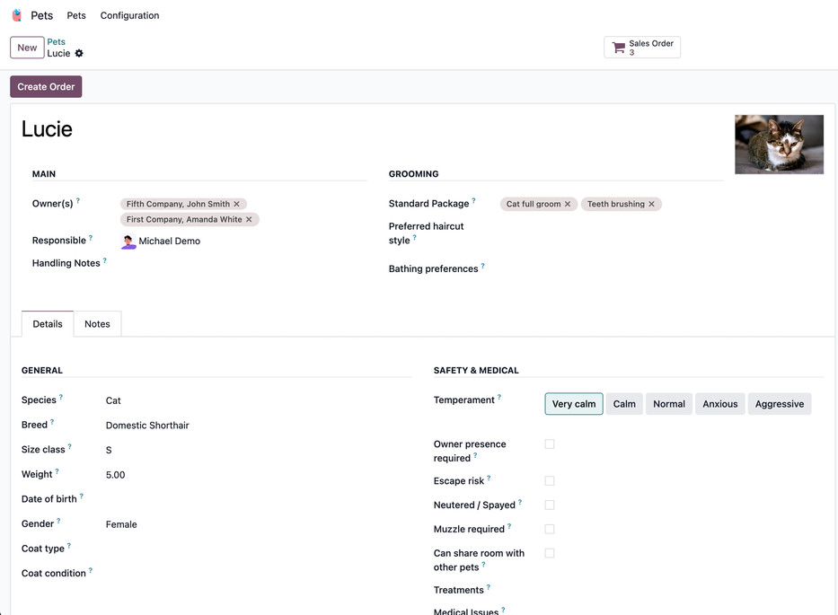

:industry_module: pet_groomer
:knowledge_xmlid: pet_groomer.welcome_article

.. _industries/pet_groomer:

===========
Pet groomer
===========

The **Pet Groomer** industry package helps pet grooming salons manage appointment bookings, pet
profiles, grooming services, counter payments, and supplies in Odoo. It connects each pet and owner
with the visit history and handling information used to prepare the service.

Use the package to arrange grooming times, keep handling notes with the pet's profile, and add
services and retail products to the same checkout. The record of earlier visits helps the team
prepare for returning pets, including households with more than one animal.

.. _industries/pet_groomer/basics:

Basics
======

The main dashboard provides access to every installed app in the database.

* The **Appointments** app: Offer grooming services with configured durations and available booking
  times.
* The **Calendar** app: Follow grooming sessions and groomer availability.
* The **Pets** app: Maintain pet profiles, owner links, and grooming history.
* The **Sales** app: Prepare service orders and agreed pricing before checkout.
* The **Point of Sale** app: Take counter payments for grooming and retail products.
* The **Purchase** app: Order salon supplies and retail stock.
* The **Inventory** app: Follow products sold and supplies used by the salon.

.. _industries/pet_groomer/arrange-grooming-visits:

Arrange grooming visits
=======================

.. _industries/pet_groomer/offer-online-booking:

Offer online booking
--------------------

Create appointment types in the **Appointments** app for services such as washing, haircuts, nail
trimming, and full grooming packages. Set the duration, working hours, and assigned groomers or
resources for each type.

Collect the customer information needed for the booking and configure confirmations and reminders.
Share the booking link or publish it on the salon website so owners can choose an available time.

:doc:`Configure grooming appointment types
<../applications/productivity/appointments/appointment_types>`

.. _industries/pet_groomer/manage-the-salon-calendar:

Manage the salon calendar
-------------------------

Online bookings appear in the **Calendar** app. Use it to follow each groomer's sessions, find busy
periods, and review available time. Keep groomer and resource availability configured so the booking
page offers the appropriate slots.

Reschedule an appointment when needed and review the attendee notification before sending the
change. Configure Google or Outlook synchronization for groomers who also use an external calendar.

:doc:`Calendar Documentation <../applications/productivity/calendar>`

.. _industries/pet_groomer/maintain-pet-profiles:

Maintain pet profiles
=====================

In :guilabel:`Pets`, create one profile for each animal and link it to the owner. A household with
several pets keeps a separate record for each animal.

Record the pet's breed, size, age, temperament, and handling notes. Add reported allergies, skin
conditions, or grooming restrictions that the salon needs to consider when preparing a visit.

Link the pet to its appointment and sales order using the package's pet fields. Review earlier
grooming sessions before the next visit and update the profile with the relevant service details.

.. _industries/pet_groomer/prepare-the-service-order:

Prepare the service order
=========================

Open or create the sales order associated with the appointment. Add the grooming services and any
agreed extras, such as a special shampoo or additional treatment.

Set prices using the service's configured pricing and the agreed adjustments for pet size, coat
condition, or work required. Keep each service and extra on its own line so the owner can see the
breakdown before payment.

For recurring service combinations, enable :guilabel:`Quotation Templates` under :guilabel:`Sales`
in the **Settings** app and prepare a template. Select it when creating the service quotation or
order.

:doc:`Prepare service quotation templates
<../applications/sales/sales/sales_quotations/quote_template>`

.. _industries/pet_groomer/take-payment-at-the-counter:

Take payment at the counter
===========================

Open the salon's the **Point of Sale** app session and use its quotation/order selection to load the
existing sales order. Add any retail products the owner is purchasing at the same visit.

Review the services, products, and any applicable loyalty benefit or promotion. Take payment using
an enabled cash, card, or other payment method, then print or email the receipt.

Follow the existing order's payment workflow when loading it into Point of Sale so the same services
are not charged twice.

:doc:`Point of Sale Documentation <../applications/sales/point_of_sale>`

.. _industries/pet_groomer/purchase-supplies-and-follow-stock:

Purchase supplies and follow stock
==================================

In the **Purchase** app, create requests for quotation for shampoos, conditioners, brushes, treats,
and accessories. Compare vendor prices and arrival dates, then confirm the purchase order. Record
the received quantities on its Inventory receipt.

Configure inventory tracking for the products that need stock counts. Retail sales create the stock
movements configured for the sales point. Record products consumed during grooming through the
salon's configured stock-consumption process; selling a service alone does not record every supply
used in that service.

Use the **Inventory** app to review stock levels and movements. Configure reordering rules for
supplies that should be replenished below a minimum quantity, and use sales reports to follow the
retail products sold most often.

:doc:`Configure supply reordering rules
<../applications/inventory_and_mrp/inventory/warehouses_storage/replenishment/reordering_rules>`

.. _industries/pet_groomer/go-further:
.. _industries/pet_groomer/additional-apps:

Additional apps
===============

Consent forms, staff administration, and owner feedback can support the salon between grooming
appointments:

* Use the **Sign** app to request signatures on consent forms, waivers, and service approvals.
* Use the **Planning** app to schedule groomer and counter shifts.
* Use the **Employees** app to maintain salon staff records.
* Use the **Recruitment** app to follow applications for grooming and salon roles.
* Use the **Time Off** app to manage staff leave alongside appointment availability.
* Use the **Surveys** app to collect owner feedback after a visit.
* Use the **Email Marketing** app and the **Social Marketing** app to share salon news and service
  offers with selected audiences.

For further training, explore `Odoo Tutorials
<https://www.odoo.com/slides/tag/odoo-tutorials-9?prevent_redirect=True>`__.

.. note::
   `Contact Odoo <https://www.odoo.com/contactus>`__ to discuss the setup or request a
   demonstration.
