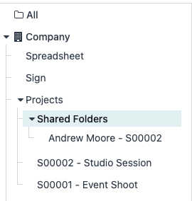

:industry_module: photography
:knowledge_xmlid: photography.welcome_article

.. _industries/photography:

===========
Photography
===========

The **Photography** industry package helps photography studios and freelance photographers manage
client briefs, bookings, quotations, shoot preparation, editing, image delivery, and invoicing in
Odoo. It supports corporate events, family sessions, and other commissions from the first inquiry
through delivery.

Use the package to prepare service offers, arrange studio appointments, and organize preparation and
editing tasks. Client folders provide a place to share selected images alongside the order and
project records.

.. _industries/photography/basics:

Basics
======

The main dashboard provides access to every installed app in the database.

* The **Website** app: Present the portfolio and collect requests for quotes.
* The **CRM** app: Follow inquiries from website forms, email, and direct contact.
* The **Sales** app: Prepare service quotations and collect online acceptance.
* The **Appointments** app: Offer studio sessions according to photographer and resource
  availability.
* The **Project** app: Organize shoot preparation, editing, and delivery tasks.
* The **Documents** app: Upload and share selected images with clients.
* The **Invoicing** app: Invoice the agreed photography services and follow payments.

.. _industries/photography/collect-and-qualify-inquiries:

Collect and qualify inquiries
=============================

Configure the website contact form to create CRM inquiries. Ask for the client's contact details,
the type of shoot, and the information needed to prepare an offer. To add a question, select the
form in the website editor and click :guilabel:`Add field`.

Configure a CRM email alias for requests received by email. Messages to the alias create leads or
opportunities, and replies to messages sent through their chatter remain with the conversation.

Open the inquiry in the **CRM** app and arrange a call or meeting to agree on the brief, date,
location, and expected deliverables.

:doc:`Collect shoot requests through website forms
<../applications/websites/website/web_design/building_blocks/forms>`

:doc:`Record inquiries from email and direct contact
<../applications/sales/crm/acquire_leads/email_manual>`

.. _industries/photography/prepare-and-confirm-the-offer:

Prepare and confirm the offer
=============================

Create a quotation from the opportunity with the services and schedule agreed with the client. Use
quotation templates for frequently sold packages. Adapt the sections, descriptions, email template,
and terms before sending the offer for online acceptance.

After acceptance, confirm the sales order. For service products configured to create a project, the
confirmation generates the shooting project from its template. Add preparation, shooting, editing,
and delivery tasks suited to the assignment.

If a service should not create project work, use the package's equivalent product without project
creation, or change the service product's configured creation behavior.

:doc:`Prepare photography quotation templates
<../applications/sales/sales/sales_quotations/quote_template>`

:doc:`Prepare shoot project templates
<../applications/services/project/project_management/project_templates>`

.. _industries/photography/book-studio-sessions:

Book studio sessions
====================

For studio work, configure appointment types in the **Appointments** app with their duration,
available times, and assigned photographers or resources.

Send the booking link using the template email from the sales order or task. The client selects an
available slot. The booking page can also be linked directly from the website for visitors who
should arrange a studio session without first requesting a quotation.

Keep the confirmed appointment and project tasks aligned with the services sold.

.. _industries/photography/share-session-images:

Share session images
====================

Create a client or session folder in the **Documents** app, upload the images to share, and
configure folder access for the intended recipient. Send the folder's sharing link to the client.

.. note::
   Image files contribute to database storage. Review the hosting capacity and
   `Odoo Cloud Acceptable Use Policy <https://www.odoo.com/acceptable-use>`__ when planning
   storage. Choose an appropriate long-term archive for the studio's full-resolution originals.

:doc:`Documents <../applications/productivity/documents>`

.. _industries/photography/invoice-the-assignment:

Invoice the assignment
======================

Open the sales order and click :guilabel:`Create Invoice` when its services are eligible under their
invoicing policies. Review the invoice, confirm it, and send it to the client.

Configure an online payment provider when clients should pay through their invoice link. Follow
payment status in the **Invoicing** app.

:doc:`Create and manage client invoices
<../applications/finance/accounting/customer_invoices/overview>`

.. _industries/photography/go-further:
.. _industries/photography/additional-apps:

Additional apps
===============

Signed agreements, team schedules, and client feedback can support the work before and after each
shoot:

* Use the **Sign** app to request signatures on photography agreements and releases.
* Use the **Planning** app to schedule photographers, studio rooms, and shared equipment.
* Use the **Surveys** app to collect a client brief or feedback after the shoot.
* Use the **Email Marketing** app and the **Social Marketing** app to announce studio offers and
  upcoming sessions.
* Use the **Accounting** app to follow customer payments, supplier bills, bank transactions, and
  financial reports.

For further training, explore `Odoo Tutorials
<https://www.odoo.com/slides/tag/odoo-tutorials-9?prevent_redirect=True>`__.

.. note::
   `Contact Odoo <https://www.odoo.com/contactus>`__ to discuss the setup or request a
   demonstration.
