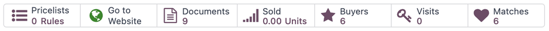

:industry_module: real_estate
:knowledge_xmlid: real_estate.welcome_article

.. _industries/real_estate:

==================
Real estate agency
==================

The **Real Estate Agency** industry package helps real estate agencies manage property listings,
owner and buyer inquiries, visits, offers, signatures, and commissions in Odoo. It connects property
information and buyer preferences with the conversations moving a potential sale forward.

Use the package to maintain listings, match them to buyer preferences, and share visit-booking
links. Quotations, signed offers, and commission records stay alongside the property and customer
information as the agency follows each deal.

.. _industries/real_estate/basics:

Basics
======

The main dashboard provides access to every installed app in the database.

* The **CRM** app: Follow buyers, owners, offers, and planned sales activities.
* The **Properties** app: Maintain property listings, availability, and related opportunities.
* The **Appointments** app: Offer property visits according to agent availability.
* The **Sales** app: Prepare quotations and follow the agency’s commission records.
* The **Website** app: Publish listings, inquiry forms, and property-alert signup.
* The **Sign** app: Request signatures on offer and reservation documents.
* The **Invoicing** app: Invoice the agreed services and record commission information.

.. note::
   The Odoo mobile app provides access to the database from a phone.

Use a separate `Odoo trial database <http://Odoo.com/trial>`__ for the sample listing workflows.

.. _industries/real_estate/maintain-property-listings:

Maintain property listings
==========================

Create a listing in :guilabel:`Properties` with its address, price, features, status, and images.
Use the smart buttons to open its opportunities and scheduled visits. Follow the property's status
from the :guilabel:`Sales` tab and its status ribbon.

Keep the price, status, and attributes current so website information and matching criteria reflect
the listing.

.. _industries/real_estate/follow-buyer-and-owner-inquiries:

Follow buyer and owner inquiries
================================

Create opportunities in the **CRM** app for website inquiries, direct requests, and third-party
portal contacts. Link them to the relevant property and assign the responsible agent.

For a property advertised on another portal, enter its unique ID in :guilabel:`External Reference`.
Configure the package's incoming buyer alias, for example ``buyers@example.com``, and use that
address as the portal contact email. The package uses those incoming messages and references to
create leads in the related property's pipeline.

Record calls, messages, and visit follow-up in the chatter and planned activities. Use quotation
templates and configured stage communications for recurring steps.

:doc:`Record incoming buyer and owner inquiries
<../applications/sales/crm/acquire_leads/email_manual>`

.. _industries/real_estate/match-properties-to-buyer-preferences:

Match properties to buyer preferences
=====================================

The website's matchmaking form collects property preferences and subscriptions to matching alerts.
Review those preferences on the contact's :guilabel:`Matchmaking` tab, or record them directly on
the contact when enrolling a buyer in notifications.

Open the contact's smart buttons to see matching properties. The property record's corresponding
buttons show matching contacts. Subscribed contacts receive the package's daily email when new
matches are available.

Updating a property's price makes it eligible for matching notifications again. To send a selection
directly, click :guilabel:`Send New Matches` on the contact.

Adapt the matching email template to the agency. To add a criterion, configure the corresponding
attribute-linked many-to-many field on the contact and expose its matching field on the website
form. Keep the contact preferences and property attributes aligned.

.. _industries/real_estate/publish-listings-and-collect-requests:

Publish listings and collect requests
=====================================

Use the **Website** app to present listings with images and search filters. Link the property-alert
form and prepare the contact form for general inquiries or an estimate request.

The package's property page has its own inquiry form, which creates a lead in that property's sales
pipeline.

:doc:`Configure inquiry forms <../applications/websites/website/web_design/building_blocks/forms>`

.. _industries/real_estate/arrange-property-visits:

Arrange property visits
=======================

On a property, click :guilabel:`Create Visit Link` to generate and link its appointment type.
Configure the agent's availability and the visit duration in the **Appointments** app.

Opportunities linked to that property display :guilabel:`Visit`. Use it to send the booking
invitation to the contact. Booked visits appear in the calendar and remain associated with the
relevant records. Configure calendar synchronization when agents also use external calendars.

:doc:`Configure property-visit availability
<../applications/productivity/appointments/appointment_types>`

.. _industries/real_estate/prepare-offers-and-follow-commissions:

Prepare offers and follow commissions
=====================================

When a buyer is ready to make an offer, click :guilabel:`Offer` on the opportunity to prepare the
package's signature request in the **Sign** app. Select the appropriate template and recipients,
then send it.

Prepare the agreed service quotation in the **Sales** app, attach the relevant contracts or plans,
and follow the negotiation through CRM. Confirm the accepted order and create its invoice when
eligible under the product's invoicing policy.

Configure commission plans in :menuselection:`Sales --> Commissions` for the :guilabel:`Salesperson`
and the property's :guilabel:`Seller`. Complete :guilabel:`Seller` on the invoice so the package's
commission calculation uses the correct parties. Follow sales and commission reporting for the
agency's recorded transactions.

:doc:`Create and send service quotations
<../applications/sales/sales/sales_quotations/create_quotations>`

.. _industries/real_estate/go-further:
.. _industries/real_estate/additional-apps:

Additional apps
===============

Property files, longer client follow-up, and renovation coordination can be managed alongside
listing and sales work:

* Use the **Documents** app to organize property plans, contracts, and listing files with configured
  access.
* Use the **SMS Marketing** app to send updates to selected prospective buyers.
* Use the **Marketing Automation** app to configure follow-up campaigns for property seekers.
* Use the **Project** app to organize multi-stage renovation or development work.
* Use the **Dashboards** app to review recorded sale durations and agent performance.

For further training, explore `Odoo Tutorials
<https://www.odoo.com/slides/tag/odoo-tutorials-9?prevent_redirect=True>`__.

.. note::
   `Contact Odoo <https://www.odoo.com/contactus>`__ to discuss the setup or request a
   demonstration.
