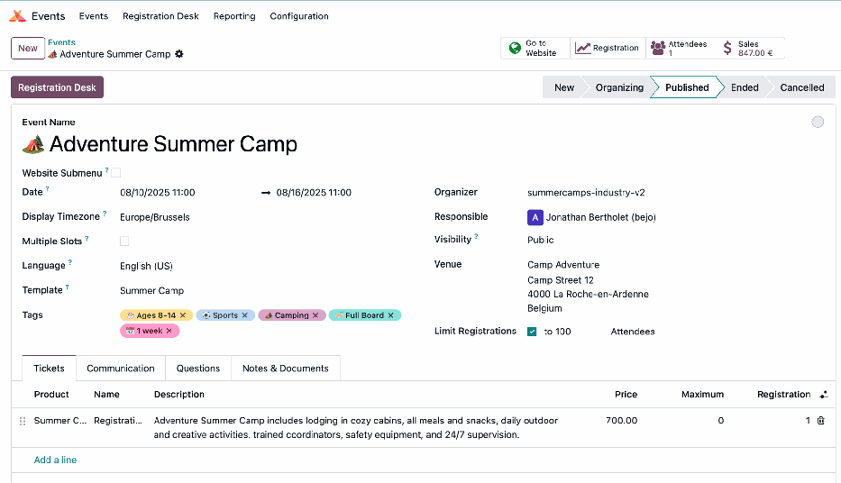
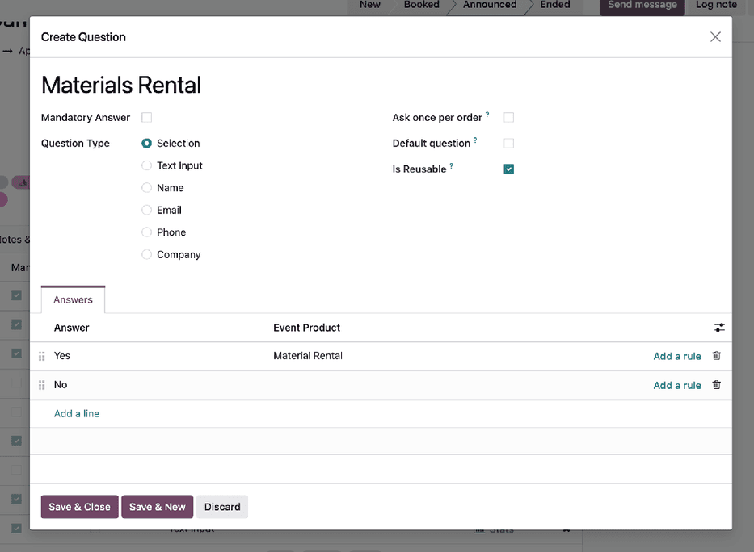
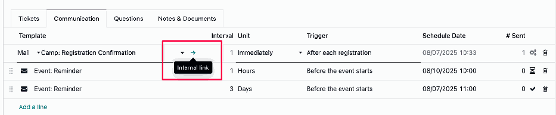
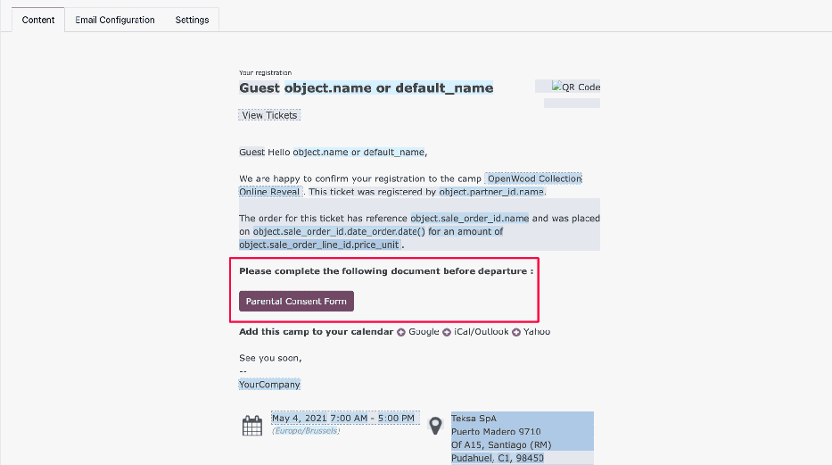
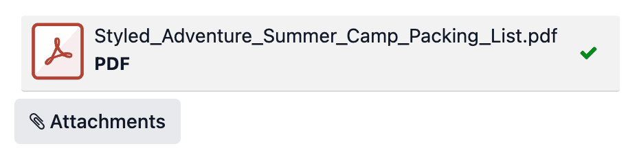
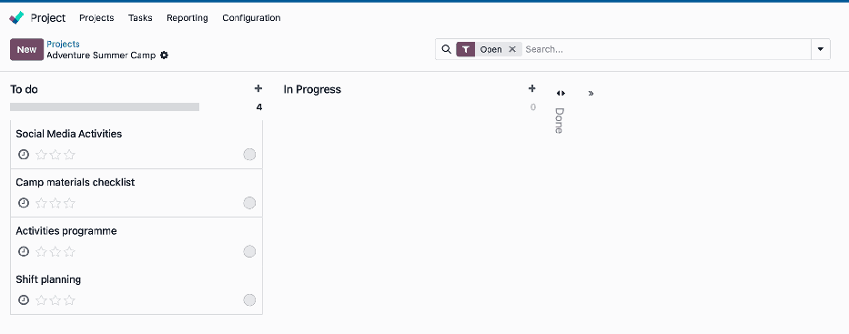

:industry_module: summer_camps
:knowledge_xmlid: summer_camps.welcome_article

.. _industries/summer_camps:

============
Summer camps
============

The **Summer Camps** industry package helps camp organizers manage family inquiries, session
registrations, consent forms, preparation tasks, staffing, and payments in Odoo. It connects each
session’s attendees with the information and supplies needed before arrival.

Use the package to present camps online, offer family information meetings, and manage the
preparation tasks behind each stay. Confirmation messages and shared forms keep practical
information with the registration workflow.

.. _industries/summer_camps/basics:

Basics
======

The main dashboard provides access to every installed app in the database.

* The **Website** app: Present camp options and link to registration and meeting booking.
* The **Events** app: Configure camp sessions, tickets, registration questions, and attendance.
* The **Project** app: Organize materials, staffing tasks, and preparation deadlines.
* The **Appointments** app: Offer information calls or meetings with families.
* The **CRM** app: Follow family inquiries and school or group booking requests.
* The **Sales** app: Prepare quotations for group or other customized camp offers.
* The **Sign** app: Collect signatures on the camp’s parental authorization forms.

.. note::
   The Odoo mobile app provides access to the database from a phone.

Use a separate `Odoo trial database <http://Odoo.com/trial>`__ for the sample camp workflows.

.. _industries/summer_camps/present-camp-options-and-follow-inquiries:

Present camp options and follow inquiries
=========================================

Create website pages with the camp activities, dates, location, accommodation, and practical
information. Link :guilabel:`Register Now` to the appropriate event registration and configure
online payments for paid tickets.

Configure contact forms to create CRM opportunities. Assign the responsible organizer and use stages
such as :guilabel:`New`, :guilabel:`Contacted`, :guilabel:`Quotation Sent`, and
:guilabel:`Confirmed`. Add relevant tags, record discussions and attachments in the chatter, and
schedule follow-up activities.

For a group request, create a quotation from the opportunity with the agreed services and terms.
Keep its confirmation linked to the participants' registration arrangements.

.. _industries/summer_camps/configure-sessions-and-registration:

Configure sessions and registration
===================================

Create each camp session in the **Events** app using a template for recurring formats. Add tags for
the camp type, duration, lodging, or meal plan. Set ticket prices, sale periods, early-booking
offers, and capacity limits.

Use registration questions for the participant information needed to prepare the camp, such as age,
dietary requirements, and the relevant preparation information. Configure confirmation, reminder,
and follow-up messages.

.. _industries/summer_camps/add-priced-registration-options:

Add priced registration options
-------------------------------

The package can add products according to an attendee's selected answer. Set the question type to
:guilabel:`Selection`, then select the new or existing product in the answer's :guilabel:`Event
Product` column.

The selected option's product appears during checkout and on the sales order associated with the
registration. Review the products and their prices when preparing the ticket's options.

.. _industries/summer_camps/follow-attendees-and-arrivals:

Follow attendees and arrivals
-----------------------------

Use the event's registrations and reports to follow participant details, registration counts, and
camp revenue. Group participants using tags or registration answers where needed for the organizer's
communication and preparation.

Open :guilabel:`Registration Desk` when campers arrive to scan their ticket or select the attendee
and record check-in.

.. _industries/summer_camps/collect-parental-authorization:

Collect parental authorization
==============================

Prepare reusable templates in the **Sign** app for the forms used by the camp. Add the required
text, date, and signature fields, including the relevant contact and authorization information.
Assign the signer roles and generate the template's share link.

Open the camp event's communication settings to edit its confirmation email template.

Add that link to the confirmation email so a parent or guardian can complete the form before
arrival. In the email editor, type ``/`` to choose formatting options, or use ``/buttons`` to add a
button linked to the shared Sign form.

Use the template's :guilabel:`Attachments` section for the packing list and other files sent with
the message. Create separate templates and associate them with the relevant event communications.

Follow completed signature requests in Sign. To export the recorded form answers, open the Sign
template's gear menu and select :guilabel:`Export Answers`.

.. _industries/summer_camps/arrange-family-information-meetings:

Arrange family information meetings
===================================

Create appointment types in the **Appointments** app for calls and in-person information sessions.
Set available times and assign the organizers responsible for particular camp types or age groups.
Share the booking page through the website or an inquiry response.

Configure confirmations and reminders. Add SMS reminders when the service is configured, and set
Google or Outlook synchronization for organizers using those external calendars.

.. _industries/summer_camps/prepare-the-camp-s-operations:

Prepare the camp's operations
=============================

Create a project in the **Project** app for each session or preparation period. Add tasks for
materials, equipment logistics, staff assignments, and pre-camp checklists. Set their owners and
deadlines, then follow task progress through preparation and on-site activity coordination.

Reuse project and event templates for the next session. On Odoo Online, manage demonstration copies
from `Odoo.com <http://Odoo.com>`__ using :guilabel:`My Databases`: open the database's gear menu
and select :guilabel:`Duplicate`.

.. _industries/summer_camps/go-further:
.. _industries/summer_camps/additional-apps:

Additional apps
===============

Camp promotion, post-session feedback, and financial reporting can continue alongside the
registration and preparation work:

* Use the **Email Marketing** app to announce upcoming camps and send selected post-camp messages.
* Use the **Social Marketing** app to schedule camp updates on connected social accounts.
* Use the **Surveys** app to collect feedback from families and participants.
* Use the **Accounting** app to follow camp invoices, payments, and financial reporting.

For further training, explore `Odoo Tutorials
<https://www.odoo.com/slides/tag/odoo-tutorials-9?prevent_redirect=True>`__.

.. note::
   `Contact Odoo <https://www.odoo.com/contactus>`__ to discuss the setup or request a
   demonstration.
