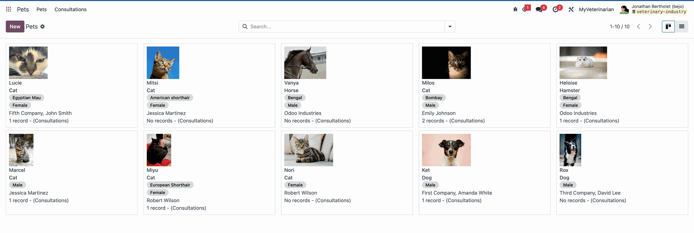
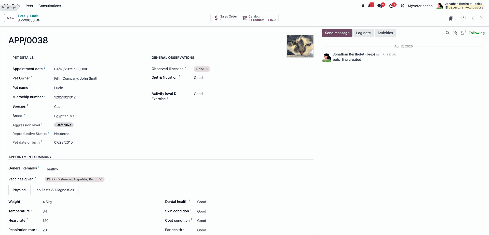
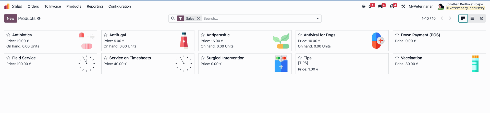

:industry_module: veterinary_clinic
:knowledge_xmlid: veterinary_clinic.welcome_article

.. _industries/veterinary_clinic:

=================
Veterinary Clinic
=================

A veterinary visit starts with an owner finding a suitable appointment and continues
through the pet's record, consultation, and payment. Odoo brings those steps together so
reception staff and veterinarians can work from the same client and pet information.

Use the package to present the clinic's services, book visits, record consultation details,
and prepare the products and services for checkout. Pet profiles keep the animal's history
with its owner, while digital forms and sales records support the clinic's administrative work.

.. _industries/veterinary_clinic/basics:

Basics
======

The main dashboard provides access to every installed app in the database.

* **Website** app: Present the clinic, its services, and appointment-booking links.
* **Appointments** app: Offer available visits and send configured booking confirmations and
  reminders.
* **Contacts** app: Maintain pet-owner details for communication and billing.
* :guilabel:`Pets` app: Maintain pet profiles, consultation records, and associated attachments.
* **Sales** app: Prepare the products and services to charge after a consultation.
* **Point of Sale** app: Collect front-desk payments for consultations and product sales.
* **Invoicing** app: Issue invoices and follow customer payment records.
* **Sign** app: Request signatures on consent forms and employee contracts.

.. note::

   The Odoo mobile app provides access to the database from a phone.

A separate `Odoo trial database <http://Odoo.com/trial>`__ can hold the sample clinic records.

.. _industries/veterinary_clinic/present-the-clinic-and-book-visits:

Present the clinic and book visits
==================================

In **Website**, create pages for services, the veterinary team, and common administrative
questions. Add contact details and booking links, and use the website's search-engine settings
to describe the clinic and its location.

Configure appointment types for the visits the clinic offers. Set their duration, available
veterinarians or rooms, booking times, and any buffer between visits. Publish the booking link
or embed it on the relevant service page.

Configure confirmation emails and reminders for each appointment type. SMS reminders require
the relevant configuration and credits. Calendar synchronization with Google or Outlook also
requires the corresponding calendar connection.

Review the veterinarian's agenda and available rooms when accepting or changing a booking.
Use the appointment's owner and pet information to prepare the reception and consultation.

:doc:`Website Documentation <../applications/websites/website>`

:doc:`Appointments Documentation <../applications/productivity/appointments>`

.. _industries/veterinary_clinic/maintain-pet-and-owner-records:

Maintain pet and owner records
==============================

Create the owner in **Contacts**, then link that contact to the pet's record in :guilabel:`Pets`.
Record the pet identifier, breed, color, microchip details, and photo where applicable.

Maintain the vaccination history and due dates in the pet record. Add the fields needed for
the clinic's records, such as weight, insurance information, allergies, and behavior notes.
Review the owner link before preparing communications or billing documents.

|image-d7ef0ecd48|

.. _industries/veterinary_clinic/record-a-consultation:

Record a consultation
=====================

Open the pet and create or open its consultation record. Complete the relevant fields, such
as vaccination details, aggression level, observed illnesses, and the veterinarian's notes.
Use consistent entries so the team can follow the history at a later visit.

Use :guilabel:`Catalog` to select the products and services used during the consultation. Add
notes,
instructions, and sections to the associated sales order when the receptionist needs context
for the charge.

Attach laboratory results, X-rays, and referral letters in **Lab Tests & Diagnostics**. Use
the chatter to record the discussion associated with the consultation, taking account of the
record's access rights and message recipients.

|image-d366e7e247|

.. _industries/veterinary_clinic/prepare-products-and-stock-records:

Prepare products and stock records
==================================

Maintain the prices and barcodes for services, vaccines, medications, and other clinic
products. Configure the sale unit and compatible purchase units where conversion is needed;
record package sizes separately when they are not interchangeable units.

When stock tracking is enabled, configure lots or serial numbers and expiration dates for
products that need them. Record those identifiers on receipts and outgoing stock operations.
Reordering rules using a purchase route can generate draft supplier quotations for low stock;
review quantities and supplier details before confirming them.

Configure pricelists or promotions for eligible wellness packages and other offers. Keep the
product prices, package contents, and validity conditions clear for reception staff.

|image-e591daeb0f|

.. _industries/veterinary_clinic/collect-payment-after-the-visit:

Collect payment after the visit
===============================

Review the products and services selected from the consultation's :guilabel:`Catalog`. Confirm the
associated sales order, including its notes, quantities, prices, and payment terms.

For front-desk checkout, open **Point of Sale**, select :guilabel:`Quotation/Order`, and load the
relevant sales order. Use the appropriate settlement option, review the amount due, and
collect payment with an enabled method. Card payments through a bank terminal require a
compatible configured terminal. Cash and vouchers also follow the register's configuration.

Add separately purchased products to the same checkout when needed, using their barcodes or
catalog entries. Issue the receipt or invoice requested by the owner. Follow the selected
sales-order settlement or invoicing route so the same consultation is not billed twice.

When payment is handled through Invoicing, create the invoice from the eligible sales order,
review it, and record the payment. Use agreed deposits or payment terms for visits that are
paid in stages.

.. _industries/veterinary_clinic/request-signed-forms:

Request signed forms
====================

In **Sign**, prepare templates for consent documents, longer care arrangements, and employee
contracts. Place the required fields and assign each field to the correct signing role.

Send the document to the intended recipients and follow the request's status. Configure
reminders where needed, and retain the completed document with the relevant administrative
record.

.. tip::

   Configure the clinic website and appointment types first, then prepare the product
   catalog and consultation workflow. Keep experiments in a separate database. To duplicate
   a database, open :guilabel:`My Databases` on `Odoo.com <http://Odoo.com>`__, use its gear menu,
   and select the duplication action.

.. _industries/veterinary_clinic/go-further:

Additional apps
===============

Staff leave, mobile visits, owner communications, and financial reporting can support
the clinic's booking and consultation work:

* Use **Accounting** to manage clinic income, supplier bills, and financial reporting with the
  relevant localization.
* Use **Time Off** to manage staff leave alongside veterinary appointment availability.
* Use **Expenses** to record reimbursable clinic purchases and travel expenses.
* Use **Fleet** to follow vehicles used for home visits or transporting clinic supplies.
* Use **Email Marketing** to send owner newsletters and selected follow-up campaigns to an
  appropriate audience.
* Use **Live Chat** to answer website visitors when clinic staff are available.
* Use **Dashboards** to review appointment activity, sales, and other configured clinic measures.

Explore the :doc:`Odoo documentation <../index>` and
`Odoo Academy <https://www.odoo.com/slides/getting-started-15>`__ for more guidance.

`Odoo learning tutorials <http://Odoo.com/slides>`__

.. note::

   `Contact Odoo <https://www.odoo.com/contactus>`__ to discuss the setup or request a
   demonstration.

